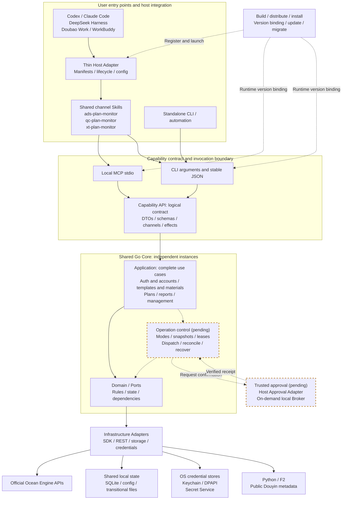

<p align="center">
  
</p>

<h1 align="center">ocean-watch</h1>

<p align="center">Ocean Engine Marketing and Qianchuan campaign operations, plus Star Map account authorization, for Codex, Claude Code, DeepSeek Harness, Doubao Work, and WorkBuddy</p>

<p align="center">
  <a href=".codex-plugin/plugin.json"></a>
  <a href=".claude-plugin/plugin.json"></a>
  <a href="hosts/workbuddy/README.md"></a>
  <a href="skills/"></a>
  <a href="https://go.dev/"></a>
  <a href="https://modelcontextprotocol.io/"></a>
  <a href="https://www.jsonrpc.org/"></a>
  <a href="https://json-schema.org/"></a>
  <a href="https://oauth.net/2/"></a>
  <a href="https://open.oceanengine.com/"></a>
  <a href="https://github.com/oceanengine/ad_open_sdk_go"></a>
  <a href="https://www.python.org/"></a>
  <a href="https://github.com/Johnserf-Seed/f2"></a>
  <a href="docs/architecture/overview.md"></a>
  <a href="docs/guides/configuration.md"></a>
  <a href="https://github.com/westng/ocean-watch/actions/workflows/ci.yml"></a>
  <a href="LICENSE"></a>
</p>

<p align="center">
  <a href="README.en-US.md">README</a> ·
  <a href="docs/README.md">Documentation</a> ·
  <a href="CONTRIBUTING.md">Contributing</a> ·
  <a href="LICENSE">MIT license</a> ·
  <a href="SECURITY.md">Security</a> ·
  <a href="CHANGELOG.md">Changelog</a>
</p>

[中文](README.md) | English

Ocean Watch uses official Ocean Engine APIs for authorization, accounts, materials, templates, plans, reports, and delivery analysis. Three channel Skills cover Marketing, Qianchuan, and Star Map, while local MCP and CLI entry points share one Go business core, local state, and credentials. Plan mutations default to preflight.

This page describes the current source, including [unreleased changes](CHANGELOG.md#未发布). Published versions are listed in [Releases](https://github.com/westng/ocean-watch/releases). Parts of V3 are implemented; the complete architecture and host business acceptance remain in progress.

## What It Does

| Entry point | Channel | Main capabilities |
| --- | --- | --- |
| [ads-plan-monitor](skills/ads-plan-monitor/SKILL.md) | Ocean Engine Marketing | OAuth, authorized-advertiser sync, responsible accounts, uploaded and creator-authorized materials, templates, plans, reports, and strategy |
| [qc-plan-monitor](skills/qc-plan-monitor/SKILL.md) | Qianchuan | OAuth, authorized-advertiser sync, responsible accounts, product and live templates, creator works, all-domain plans, and all-domain/Multiplication reports |
| [xt-plan-monitor](skills/xt-plan-monitor/SKILL.md) | Ocean Engine Star Map (巨量星图) | Dedicated channel Skill for OAuth, recovery, account sync, managed accounts, and local authorization mappings; Star plans and reports are not enabled yet |

Marketing, Qianchuan, and Star Map manage separate applications, authorizations, and account mappings. Credentials and business templates are not reused across channels.

`xt-plan-monitor` is the public Star Map Skill name; `star_map` remains its internal Runtime channel key. All three Skills use the same capability contract and shared Go core. Star Map accounts use the `star_account` subject type.

The current catalog contains **81 CLI capabilities and 35 default MCP tools**, with overlap between the two; enabling optional developer documentation exposes 38 tools. MCP provides queries, materials and reports, Qianchuan work preflight, authorization/account sync, and local F2 setup. Plan creation, material changes, budgets, ROI targets, bids, and status updates still use CLI. **WorkBuddy currently exposes MCP capabilities only and does not execute CLI writes through a shell.** New tools and Skill contracts require reloading and acceptance in each actual host.

Qianchuan now maps 156 official GET queries through a scoped catalog and offers account health, plan diagnosis, material checks, delivery suggestions, and custom reports. Three entries retain explicit pagination limits. Existing reports and work preflight continue using the SDK; optional developer documentation stays separate from business OAuth. See the [official query contract](docs/reference/qianchuan-official-mcp.md).

Qianchuan work preflight resolves batch metadata with F2 first, then processes advertiser scopes concurrently and shares plan reads within each account and authorization scope. A uniquely reusable plan receives an append preview; creation requires a complete query proving no compatible target. Multiple candidates, unverified identities, or binding drift block the affected group. See the [work-delivery workflow](docs/reference/qianchuan-work-routing.md).

### Current Feature Support

Status verified on **2026-10-30**. Adapter availability, tool discovery, and real business acceptance are separate scopes of evidence.

| Host / platform | Features and integration | Support status | Limits and acceptance |
| --- | --- | --- | --- |
| Codex | Plugin + three Skills + local MCP; Skills can use CLI for additional capabilities | Adapter implemented; full current-V3 host acceptance pending | MCP uses the macOS/Linux launcher; tool or Skill contract changes require a new task |
| Claude Code | Dedicated Plugin manifest + three Skills + local MCP / CLI | Adapter implemented; full current-V3 host acceptance pending | MCP uses the POSIX launcher; start a new task after updating |
| DeepSeek Harness | Desktop native bundle + three Skills + local MCP / CLI | Adapter implemented; current-V3 desktop acceptance pending | Peers pin bundled runtime `0.2.0-rc.2`; no separate npm/CLI host |
| Doubao Work | Existing user Skills + MCP path-configuration script | Script available; current-V3 discovery and business acceptance pending | macOS Apple Silicon only; the script does not install Skills |
| WorkBuddy | Local installer + stdio MCP + three generated Skills | Local installation, all three Skills, native connection after restart, and 26/26 enabled tools verified on `5.9.3`, macOS arm64 | Full WB1 business acceptance pending, without a published connector Marketplace package |

A source-built macOS arm64 Runtime has passed real Qianchuan account-sync and explicitly approved account-rebinding acceptance. This does not establish acceptance for all channels, hosts, or plan writes.

## Quick Start

Choose one host integration. Standard Marketing and Qianchuan workflows use the bundled Go Runtime without requiring a Go installation. Qianchuan Douyin work-link parsing additionally requires Python `3.10+` and F2 `0.0.1.7`. Local Python installation scripts also require Python 3.

Codex with Plugin support:

```bash
codex plugin marketplace add westng/ocean-watch
codex plugin add ocean-watch@ocean-watch
```

Claude Code with Plugin support:

```bash
claude plugin marketplace add westng/ocean-watch
claude plugin install ocean-watch@ocean-watch
```

DeepSeek Harness Desktop `0.2.0-rc.2`: open **Plugins → Add plugin** in the desktop app and enter this repository's absolute path. This installs into the active `desktop` profile; no separate npm/CLI Harness installation is needed.

The native bundle registers all three Skills and the local MCP tools. See the Chinese [DeepSeek Harness guide](docs/guides/deepseek-harness.md) for compatibility, desktop profiles, and verification.

WorkBuddy (verified on macOS Apple Silicon): run the installer from the repository root with native arm64 Python so a Rosetta interpreter does not select an Intel binary.

```bash
/usr/bin/arch -arm64 /usr/bin/python3 scripts/install-workbuddy.py
```

The installer verifies the manifest, backs up previous configuration and Skills, and preserves other MCP services and native trust settings. Reload MCP / start a new session afterward, restarting WorkBuddy if needed. See [WorkBuddy local integration](hosts/workbuddy/README.md) for other platform commands, shared state, and acceptance scope.

Doubao Work (macOS Apple Silicon): first import all three Skills from `skills/` into Doubao Work, then run this command from a repository checkout kept on the local machine:

```bash
bash scripts/install-doubao.sh
```

The script only updates existing Skills' MCP paths and requires the repository's arm64 Runtime. Fully quit and restart Doubao Work afterward.

All hosts should use the same state root, resolved in priority order: `OCEAN_WATCH_HOME` → `CODEX_HOME` → `~/.codex`. A valid authorization for a channel can be reused across hosts; Marketing and Qianchuan still require separate authorizations. After initial installation, start a new task, describe your goal, and follow the official OAuth flow. See [Getting started](docs/guides/getting-started.md) and [Configuration](docs/guides/configuration.md).

## Ask It Naturally

- **Star Map accounts:** “Guide me through Star Map authorization, then sync the accounts covered by this grant.”
- **Authorize or recover access:** “Guide me through Qianchuan authorization, then show the authorization status.”
- **Refresh access:** “This authorized user received new advertisers. Update the local access snapshot to match the official account.”
- **Review accounts:** “List the accounts in my local managed-account registry and inspect Qianchuan authorization.”
- **Review business data:** “Show today's spend, GMV, and ROI for this Qianchuan account, including the report scope.”
- **Find Marketing materials:** “Find videos uploaded to this Marketing account today.”
- **Process Qianchuan works:** “Preflight these Douyin works with this template. Show proposed creates, appends, skips, and failures.”
- **Analyze performance:** “Review the last seven days of material performance, identify high-spend low-conversion materials, and recommend actions.”

These are examples; available operations depend on the tools loaded by the host. CLI-capable entry points can also create plans and change delivery settings, after showing preflight results and receiving explicit confirmation.

## V3 Runtime Architecture

V3 is a local-first modular monolith: **thin host adapters + shared Skills + a common capability contract + one Go core + shared persistent state and OS credentials**. Its runtime architecture covers installation and startup, business calls, confirmation and recovery, process shutdown, and version migration. The diagram shows these system boundaries; dashed boxes mark unified operation control and trusted approval that still need production integration.



| Layer | Project responsibility |
| --- | --- |
| Host adapters and shared Skills | Each host owns installation, registration, connections, and unloading. Three channel Skills share intent, call order, and presentation rules; host packages supply controlled mappings. |
| Capability API and transports | MCP and CLI map the same business contract with channel, input/output, and effect metadata. MCP calls Application directly; Go CLI calls it in process. Capability API adds no network service, and WorkBuddy uses MCP only. |
| Application / Domain / Ports | Shared use cases cover setup and diagnosis, authorization and accounts, templates and materials, plans, reports, execution history, and recovery. Domain rules do not depend on host SDKs; ports define external dependencies. |
| Operation and request control | Current use cases provide preflight, write locks, pagination, rate control, and reconciliation. V3 unifies writes around operation versions, snapshot digests, trusted approval, execution leases, dispatch records, and recovery; tool visibility and execution permission are checked separately. |
| Data and external dependencies | Hosts share a protected state root and cross-process lock protocols. Transactional state moves into SQLite; OS credential stores hold secrets and tokens. Official APIs and public metadata use separate adapters. |
| Runtime and delivery lifecycle | Each host instance owns its connections, Runtime subprocesses, and temporary resources. Build and installation manage artifacts, compatibility, version binding, upgrades, migration, and rollback; shared data belongs to the user. |

**Current implementation and the complete target:**

| Area | Current runtime | Complete V3 target |
| --- | --- | --- |
| Operations and approval | Operation domain models, approval-verification ports, and SQLite foundations exist; production writes still use each use case's dry-run / `--submit` gates. | Advertising writes use unified operation state and `read / plan / execute` modes, preferring verified host approval with an on-demand local Broker fallback. Configuration, authorization, and migration retain separate management boundaries. |
| Persistence | Qianchuan preflight journals default to SQLite; authorization indexes, templates, plan bindings, and other state still use files. | Transactional business state is persisted consistently, including credential-reference rotation, backups, migration, and unfinished-operation recovery; secrets stay in OS credential stores. |
| Runtime and upgrades | Codex's compatibility proxy can still switch compatible runtimes; Claude updates require a new task, and WorkBuddy uses a pinned installation directory. | Each process binds an immutable Runtime and updates explicitly; operation formats, capability contracts, and database schemas are checked independently before recovery or migration. |

The repository bundles five Runtime binaries: macOS Intel / Apple Silicon, Linux x86_64 / ARM64, and Windows x86_64. See [V3 Project Runtime Architecture](docs/architecture/overview.md) for layer responsibilities, complete request paths, state and process ownership, and implementation mapping; see the [PRD](docs/product/prd.md) for target requirements. Cross-compilation, one feature passing, or host tool discovery does not establish complete V3 acceptance.

## Operational and Security Boundaries

Launching from a Git checkout or worktree uses that directory's validated Runtime build, with separate runtime snapshots and selection state for each checkout. Authorization, accounts, and business configuration keep using the shared state home. Rebuild artifacts after Runtime, F2, or Skill changes, and update installed plugins through their host. See [Contributing](CONTRIBUTING.md).

- Account, material, template, plan-detail, and report queries are read-only.
- Create, append, remove, budget, ROI, and status changes must preview first; no explicit confirmation means no online write.
- “Accounts I manage” reads the local responsible-account registry; refreshing advertisers available to an authorized user is a separate official authorization sync.
- Marketing and Qianchuan GMV and ROI retain their official channel-specific definitions; cross-channel summaries combine only comparable spend.
- F2 reads public Douyin work metadata only. It does not download media, create a database, or automatically read browser cookies; official Qianchuan APIs under the target advertiser always determine deliverability.
- Secrets and tokens use macOS Keychain, Windows DPAPI, or Linux Secret Service, without entering chat, ordinary configuration, or logs.
- User configuration, authorization snapshots, caches, reports, and execution history live locally under `<shared-state-root>/ads-plan-monitor/` and are not open-source repository content.

See [Configuration](docs/guides/configuration.md) and [Security](SECURITY.md) for details.

## Feature Requests

Describe your use case, expected behavior, host, and plugin version in [Issues](https://github.com/westng/ocean-watch/issues). Do not attach credentials or unredacted business data.

## Documentation

| Audience | Entry points |
| --- | --- |
| Everyday users | [Documentation](docs/README.md) · [Getting started](docs/guides/getting-started.md) · [Configuration](docs/guides/configuration.md) |
| Scripting and diagnostics | [CLI reference](docs/reference/cli.md) · [Authorization recovery](docs/reference/authorization-recovery.md) |
| Developers | [Architecture](docs/architecture/overview.md) · [Contributing](CONTRIBUTING.md) |
| Project and security | [Security](SECURITY.md) · [Changelog](CHANGELOG.md) · [Release guide](docs/release/releasing.md) · [MIT license](LICENSE) |

Detailed guides are currently maintained in Chinese.

## Acknowledgements

- [F2](https://github.com/Johnserf-Seed/f2) provides public Douyin work-metadata resolution for Qianchuan work-link workflows.
- [Ocean Engine Open Platform Go SDK](https://github.com/oceanengine/ad_open_sdk_go) provides Go SDK support for official Marketing and Qianchuan API integrations.

## License

[MIT](LICENSE)
