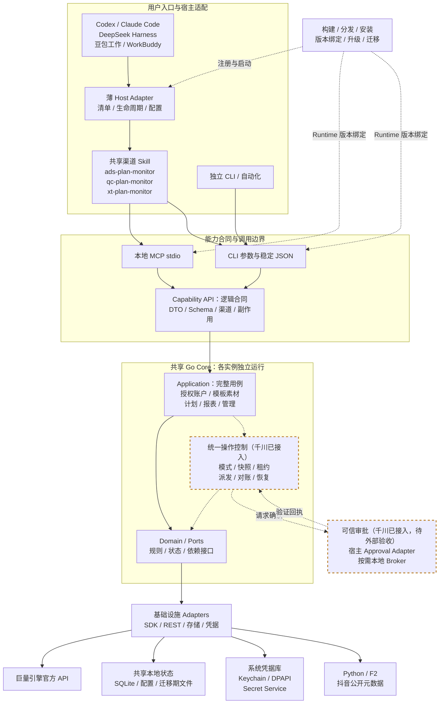

<p align="center">
  
</p>

<h1 align="center">ocean-watch</h1>

<p align="center">面向 Codex、Claude Code、DeepSeek Harness、豆包工作与 WorkBuddy 的营销与千川投放工具，以及星图账号授权管理</p>

<p align="center">
  <a href=".codex-plugin/plugin.json"></a>
  <a href=".claude-plugin/plugin.json"></a>
  <a href="hosts/workbuddy/README.md"></a>
  <a href="skills/"></a>
  <a href="https://go.dev/"></a>
  <a href="https://modelcontextprotocol.io/"></a>
  <a href="https://www.jsonrpc.org/"></a>
  <a href="https://json-schema.org/"></a>
  <a href="https://oauth.net/2/"></a>
  <a href="https://open.oceanengine.com/"></a>
  <a href="https://github.com/oceanengine/ad_open_sdk_go"></a>
  <a href="https://www.python.org/"></a>
  <a href="https://github.com/Johnserf-Seed/f2"></a>
  <a href="docs/architecture/overview.md"></a>
  <a href="docs/guides/configuration.md"></a>
  <a href="https://github.com/westng/ocean-watch/actions/workflows/ci.yml"></a>
  <a href="LICENSE"></a>
</p>

<p align="center">
  <a href="README.md">README</a> ·
  <a href="docs/README.md">Documentation</a> ·
  <a href="CONTRIBUTING.md">Contributing</a> ·
  <a href="LICENSE">MIT license</a> ·
  <a href="SECURITY.md">Security</a> ·
  <a href="CHANGELOG.md">Changelog</a>
</p>

中文 | [English](README.en-US.md)

Ocean Watch 通过巨量引擎官方 API 提供授权、账户、素材、模板、计划、报表和投放分析。AI 助手使用营销、千川、星图三个渠道 Skill 理解业务目标，本地 MCP 与 CLI 共用一套 Go 业务核心、状态和凭据，计划写入默认只预检。

本页描述当前源码，包括[未发布改动](CHANGELOG.md#未发布)；已发布版本见 [Releases](https://github.com/westng/ocean-watch/releases)。V3 的部分能力已落地，完整架构目标和各宿主业务验收仍在推进。

当前主线版本为 **3.0.0-alpha.1 实验性预发布**：原 `V3` 成为 `main`，原主线保留在 `2.0`。真实宿主、人工 Broker 与业务闭环验收仍开放，预算金额单位待核实；使用范围、状态迁移和限制见 [alpha.1 说明](docs/release/alpha1.md)。

## 能做什么

| 入口 | 渠道 | 主要能力 |
| --- | --- | --- |
| [ads-plan-monitor](skills/ads-plan-monitor/SKILL.md) | 巨量营销 | OAuth、授权广告主同步、负责账户、上传与达人授权素材、模板、计划、报表和策略分析 |
| [qc-plan-monitor](skills/qc-plan-monitor/SKILL.md) | 巨量千川 | OAuth、授权广告主同步、负责账户、商品与直播模板、达人作品、全域计划、全域与乘方报表 |
| [xt-plan-monitor](skills/xt-plan-monitor/SKILL.md) | 巨量星图 | 独立渠道 Skill：OAuth、授权恢复、星图账户同步、负责账号与本地授权映射；星图计划与报表 API 尚未接入 |

营销、千川和星图分别管理应用、授权和账户映射，不跨渠道复用凭据或业务模板。

`xt-plan-monitor` 是星图 Skill 的对外名称，`star_map` 是其运行时渠道键。三个 Skill 都按统一能力合同调用共享 Go Core，星图账号使用 `star_account` 类型。

当前能力目录包含 **87 条 CLI 能力和默认 40 个 MCP 工具**，两者有重叠；启用可选开发资料后为 43 个。新增千川操作准备、查询、Broker 确认、执行和只读对账入口，CLI 与 MCP 共用不可变操作及 SQLite 派发事实。预发布阻断未迁移的旧在线写入；真实桌面确认及首发宿主验收仍待完成。**WorkBuddy 只使用 MCP，不通过 Shell 补执行 CLI。** 新增工具与 Skill 合同需要重新加载，详见[操作合同](docs/reference/operation-approval.md)与 [alpha.1 范围](docs/release/alpha1.md)。

千川官方 GET 目录新增 156 项受控查询映射，以及账户健康、计划诊断、素材检查、投放建议和自定义报表等对话入口；3 项保留明确分页限制。已有报表和作品预检继续复用 SDK，开发资料默认关闭且独立于业务 OAuth。见[官方查询合同](docs/reference/qianchuan-official-mcp.md)。

千川作品先通过 F2 批量解析，再按广告账户并行预检，同账户同授权共享计划查询。唯一可复用计划进入追加预览，完整查询无目标时才新建；多候选、身份未核实或绑定漂移会阻断该组。见[作品投放流程](docs/reference/qianchuan-work-routing.md)。

### 当前功能支持

以下状态核实于 **2026-10-30**。提供适配资源、发现工具和完成真实业务验收是不同范围，不能相互替代。

| 宿主 / 平台 | 功能与接入方式 | 支持状态 | 限制与验收 |
| --- | --- | --- | --- |
| Codex | Plugin + 三个 Skill + 本地 MCP；Skill 可使用 CLI 补充能力 | 适配已实现；当前 V3 完整宿主验收待完成 | MCP 使用 macOS/Linux 启动器；工具或 Skill 合同变化后需新建任务 |
| Claude Code | 独立 Plugin 清单 + 三个 Skill + 本地 MCP / CLI | 适配已实现；当前 V3 完整宿主验收待完成 | MCP 使用 POSIX 启动器；更新插件后需新建任务 |
| DeepSeek Harness | 桌面版原生组合包 + 三个 Skill + 本地 MCP / CLI | 适配已实现；当前 V3 桌面验收待完成 | peer 声明限定内置运行时 `0.2.0-rc.2`；不使用独立 npm/CLI 宿主 |
| 豆包工作 | 已有用户 Skill + MCP 路径配置脚本 | 已提供脚本；当前 V3 实际发现与业务验收待完成 | 脚本仅面向 macOS Apple Silicon，不负责安装 Skill |
| WorkBuddy | 本机安装器 + stdio MCP + 三个生成的 Skill | 已在 `5.9.3`、macOS arm64 验证本机安装、三项 Skill 展示、重启后原生连接与 26/26 工具启用 | 完整业务验收（WB1）待完成，未发布连接器 Marketplace 包 |

源码构建的 macOS arm64 Runtime 已完成真实千川授权的账户同步与显式改绑验收；这不代表所有渠道、宿主和计划写入已经验收。

## 快速开始

选择一个宿主接入。普通营销和千川流程使用内置 Go Runtime，无需安装 Go；千川抖音作品链接解析额外需要 Python `3.10+` 与 F2 `0.0.1.7`。本机 Python 安装脚本另需可用的 Python 3。

支持 Plugin 的 Codex：

```bash
codex plugin marketplace add westng/ocean-watch
codex plugin add ocean-watch@ocean-watch
```

支持 Plugin 的 Claude Code：

```bash
claude plugin marketplace add westng/ocean-watch
claude plugin install ocean-watch@ocean-watch
```

DeepSeek Harness 桌面版 `0.2.0-rc.2`：在应用的「插件 → 添加插件」中输入本仓库的绝对路径，安装到当前 `desktop` profile。无需安装独立 npm/CLI 宿主。

原生组合包同时注册三个 Skill 和本地 MCP 工具。安装与桌面版验收方式见 [DeepSeek Harness 接入](docs/guides/deepseek-harness.md)。

WorkBuddy（已实测 macOS Apple Silicon）：在仓库根目录使用原生 arm64 Python 安装，避免 Rosetta 解释器误选 Intel 二进制。

```bash
/usr/bin/arch -arm64 /usr/bin/python3 scripts/install-workbuddy.py
```

安装器校验清单、备份旧配置和 Skill，保留其他 MCP 服务及原生信任设置。安装后重新加载 MCP / 新建会话，必要时重启 WorkBuddy。其他平台命令、共享状态与验收范围见 [WorkBuddy 本机接入](hosts/workbuddy/README.md)。

豆包工作（macOS Apple Silicon）：先在豆包工作中导入 `skills/` 下的三个 Skill，再在保留于本机的仓库根目录运行：

```bash
bash scripts/install-doubao.sh
```

脚本只更新已有 Skill 的 MCP 路径，依赖仓库内的 arm64 Runtime；运行后完全退出并重启豆包工作。

所有宿主应使用同一状态根：`OCEAN_WATCH_HOME` → `CODEX_HOME` → `~/.codex`，按优先级解析。同一渠道的有效授权可跨宿主复用；营销与千川仍需分别授权。首次接入后新建任务，描述目标并按引导完成官方 OAuth。详见[快速开始](docs/guides/getting-started.md)和[配置与授权](docs/guides/configuration.md)。

## 可以直接这样问

- **星图账号**：“帮我完成星图授权，并同步这个授权下的星图账号。”
- **授权与恢复**：“帮我完成千川授权，完成后查看授权状态。”
- **同步权限**：“这个授权账号新增了广告主，把本地权限更新到官方最新状态。”
- **查看账户**：“列出我本机负责的账户，并查看千川授权状态。”
- **查看经营数据**：“查这个千川账户今天的消耗、GMV 和 ROI，注明报表范围。”
- **查找营销素材**：“查询这个营销账户今天上传的视频。”
- **处理千川作品**：“按这个模板预检这些抖音作品，列出会新建、追加、跳过和失败的项目。”
- **分析投放效果**：“看最近 7 天的素材表现，找出高消耗低转化素材并给出优化建议。”

这些问法是示意，具体范围以宿主已加载的工具为准。支持 CLI 的入口还可创建计划和调整投放参数，但必须先展示预检、获得明确确认，再提交。

## V3 运行架构

V3 采用本地优先的模块化单体：**薄宿主适配 + 共享 Skill + 统一能力合同 + 唯一 Go Core + 共享持久状态与系统凭据**。项目运行包括安装启动、业务调用、操作确认与恢复、进程退出和版本迁移。下图覆盖这些系统边界；虚线框表示尚未全面接入及完成外部验收的统一操作控制与可信审批。



| 层次 | 项目级职责 |
| --- | --- |
| 宿主适配与共享 Skill | 各宿主拥有自己的安装、注册、连接和卸载生命周期；三个渠道 Skill 共享意图、调用顺序和展示规则，宿主包只提供受控映射。 |
| Capability API 与 Transport | MCP 与 CLI 映射同一业务合同，声明渠道、输入输出和副作用；MCP 直接调用 Application，Go CLI 在自身进程内调用 Application。Capability API 不新增网络服务，WorkBuddy 只使用 MCP。 |
| Application / Domain / Ports | 统一实现初始化诊断、授权账户、模板素材、计划、报表、执行记录与恢复；领域规则不依赖宿主 SDK，外部依赖通过端口接入。 |
| 操作与请求治理 | 当前已有预检、写锁、分页限流和结果对账。V3 目标将写入统一到操作版本、快照摘要、可信审批、执行租约、派发记录和恢复状态机，工具可见性与执行权限分别校验。 |
| 数据与外部依赖 | 多宿主共享受保护的状态根和跨进程锁；事务性状态逐步迁入 SQLite，Secret/Token 由系统凭据库持有，官方 API 与公开元数据各有独立 Adapter。 |
| 运行与交付生命周期 | 每个宿主实例拥有自己的连接、Runtime 子进程和临时资源；构建与安装层负责产物、兼容校验、版本绑定、升级、迁移及回退，共享数据由用户所有。 |

**当前实现与完整目标的差异：**

| 项目部分 | 当前运行方式 | 完整 V3 目标 |
| --- | --- | --- |
| 操作与审批 | 新的千川操作入口已接入 Broker、SQLite 审批消费及派发/读回；稳定版旧用例仍有 dry-run / `--submit`，预发布阻断旧在线写入。 | 投放写入接入统一操作状态机与 `read / plan / execute` 模式；经验证的宿主审批优先，本地 Broker 按需兜底。配置、授权和迁移保留独立管理边界。 |
| 持久化 | 千川预检 Journal 默认写入 SQLite；授权索引、模板、计划绑定等仍有文件存储。 | 事务性业务状态统一持久化，完成凭据引用轮换、备份、迁移与未结操作恢复；秘密仍只在系统凭据库。 |
| Runtime 与升级 | Codex 兼容代理仍可切换合同兼容的 Runtime；Claude 更新后新建任务，WorkBuddy 使用安装器固定目录。 | 每个进程绑定不可变 Runtime，显式更新；操作格式、能力合同和数据库 Schema 分别校验兼容性，再恢复或迁移。 |

仓库预置 macOS Intel / Apple Silicon、Linux x86_64 / ARM64、Windows x86_64 五种 Runtime 二进制。逐层职责、完整请求链路、状态与进程归属及当前落点见 [V3 项目运行架构](docs/architecture/overview.md)；目标约束见 [PRD](docs/product/prd.md)。交叉构建、单个功能通过或宿主工具发现均不代表完整 V3 已验收。

## 操作与安全边界

从 Git checkout 或 worktree 运行仓库启动器时，Runtime 使用该目录的已校验构建，快照和选择状态按 checkout 独立保存；授权、账户和业务配置继续使用共享状态根。修改 Runtime、F2 或 Skill 后先重建产物，已安装插件通过对应宿主更新。详见[开发说明](CONTRIBUTING.md)。

- 查询账户、素材、模板、计划详情和报表属于只读操作。
- 创建、追加、删除和预算、ROI、状态调整必须先预览；没有明确确认，不执行在线写入。
- “我负责的账户”读取本机账户簿；刷新当前授权用户可访问的广告主属于独立的官方授权同步。
- 营销与千川的 GMV、ROI 等指标保持各自官方口径，跨渠道只汇总可比较的消耗。
- F2 只解析抖音公开作品元数据，不下载素材、不创建数据库、不自动读取浏览器 Cookie；最终可投放性始终由目标广告主下的千川官方接口确认。
- Secret 和 Token 保存在 macOS Keychain、Windows DPAPI 或 Linux Secret Service，不进入聊天、普通配置或日志。
- 用户配置、授权快照、缓存、报表和执行记录位于本机 `<共享状态根>/ads-plan-monitor/`，不属于开源仓库内容。

更多信息见[配置与授权](docs/guides/configuration.md)和[安全说明](SECURITY.md)。

## 功能建议

欢迎在 [Issues](https://github.com/westng/ocean-watch/issues) 描述使用场景、期望行为、宿主与插件版本；请勿附上凭据或未脱敏的业务数据。

## 文档

| 读者 | 入口 |
| --- | --- |
| 普通用户 | [Documentation](docs/README.md) · [快速开始](docs/guides/getting-started.md) · [配置与授权](docs/guides/configuration.md) |
| 脚本与排错 | [CLI 参考](docs/reference/cli.md) · [授权恢复](docs/reference/authorization-recovery.md) |
| 开发者 | [架构说明](docs/architecture/overview.md) · [Contributing](CONTRIBUTING.md) |
| 项目与安全 | [Security](SECURITY.md) · [Changelog](CHANGELOG.md) · [发布指南](docs/release/releasing.md) · [MIT license](LICENSE) |

## 鸣谢

- [F2](https://github.com/Johnserf-Seed/f2)：为千川作品链接流程提供抖音公开作品元数据解析能力。
- [巨量引擎开放平台 Go SDK](https://github.com/oceanengine/ad_open_sdk_go)：为巨量营销与巨量千川官方 API 集成提供 Go SDK 支持。

## License

[MIT](LICENSE)
