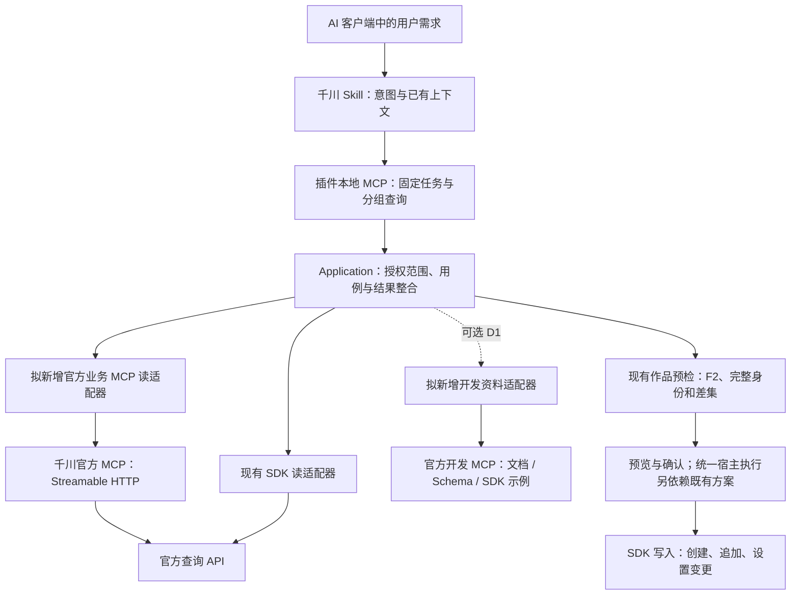

# 千川 Skill 与官方 MCP 全量查询接入方案

文档属性：AI 设计方案。日期：2026-11-01，续验：2026-11-02。版本：实施修订版 1.2。状态：正式共享策略、156 项受控查询映射、九个任务入口与 D1 已实现并通过本地验证；当前 Codex 的余额/配额和三类资料样本通过，其余真实范围与三项完整分页证据分别记录。

适用范围：Ocean Watch 的千川 Skill、本地 Go Runtime、MCP/CLI 共享查询用例及 AI 客户端调用体验。用户已经明确要求官方查询能力统一封装进千川 Skill，并授权本地实施和沿用上次预检账户的少量真实只读联调。该授权不扩张到其他业务对象、Host 安装、提交、推送或发布。

权威边界：当前行为以源码、测试、已安装产物和[正式查询合同](../../reference/qianchuan-official-mcp.md)为准。下文保留的设计时基线、“拟新增”和 `S_R1-draft` 是历史设计，不作为当前工具参数来源。当前实现和范围决定 A_Q1/A_D1 见[实施计划](../plans/qianchuan-official-mcp-integration-2026-11-01.md)，实际执行证据见[验收记录](../reviews/qianchuan-official-mcp-implementation-2026-11-01.md)。

本地实施快照：候选目录保持 156 项 `published_only`；S_R1 草案登记 9 个目标工具和 15 个查询依赖；输入与结果 DTO、F2 描述校正及内部原型已落地。余额、配额与有界两页商品全域计划在同一已授权账户完成真实 SDK 对照，默认分页、长商品 ID 与原始数字路径已有证据，`40100` 反馈共享冷却器的遗漏已修复。所有新增 Host 工具未注册，共享启动策略、完整逐查询合同及正式客户端仍在 P1。P0.5 最小工程验证不等于产品或 Host 接入验收，详见[脱敏记录](../research/qianchuan-official-mcp-poc-2026-11-01.md)及[正式内部合同](../../reference/qianchuan-official-mcp.md)。

## 1. 目标与主要决策

用户在 AI 客户端中继续用一个千川 Skill 表达业务需求。Skill 选择任务，本地插件负责授权、查询、核验、结果整合和展示，官方 MCP 成为 Runtime 内部的一种查询适配器。

目标包括：

1. 登记和封装当前公开的 156 个千川业务查询工具，保留清晰的场景、权限和可用性状态；以后按版本增补官方目录。
2. 常用请求由少量固定任务工具完成，低频查询按需获取目录和参数 Schema。用户不需要记住远端工具名、接口路径或配置文件。
3. 已有商品、达人、作品、计划、素材、全域/乘方报表继续复用现有 Application Service；补齐审核、配额、首发/低效素材、余额、直播详情和其他低频查询。
4. 将官方文档、Schema、SDK 示例作为可选开发资料能力，接入明确的开发问题路由；独立准备、验收和启用，不成为业务查询首版前提。
5. 官方业务 MCP 只承担查询。计划创建、追加/移除素材、状态、预算和 ROI 变更仍经过现有预览、确认和 SDK 写入用例；统一宿主审批/执行衔接沿用既有 PRD 和作品流程方案的后续工作。

关键实现选择：

- 对外保持本地 MCP 任务入口，对内连接官方远端 MCP。各 AI 客户端无需再单独配置一套带业务凭据的官方 MCP。
- Skill 是意图路由与结果解释层，不能单靠增加提示词变成 MCP 执行器。网络连接、参数校验、授权和查询必须由 Runtime 实现。
- 完整覆盖通过“版本化目录 + 分组查询入口 + 常用任务组合”实现。156 项不机械展开成 156 个 Host 工具，也不把全部参数塞进每次对话。
- 已验收的核心预检初期继续使用 SDK 查询；新增查询优先使用官方 MCP。核心查询迁移到 MCP 必须通过逐字段和业务决策对照。
- 每个 query_id 绑定能力、工具集、最低执行模式和主体校验合同；通用入口与组合任务均由 Core 逐项复核，远端发现不扩大本地权限。
- Schema 变化按结构与业务语义判断兼容性，保留批准的输入/输出合同；未经批准的新参数、工具和权限不进入 Host 契约。
- 首批验收按 P0 → P0.5 最小官方联调 → P1 → P2 → P4-A → P5-A 推进。P3 全目录按组扩展及 D1 可选开发资料均不阻塞首批验收。

本方案继续服务于本地投放操作内核：优先解决账户、计划、素材、预检与报表的对话调用。156 项覆盖是分批完成的最终目标；开发资料用于本项目接口维护，不扩展为通用开发平台。查询接入不替代既有 PRD 的可信执行、对账和恢复工作。

## 2. 设计时基线与证据边界（历史快照）

| 项目 | 已核实事实 | 对设计的影响 |
| --- | --- | --- |
| 官方业务目录 | 公开工具列表有 156 个唯一工具名和接口路径 | 形成完整登记表；目录数量不是当前授权可调用数量 |
| 官方业务连接 | 既有 TokenLease 的单账户真实连接及三项查询通过；Tool-Range 额外下发一个未选工具 | 保留本地独立白名单，不能把远端筛选当作本地许可 |
| 官方应用授权 | 当前接入页标注“已暂停新增” | 默认选择开发者授权，不把旧 API Key 获取流程作为新增用户前提 |
| 官方开发工具 | SSE；open_api_doc_gen、open_api_schema_gen、open_sdk_example_code_tool | 归入独立 D1；缺元信息或连接不可用不阻塞业务首版 |
| 本地能力合同 | 91 个能力、26 个 MCP 工具、77 个 CLI 命令 | 多入口有重叠；新增工具纳入现有单一能力目录和路由校验 |
| 本地策略缺口 | 当前 CapabilitySpec 没有工具集和最低执行模式字段；PRD 要求 Core 强制校验 | P0/P1 补齐共享策略，不能声称复用 Registry 即已继承权限门禁 |
| 开发元信息入口 | 当前应用设置保存 app_id/secret，没有 developer_id 设置流程；项目配置禁止这些字段 | D1 增加独立受控准备入口及受保护存储，不改变普通业务准备流程 |
| 本地依赖 | modelcontextprotocol/go-sdk v1.7.0；ad_open_sdk_go v1.1.92 | 复用现有 Go 内核与依赖体系，不另起业务服务 |
| 核心查询重合 | 6 个作品/计划查询和 6 个报表查询已使用 SDK，且出现在官方 MCP 目录 | 避免重复实现业务规则；Backend 只替换 Port 的数据来源 |
| 整体账户报表 | SDK 已使用 report/all_promotion/get；本份 MCP 目录未列出对应工具 | 包含乘方的 overall 报表保留 SDK，不用纯全域报表冒充整体口径 |
| 文档差异 | 列表清单链接指向通知；正确 API 文档已找到，实际可选 page_size 存在整数/字符串枚举冲突 | 保留原始来源；原型省略可选页大小并核对默认 10，不弱化 Schema |
| 现有请求控制 | 千川账户读取初始采用 2 个保守在途槽位，准入等待与网络读取分开计时 | MCP 与 SDK 在同一账户范围共享控制，不能绕开原限制 |

未核实：其他查询及三项之外的完整输入/输出、所有角色/场景、任意分页大小、未批准字段/单位、正式策略、会话刷新和客户端性能。前一轮 SDK 作品预检证据与本轮 MCP 最小 PoC 分开引用；它们均不证明所有官方工具可用或已安装 Host 更新。

Skill 主文件已校正“Warm owner hints may skip F2”旧描述，与最新源码及正式作品路由说明一致：本批 F2 解析及官方复核仍执行，缓存仅作提示，不作为授权或商品证明。

## 3. 用户对话体验

### 3.1 业务用户

| 用户表达 | Skill 的目标路由 | 用户得到的结果 |
| --- | --- | --- |
| 查这个户的计划、预算和 ROI | 现有计划/报表任务工具 | 同一账户、明确日期及全域/整体口径的事实 |
| 这个户余额还有多少、还能开几条计划 | 拟新增账户健康任务 | 余额、预算、配额及未返回/不可用项 |
| 这条计划为什么不跑、有没有审核问题 | 拟新增计划诊断任务 | 计划状态、审核建议、适用的学习期/成本保障信息 |
| 这些视频哪些是首发、哪些是低效素材 | 拟新增素材质量任务 | 作品/素材身份、首发/低效标签及查询失败项 |
| 给这个全域计划看看建议预算或 ROI | 拟新增投放建议任务 | 官方建议、适用场景和获取时间；形成后续变更预览的依据 |
| 查直播间流量、用户洞察、订单或违规积分 | 官方分组查询入口 | 对应范围的结构化业务结果 |
| 我负责的户近 7 天消耗和 ROI | 拟新增负责账户报表任务 | 仅本地负责账户集合，逐户结果和失败明细 |
| 这批作品预检后应该新建还是追加 | 现有 preflight_qianchuan_works | 完整身份匹配、素材差集和分组决策 |
| 按刚才确认的内容创建或更新 | 既有写入边界，接入统一宿主执行后复用 | 精确预览、确认和写入结果；不走官方查询 MCP |

只追问本次任务缺失且影响结果的账户、对象、日期或业务选择。已在本会话确认的授权范围、模板和对象继续使用；不重复索要链接或让用户操作 Shell。

内部商务与视频类型标签按结构化业务字段保留。标签中的商务归属和“实况”等类型不是达人身份；达人以本批官方核验为准。备注日期不自动覆盖上海业务日，也不自动成为精确计划名称查询条件；用户明确指定计划名、ID 或历史日期时再按该条件查询。

### 3.2 开发用户

“这个接口有哪些字段”“查千川接口 Schema”“按官方 Go SDK 写调用示例”等明确开发请求，在 D1 已实现并启用时使用开发资料任务。D1 默认关闭；其设置或连接缺失只影响资料请求。普通“查消耗”“预检作品”直接使用业务工具，P0.5/P1 的接口核对也不以 D1 可用为前提。

### 3.3 Skill 的三层内容

| 层级 | 内容 | 加载时机 |
| --- | --- | --- |
| 主 SKILL.md | 渠道边界、意图优先级、高频任务路由、授权恢复、展示合同 | 选择千川 Skill 时 |
| 窄参考 | 官方查询路由、自定义报表、开发资料路由 | 当前任务命中该模式时 |
| Runtime 目录 | 156 项的参数 Schema、分页、作用域、场景、字段和版本 | 通过目录工具按 query_id 或业务分组返回 |

保持现有自动发现策略，增加口语化高频能力的精确描述；不加入无边界的“所有平台/所有工具”触发词。完整官方目录维护在 Runtime 中，不复制到 Skill 主文件形成第二份事实源。

## 4. 目标调用结构

这是目标结构图，不表示新增组件已经安装或实现。业务规则留在 Application/Domain；MCP 客户端、SDK 类型和远端会话只出现在 Adapter。

### 4.1 查询来源策略

| 用例 | 首版来源 | 以后切换条件 |
| --- | --- | --- |
| 现有作品预检、提交前复核、计划与素材身份读取 | SDK | 官方 MCP 字段、分页、失败语义及决策完全等价后，按用例显式切换 |
| 现有固定报表、自定义全域/乘方报表、负责账户报表 | 既有 SDK Service | 逐主题确认指标与范围，overall 缺失工具继续 SDK |
| 新增审核、配额、质量标签、余额及其他官方查询 | 官方 MCP | 逐工具完成 Schema/作用域/输出验证 |
| 开发资料 | 可选 D1 官方开发 MCP | 资料工具集已启用、明确开发意图、元信息及独立验收通过 |
| 在线业务变更 | 既有 SDK 写 Service | 与本方案查询接入解耦 |

Backend 由版本化用例映射确定，模型不能用一个参数绕过校验选择任意远端服务。Host 缺失某个已经命名的 MCP 工具时保持现有规则：说明缺失并停止该路由，不静默改走等价 CLI。上游官方工具缺失则返回结构化不可用信息；是否提供等价 SDK 后端必须在代码中显式登记和验证。

## 5. 完整查询覆盖

全量目录分为 11 个业务分组，详见[156 项登记表](../research/qianchuan-official-mcp-catalog-2026-11-01.md)。这是本方案分类，权限和场景不能从分组名推断。

| 分组 | 条目数 | Skill 对话范围 |
| --- | --- | --- |
| accounts | 17 | 账户、店铺、代理、组织、授权关系 |
| finance | 17 | 余额、预算、流水、充值/转账结果及可转信息查询 |
| plans | 23 | 计划、审核、学习期、配额、投放建议 |
| assets | 14 | 图片、视频、图文、首发/低效、预审结果 |
| products | 5 | 可投商品与计划/抖音号商品关联 |
| reports | 20 | 指标配置、账户/计划/素材、订单与其他报表 |
| live | 5 | 今日直播间、流量、商品和用户洞察 |
| aweme_orders | 17 | 随心推订单、效果预估和建议 |
| targeting | 21 | 达人定向、受众、地域和兴趣行为词库 |
| compliance | 9 | 评论、屏蔽列表和违规积分查询 |
| operations | 8 | 操作日志、灰度、调控与订阅账户查询 |
| 合计 | 156 | 全部公开业务工具登记 |

“完整覆盖”分三个状态，必须分别统计：

- 目录覆盖：156/156 条有明确登记、来源、分组和实施归属。
- 封装验证：逐条参数/输出 Schema、作用域、分页和失败语义有代码与隔离 fixture 验证。
- 真实可用：在注明的官方角色、业务场景和授权范围内完成调用；没权限或没有对应环境的条目标记未验证/不可用，不能把登记成功当成真实调用成功。

官方新增 POST 类变更工具即使出现在远端发现结果中，也不自动进入本方案。财务工具只开放查询，不将查询结果接到充值、转账或合同接受动作。

## 6. 对外任务工具

以下 12 个名称是目标设计，不是当前注册工具：9 个业务/目录工具，3 个 D1 可选开发资料工具。实现时纳入共享能力与策略合同、MCP Schema、Host 清单和 Skill 路由；在不改变用途的前提下可合并，但不能按每条官方 API 扩张 Host 注册。首批只声明已实现且通过验收的工具。

| 拟新增 MCP 工具 | 作用 | 主要输入与边界 |
| --- | --- | --- |
| get_qianchuan_official_capabilities | 本地目录查询与单项参数发现 | 分组/关键词/query_id、分页；默认不刷新 Token、不连接远端 |
| query_qianchuan_official | 全目录受控查询 | 已登记 query_id、明确作用域、经验证参数和结果上限 |
| get_qianchuan_account_health | 账户健康组合查询 | 单账户或明确的负责账户集合、所需检查项 |
| diagnose_qianchuan_plan | 计划状态与审核等组合诊断 | 广告主、精确计划 ID；只调用适用于该计划场景的子查询 |
| inspect_qianchuan_material_quality | 首发/低效等素材标签 | 广告主、素材 ID 或作品链接；链接复用 F2 与官方身份定位 |
| get_qianchuan_delivery_suggestions | 官方预算/ROI 等建议 | 业务场景及该场景必需对象；建议不自动应用 |
| get_qianchuan_report_schema | 现有指标发现用例的 MCP 入口 | 全域/整体范围与主题；不硬编码用旧报表代替 |
| report_qianchuan_custom | 现有自定义报表的 MCP 入口 | 已验证主题、维度、指标、日期和过滤条件 |
| report_qianchuan_managed_accounts | 现有负责账户效果用例的 MCP 入口 | 明确日期、范围；只查询本地负责集合 |
| search_oceanengine_api_docs | 开发文档检索 | 千川开发问题或批准的平台通用主题 |
| get_oceanengine_api_schema | 开发接口 Schema | 官方 API 路径；路径作为资料标识，不执行该 API |
| get_oceanengine_sdk_example | 官方 SDK 代码示例 | API 路径及用户明确的 SDK 风格；远端实参按已发现 Schema 适配 |

新业务工具的 Effect 为 official_read；目录为 local_read；开发资料按资料读取声明。Token 刷新、短期非敏感目录缓存/操作状态与在线业务写入分别记录，不把 official_read 误报为完全没有本地副作用。

### 6.1 通用查询入口

query_qianchuan_official 不提供任意 URL、HTTP 方法、凭据、工具名透传或未校验 payload。query_id 只能取编译目录中已启用的 ID；名字可沿用公开远端工具名，服务器仍验证其登记和参数。

目标输入：

| 字段 | 含义 | 校验 |
| --- | --- | --- |
| query_id | 已登记的查询标识 | 合同已验证，能力与工具集已启用，实际模式允许，只读及场景匹配 |
| scope | kind + id 的业务范围 | advertiser/agent/shop/customer_center/organization/authorization/public_catalog；按工具确认必需类型 |
| auth_account_id | 需要时使用的既有授权选择器 | 与所选范围和千川授权关系一致；不是凭据值或文件路径 |
| parameters | 本查询的业务参数 | 按版本化 Schema 拒绝未知字段，限制层级、字符串和数组长度 |
| limit / cursor | 本次结果大小和继续位置 | 按登记分页模型解析；游标绑定查询、授权范围和过滤条件 |

不能把所有工具都硬套 advertiser_id：代理、组织、User、授权账户和公共词库各有不同作用域。参数中的主体 ID 必须与 scope 一致；Token、账户主体注入及不公开的必需参数由服务器提供。scope/权限验证失败时不派发业务调用。

公开参数 Schema 必须移除秘密字段和服务器注入字段；对远端完整请求仍做独立校验。远端实际参数尚未取得前，不猜测字段名、分页方式或是否需要 auth_account_id。

#### 6.1.1 逐查询策略合同

遵循 [PRD 8.5](../../product/prd.md#85-业务工具集与执行模式)。每条目录项必须绑定 capability_id、required_toolsets、minimum_mode、channel、Effect、scope_resolver、主体字段位置及角色/场景条件。缺少绑定的条目不能启用。共享 Registry/策略合同需补齐这些字段与服务端检查；不为 MCP、CLI 或官方 Adapter 再建一套权限判断。

| 查询类别 | 工具集绑定原则 | 模式与主体检查 |
| --- | --- | --- |
| 已有账户/授权查询 | 复用现有 core 能力，限已定义用途 | 最低 read；检查渠道、授权主体与配置允许范围 |
| 千川计划/素材及新增投放查询 | qianchuan；其他目录项逐条确定，不能仅按分组推断 | 最低 read；检查账户及对象归属、角色和场景 |
| 千川效果报表 | reports；渠道授权仍独立校验 | 最低 read；不因启用 qianchuan 而自动授予 reports |
| 开发资料 | D1 拟新增可选 developer_docs 工具集，实施前同步正式 PRD/合同 | 最低 read；检查资料主题与元信息，不取得业务账户权限 |

Runtime 启动时固定实际模式、工具集和用户配置的账户限制；普通参数和 Skill 不能扩大这些值。Core 在派发前按 query_id 解析底层能力，依次检查本地启用状态、模式、渠道/授权、配置允许范围、角色/场景和参数。总入口可见、Effect 为 official_read 或 Token 授权范围很大，都不能代替逐项检查。

scope_resolver 必须检查登记的全部主体字段，包括数组、嵌套子项和代理/组织下的子账户关系；这些主体同时受授权事实和本地账户限制约束。无法证明必需主体关系时阻断。公共词库仅在其明确登记的公共作用域执行，不借用某个广告主 ID。负责账户请求仍以本地成员清单为边界。

组合任务对每个子查询及其全部对象执行同一策略；首次校验通过不授予后续子项调用权。缓存/请求合并键包含策略范围，命中后仍复核当前请求。Tool-Range 仅由已经通过策略的任务映射生成，不能反向授予能力。

验收必须包含：关闭 reports 后经通用入口查询报表、隐藏工具直接调用、未知模式/工具集、同一 Token 下越过本地账户限制、嵌套主体注入、组合子项越界，以及 read 模式尝试创建预检。越界项在派发前拒绝；无请求级副作用的策略拒绝不产生业务网络请求或 Token 刷新。

### 6.2 目录返回

目录返回短描述、分组、用途、工具集、最低模式、scope 类型、参数 Schema、场景、分页限制、合同版本、封装状态和本地启用/受限原因，以及带核对时间的 last_known_availability。支持关键词/分组筛选和分页；指定一个 query_id 时再返回该项完整参数资料。封装已验证、本地策略允许和真实可用是不同事实。

默认只是本地元数据读取。远端 tools/list 在真正查询的初始化阶段按需完成；“工具在远端出现”不等于“当前主体已获得所有数据权限”。可用性未知就明确未知，不在目录查询中偷偷触发账户发现或授权流程。

### 6.3 高频组合任务

组合任务负责独立查询的并行、重复读合并和业务结果整理。所有子查询复用 6.1.1 的 Core 策略，只执行本次请求所需子查询：

- 账户健康按选择的余额/预算/配额等项目读取；负责账户模式复用本地成员清单，不扩张到全部授权账户。
- 计划诊断先取得场景和基础状态，再读取适用的全域审核建议、学习期或成本保障信息。旧计划接口不能默认套用到全域/乘方。
- 素材质量只解释首发/低效标签。素材 ID、作品 ID、视频 ID 和达人 UID 分开；标签不证明投放授权，也不替代作品/商品预检。
- 投放建议保留官方场景和获取时间；用户决定应用时再进入既有变更预览。

## 7. 官方连接与授权

### 7.1 业务连接

- 客户端和上游工具发现按需初始化。插件启动、本地目录/能力查询及现有无凭据 doctor 不访问官方 MCP；上游不可达或缺开发元信息不能阻断原有 SDK/F2 用例。
- 固定 origin 为 https://open.oceanengine.com，固定业务 path 为 /qianchuan/mcp；使用 Streamable HTTP。
- Runtime 通过现有 TokenManager 按千川授权获取 TokenLease，在请求头注入 Access-Token。不把 Token 固定写进 Host 的 MCP 配置，也不传给模型。
- 使用 Tool-Range 选择当前任务需要的已登记工具。一个任务可使用多个分组的工具，但集合来自用例映射；不把默认远端工具列表当作完整目录。
- Tool-Range 最大长度、远端是否支持对应分组和工具分页，在接入阶段验证；超限按已批准子集拆分，不能截断后仍声称全量可用。
- 会话池按授权 ID、Token revision、工具 profile 和目录版本隔离；业务 scope 仍在每次调用中独立校验。Token 更新后重建相应会话，旧连接在在途请求退出后关闭。
- 会话复用不缓存业务权限结论；所有数据缓存和请求合并包含授权、主体、查询参数与业务范围。

P0.5 必须先用最小原型验证实际授权、工具发现/筛选和结果解码，再进入正式客户端封装与首批启用。它验证该版本的连接机制，不证明所有用户、角色或全部目录都可用；运行时仍逐授权处理初始化、权限失败和真实可用性。

### 7.2 开发资料连接

开发资料属于可选 D1，使用 S3 声明的 SSE 服务及 app_id/developer_id 元信息，和业务连接使用不同 profile。拟归入独立 developer_docs 工具集，默认关闭；D1 实施前同步正式 PRD 和共享能力/启动策略合同。不能塞入 core 作为不受工具集限制的通用资料入口，也不新增一套宿主业务服务。

准备流程为：用户明确启用开发资料 → 受控本地配置入口（Skill 调用同一 CLI）确认使用的 App 与 developer_id → 校验字段及资料连接 → 保存准备状态。现有应用设置只有 app_id/secret，不能假定已具备 developer_id；可引用已保存的受保护 App ID 元信息，也可在资料设置页独立提供 app_id/developer_id，不以业务 OAuth 或 Secret 为前提。

资料元信息使用独立受保护记录，资料 Adapter 只接收所需元信息，不读取业务 Secret/Token。developer_id 不从广告主或授权用户 ID 推导；引用的 App 变化后绑定失效并重核，独立资料记录不会被 OAuth App 替换覆盖。

项目配置仍只保存无秘密的启用选择/引用，不能把 app_id/developer_id 放入普通 JSON；模型参数、日志和输出只显示准备状态或缺失项。此准备流程不重新索要 Secret/Token/Cookie，不创建业务授权，不改写 Host profile。缺元信息或连接不可用仅阻断资料路由，账户、预检、报表与业务 MCP 首版照常按各自合同运行。

公开资料只能作为接口证据，不能授予业务操作权限。Schema/示例请求即使检索的是创建/更新接口，也只是获取资料，不派发对应 POST 业务动作。

三个资料工具单独验收字段、返回格式、错误与敏感信息处理；对外范围限千川接口及本项目需要的平台公共接口。D1 不作为 P0.5 获取正确接口资料的唯一来源，维护者可先使用公开官方文档和锁定 SDK 核对。

### 7.3 恢复

沿用现有 REAUTHORIZATION_REQUIRED 和 ACCOUNT_SYNC_REQUIRED 恢复合同，保留原请求。只有确认的授权失效才进入 OAuth；缺工具、Schema 差异、业务权限不足或普通 HTTP 403 不自动归因为 Token 失效。F2 Cookie 和广告主 OAuth 保持独立。

MCP 会话失效可在预算内重新初始化并重试幂等查询；官方业务错误先分类。复用已保存授权时不要求用户重复提供链接或重新配置凭据。

### 7.4 最小官方联调

P0.5 选取 2～3 个已核对业务 GET/输入的查询，覆盖指定账户的简单读取、实际分页及长 ID/金额返回。使用既有 TokenManager 的受保护租约，不把凭据复制到探针配置或聊天；全过程限定已授权的精确对象，业务写请求为零。SDK 有对应读取时核对同一对象和口径。

记录实际 initialize、tools/list、Tool-Range 与 tools/call 行为，检查文本/结构化结果、数字精度、分页完成或截断标记、错误和请求预算。没有真实授权可先做隔离开发，但不能把 P0.5 标成通过或启用尚未获准的官方后端。联调结果只保存脱敏字段/类型、计量和结论。

首批范围由通过证据确定，使用版本化首批清单 S_R1 明确 query_id、任务工具、场景与合同版本；尚缺证据的高频子项明确未实现/未验收。有限样本不形成“156 项全部可用”或网络性能普遍提升结论。

## 8. 请求控制、分页与效率

### 8.1 MCP 的传输 POST 与业务只读

Streamable HTTP 的 tools/call 使用 HTTP POST 传送 MCP 消息；这不等于执行官方业务 POST。当前 SDK transport 通过 request.Method == GET 选择共享读许可，不能直接原样套到官方 MCP 连接，否则只读 MCP 会被当成排他写请求。

新增适配器在“已登记的查询调用”边界声明只读 Effect，并获取同账户共享读许可。持续 SSE/消息流不长期占有广告主槽位；槽位从业务工具派发前持有到对应结果解析、失败或取消结束。初始化、tools/list 等控制消息单独计量和限制。

初始沿用同账户 2 个保守在途读取槽位；按当前 SDK 的准入等待/网络读取分离原则设计 MCP 单次业务调用，继续服从父任务截止时间。持久流连接不机械设置为整个生命周期 30 秒；业务响应与控制消息各有有界超时、单消息大小和取消机制。

Retry-After、可恢复限流与有界读重试纳入现有请求控制。默认并发是工程保护值，不宣称为官方 QPS 配额；官方频控仍需核实。

广告主查询复用现有账户控制键；代理、店铺、组织或公共查询须按登记的授权/主体范围定义控制键和预算，不能因没有 advertiser_id 跳过控制，也不能把组织 ID 冒充广告主 ID。新主体类型在对应批次实现和验证后才启用。

### 8.2 分页与完整性

每个 query_id 登记无分页、page/page_size 或游标分页模型，验证真实返回。交互查询可以返回前 N 项，但必须给出 has_more、scope 和 completeness；不把显示数当成官方总数，也不根据截断数据生成完整账户汇总。

预检的“没有匹配计划”证明继续要求完整清单和候选身份验证。现有 100 页/10000 计划上限、每窗口 200 个详情、UID/完整商品集合与素材差集规则继续保留；失败、取消、缺字段或未完成分页不能转成 would_create。

### 8.3 提效方式与衡量

| 提效方式 | 工程目标 | 不能推断的结论 |
| --- | --- | --- |
| 高频任务直接调用 | 必需上下文已知时，1 个任务 MCP 入口完成请求 | 1 个任务入口不代表下游只有 1 个 API 请求 |
| 低频目录按需展开 | 一般用目录发现 + 查询；多候选时再获取单项 Schema | 不把 156 项全部加入每轮上下文 |
| 会话/Schema 复用 | 预热后不重复 initialize/tools/list 和全文资料检索 | 无真实测量不能承诺网络耗时减少 |
| 同范围重复读取合并 | 同一请求内相同参数只读一次，独立查询有界并行 | 不能共享不同授权或商品范围的身份/权限结论 |
| 结果先在服务端整理 | 只传业务所需字段、聚合和完整性事实给模型 | 不让模型把缺失金额或截断数据补成全量结论 |

分别记录 Skill 路由调用数、上下文体积、MCP 初始化/控制请求、业务 tools/call、SDK 实际请求/重试和各阶段耗时。上游 MCP 是否又调用多个 API 通常不可见，客户端 MCP 调用数不得冒称官方 API 次数。

长任务沿用既有 Operation/状态/取消合同。该依赖尚未就绪时只开放有界同步/可继续分页查询，明确当前进度和完整性；不无限提高超时或宣称 Runtime 退出后任务还在后台运行。跨账户长任务和统一宿主执行按既有 PRD 完成后接入，不另造查询工作流宿主。

### 8.4 Schema 兼容性与版本

source_digest 记录取得的完整 Schema/资料变化；contract_fingerprint 记录实际执行所依赖的参数结构、主体/角色/场景、分页、关键输出、单位及精度。两者分开，不以全文 hash 不同直接认定执行合同不兼容。

| 变化 | 处理 |
| --- | --- |
| JSON 排序/格式变化；可证明不影响业务语义的标题、说明或示例调整 | 记录来源变化，保持批准映射；不改变参数与权限 |
| 新增非关键输出，或旧输入仍有效的可选输入增加 | 保持现有输入白名单和输出 DTO；不自动开放新参数/列，验证兼容后允许旧合同继续调用 |
| 删除/改型关键字段、新增必需输入、收紧枚举或改变分页 | SCHEMA_REVIEW_REQUIRED；阻断该项，修订映射和 fixture 后启用 |
| 业务方法、副作用、主体/权限、场景、金额单位或 ID 精度变化 | 阻断；不得仅因结构相似继续执行 |
| 无法判断是否兼容，或文案变化可能涉及单位/场景/权限 | 阻断并保留待核实原因，不能机械忽略全部 description |

比较使用规范化、解析后的合同及版本化字段映射；保留来源证据供复核。任意新工具名、未知输入字段或动态 Schema 扩权仍默认拒绝。兼容变化不向 Host 增删工具，也不热修改其输入/输出契约。缺实际输出 Schema 时须以正确官方 API 资料建立并验证映射，不能把猜测作为批准合同。

## 9. 结果与错误合同

### 9.1 事实结果

业务结果至少保留 source、observed_at、channel、scope、日期/统计口径、status、items、completeness、has_more、failures 与所需展示。

- source 区分 official_api、official_mcp、official_developer_mcp 和 local_state；引用官方 MCP 时保留登记的底层接口事实。
- 总体成功/部分成功/失败与每个子查询的状态分别表达。未返回字段用 null/未返回，不用 0 或空字符串冒充事实。
- 金额单位、指标含义、时间范围、全域/整体/乘方/随心推场景按 Schema 明确，不只依赖工具名。
- 提供受控业务 DTO/列定义，避免直接透传 SDK 模型、任意远端 JSON、秘密或素材播放 URL。
- MCP JSON 的 ID 和金额解码必须保留原始整数/十进制精度；超过 2^53 的 ID 不能先转浮点再转字符串。若客户端 SDK 已丢失数字精度，修正解码路径或明确报无效响应，不能补造身份。
- 当 presentation.required=true，Skill 保留服务端 rendered_markdown；作品批次仍严格使用计划ID、达人昵称、商品ID、素材ID、素材标题五列，并在表后列失败/跳过/查询错误。

### 9.2 建议的错误分类

| 分类 | 处理 |
| --- | --- |
| HOST_TOOL_UNAVAILABLE | Host 没有本地注册工具；停止该命名路由，提示发现/版本问题 |
| OFFICIAL_TOOL_UNAVAILABLE | 远端未提供登记工具；返回受影响项，其他独立查询可完成 |
| SCHEMA_REVIEW_REQUIRED | 8.4 判定为不兼容或无法确定；仅阻断该项，修订映射/证据后恢复 |
| 能力/模式/本地账户范围拒绝 | 复用正式策略错误码；在业务派发前拒绝，不通过总入口或大范围 Token 绕过 |
| SCOPE_MISMATCH / API_PERMISSION_DENIED | 主体或权限不符；不派发越界调用，不自动重做 OAuth |
| SCENE_UNSUPPORTED | 工具不适用该全域/乘方/随心推对象；明确不可替代 |
| REQUEST_TIMEOUT / REQUEST_CANCELLED | 保留阶段、已完成项和是否已派发；按读重试预算处理 |
| RATE_LIMITED | 服从官方冷却/Retry-After，在同账户控制中有界重试 |
| INCOMPLETE_RESULT / INVALID_RESPONSE | 分页或结构不完整；禁止完整汇总和“没有现有目标”的推断 |
| REAUTHORIZATION_REQUIRED / ACCOUNT_SYNC_REQUIRED | 使用现有授权恢复合同，原参数恢复 |

以上分类是目标合同，实施时复用已存在的同义错误码并避免重建第二套映射。错误只输出白名单阶段、query_id、登记接口、HTTP/官方数值代码及计量；不直接输出远端异常全文、headers、带查询参数 URL 或凭据。

## 10. Skill 目标路由

主 Skill 保留“已知高频工具立即调用”的原则，增加以下语义路由：

| 意图 | 主路由 |
| --- | --- |
| 账户余额、预算与在投配额 | get_qianchuan_account_health |
| 计划跑不动、审核与学习期问题 | diagnose_qianchuan_plan |
| 素材首发/低效标签 | inspect_qianchuan_material_quality |
| 官方建议预算/ROI | get_qianchuan_delivery_suggestions |
| 自定义维度/指标报表 | get_qianchuan_report_schema 后 report_qianchuan_custom |
| 负责账户效果 | report_qianchuan_managed_accounts |
| 其他明确的官方查询 | get_qianchuan_official_capabilities 按需取得精确 query_id，再 query_qianchuan_official |
| 文档、接口 Schema、官方 SDK 示例 | D1 已启用时使用三个资料任务及窄参考；缺失只影响资料请求 |
| 作品预检、快照和确认后的写入 | 保留现有路由和独立写入门禁 |

先匹配现有直接路由，再匹配新增高频用例，最后使用分组目录。目录不承担全平台漫游，也不取代账户/日期选择；不为了知道某个命名工具是否存在而扫描仓库或全部工具。

拟新增窄参考：

- references/official-mcp-query-routing.md：分组目录、参数发现、Scope、权限/场景/分页错误处理。
- references/oceanengine-developer-tools.md：明确开发意图时的文档、Schema 和 SDK 示例使用。
- 自定义报表继续维护现有 unified-report-routing.md；主 Skill 在已实现 MCP 入口后更新调用方式。

这些文件在对应 Runtime 工具实施后才加入真实 Skill 包，避免让用户调用尚未存在的名称。首批只加入 S_R1 中验收通过的业务路由，开发资料参考按 D1 独立加入；默认关闭时不要求准备开发元信息。更新 FastRoute 时同步现有 capability-routes 生成片段、路由 fixture 和 Host 注册契约。

## 11. 代码归属与维护

以下是拟修改/新增区域，不表示文件已经存在：

| 区域 | 责任 |
| --- | --- |
| internal/contracts/capabilities.go 与共享策略/路由 fixture | 能力/工具集/模式/主体合同、固定主入口和唯一 Skill 路由 |
| internal/ports/qianchuan | 受控查询、目录/可用性及资料访问的窄 Port；不暴露 MCP SDK 类型 |
| internal/application/qianchuan、reports、materials | 查询目录、组合诊断、报表复用、业务 DTO 与完整性 |
| internal/adapters/oceanenginemcp（拟新增） | 官方业务连接、Tool-Range、Schema 兼容检查、请求/响应映射 |
| internal/adapters/oceanenginedocs、onboarding 与受保护元信息适配（拟扩展） | 可选 D1 SSE 资料连接、developer_id 准备与失效处理 |
| internal/platform/requestcontrol 与现有 filesystem 控制 | 语义只读、MCP/SDK 共享槽位、冷却、超时和取消 |
| internal/bootstrap、mcpserver | 服务装配、固定 Schema/注册、版本与代理契约 |
| skills/qc-plan-monitor | 薄主 Skill、窄参考、对话路由与展示 |
| 正式 docs/guides、docs/reference | 已实现后更新用户准备、恢复、来源和限制 |

目录分为机器可验证的执行字段与短业务说明。每条登记 query_id、capability_id、工具集、最低模式、upstream_tool、API 路径、业务方法/Effect、scope_resolver/主体字段/角色/场景、source_digest、contract_fingerprint、批准映射版本、分页、列/单位和封装状态。执行前读取当前启动策略，目录状态不能替代实际权限。当前研究快照不能直接变成已启用的运行时白名单。

官方工具改名或 Schema 变化通过 PR 维护兼容别名/迁移。远端 tools/list 不向 Host 增删工具；Host 只看到固定任务契约。新增本地工具需要实际客户端重新发现，旧运行会话不能被宣称已自动获得全部新增能力。

## 12. 分阶段交付与验收

| 阶段 | 交付与依赖 | 退出条件 |
| --- | --- | --- |
| P0：基线与合同 | 156 候选登记、首批必要资料、逐查询策略定义与工具草案 | 未验证条目保持禁用；正确区分本地元数据、真实权限和 SDK 口径 |
| P0.5：最小官方联调 | 固定范围的最小业务原型，先验证外部连接假设 | 2～3 个读查询与发现/筛选、分页、数字、错误/预算有真实证据；无需全目录 Schema 或 D1 |
| P1：业务连接与受控入口 | 正式业务客户端、共享策略、目录/通用查询、兼容检查 | 隔离矩阵和正式客户端最小真实复验通过；模式/工具集/账户限制逐项强制执行 |
| P2：高频对话 | 四类高频任务和既有报表 MCP 化；冻结首批 S_R1 | 已纳入范围的任务/子项与 Schema/路由一致；未完成项明确列出，不宣称所有高频功能均可用 |
| P3：完整目录分组封装 | 从 P1 独立扩展 11 分组；每个批次进入 P4-B/P5-B | 156/156 本地合同及隔离验证才关闭全目录目标；缺证据仍未封装，真实可用性另计 |
| P4-A / P4-B：正确性与效率 | A 验收 S_R1；B 验收对应扩展批次及明确的核心后端迁移 | 只验收本批范围；口径/策略/失败/数字准确，核心预检切换须额外通过完整决策对照 |
| P5-A / P5-B：Host 与交付 | A 交付首批客户端闭环；B 按批次扩展工具/场景/客户端 | A 至少一个目标 AI 客户端真实任务通过；B 各声明组合有证据，不以全目录完成为 A 前提 |
| D1：可选开发资料 | 复用已完成共享策略，独立 SSE 客户端、元信息准备和三个资料任务 | 正式合同/配置流程、隔离及资料连接验收通过；默认关闭，不阻塞 P0.5 或业务首版 |

首批链为 P0 → P0.5 → P1 → P2 → P4-A → P5-A；扩展链为 P1 → P3（批次）→ P4-B（同批次）→ P5-B（同批次）。P3 不连接到 P4-A/P5-A，D1 没有业务首版的退出依赖。详见[实施计划](../plans/qianchuan-official-mcp-integration-2026-11-01.md)。

P5-A 的有界查询/分页支持不依赖整套 Operation 或写入审批完成。需要持久长任务或在线变更时，再接入既有 PRD 的对应门禁。实现预览、本地隔离通过、真实客户端通过和正式发布分别记录；P3 完成之前不宣称全部工具已封装。

### 12.1 客户端边界

Codex、Claude Code、DeepSeek Harness 桌面和豆包等目标入口复用同一 Runtime 与任务合同；不要求 Host 原生连接官方 Streamable HTTP/SSE。每个客户端实际支持的 OS/架构、发现方式、取消和长请求限制仍需逐项验证。

Harness 按实际桌面应用、内置 Runtime 和 desktop profile 验收，不安装独立 npm/CLI 宿主，不修改真实 profile 或兼容豁免来代替实现。WorkBuddy 按既有 PRD 的 WB1 后续阶段独立验收，当前不能借本方案标成已支持。

官方 MCP 接入不替代统一 Approval/Operation 的未完成工作，也不扩大当前写权限。P0.5 使用明确授权的账户/对象范围做最小真实联调，P5-A 再验证首批客户端业务闭环；两种证据不互相替代，也不要求首版先完成全部宿主组合。

### 12.2 性能结论

先测业务准确性，再测同等输入与范围下的路由数、上下文、请求数和耗时。使用受限对照样本记录缓存、Token 状态、账户规模和重试；样本不足只报告单次/小样本结果，不声称 p50/p95 或官方配额。

前一轮单条作品预检约 154 秒只是 SDK 链路的单样本背景。官方 MCP 没有证明支持额外 UID 筛选或减少计划详情请求，因此不能把换查询入口直接描述成该耗时的性能修复。

## 13. 回退与范围控制

按 query_id/用例关闭官方后端，不影响已验收 SDK 预检、授权、模板和写入。核心后端映射调整与 Schema/目录版本同审查；只有明确等价实现才允许登记回退路径，回退结果注明实际来源。

不迁移或复制已有业务凭据；连接关闭不删除账户、模板、Cookie、授权和预检。正式发布仍执行仓库 CHANGELOG/版本/线上 Release 检查，普通代码推送不自动升级版本或发布。

本轮已实施基础合同、内部原型与 Skill 描述校正，完成授权范围内的最小真实 PoC；公开 156 项原始工具/路径/文档登记不变。后续正式策略与任务接入完成后，再同步注册合同、Skill 路由和 Host 证据；过程方案不成为用户能力的唯一依据。
