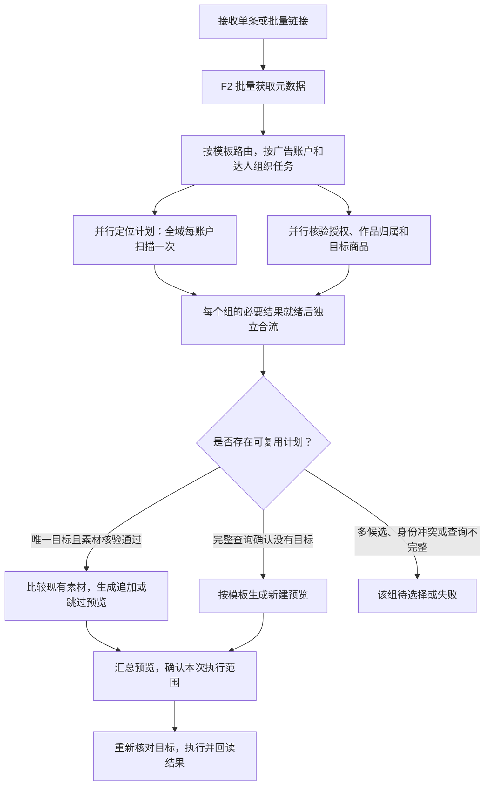

# 千川作品投放流程重构方案

> 文档属性：AI 辅助设计与实施记录；状态：主线已实施，完成本地隔离验证及仓库来源 MCP 的真实只读预检；宿主执行接入与线上写入验收待完成；核对日期：2026-11-01。
>
> 适用范围：Ocean Watch 的抖音作品解析、千川商品全域批量预检及后续新建/追加。主线按本次用户要求收敛；普通千川计划列表仅用于说明接口差异，不能据此宣称已支持普通计划执行。
>
> 权威边界：本文件保留设计目标并记录实施范围，不代表 WorkBuddy 执行工具、已安装宿主入口或线上投放写入已完成验收。真实只读测试使用显式 Git checkout 所选的当前 MCP Runtime，未更新真实宿主安装。当前行为以代码、测试及[现行流程说明](../../architecture/workflows.md)为准；正式需求见 [PRD](../../product/prd.md)。下列验证结果是本次快照，引用前须重新核对。

## 0. 实施结果与剩余范围

截至 2026-11-01，主线已采用“F2 先解析 → 模板路由及账户分组 → 账户查询与各达人官方核验并行 → 独立判断已有目标追加或无目标新建”。单条也经过 F2，路由结果在子批次复用；缓存只补身份字段。

| 范围 | 已实现的行为与证据 |
| --- | --- |
| 账户范围共享读取 | `batchReadSession` 共享命令级容量，同账户同授权使用一次不可变租约及相同查询事实；`workflow_test.go` 验证模板间复用和跨授权隔离 |
| 达人独立预检 | `preflightCreators` 按完成结果处理核验与分组；隔离测试验证慢 UID 不阻止其他就绪 UID 查询素材 |
| HTTP 真正重叠 | 每账户两个固定读取槽位、旧协议共享锁及短准入锁；`qianchuan_parallel_test.go` 和跨进程测试验证重叠、第三请求等待、写入互斥和进程退出后释放 |
| 目标选择及提交 | 新快照 v3 显式保存策略；唯一未绑定目标进入追加预览，确认追加或已存在后重新核对并写绑定；旧 v2 保留 bound_only；多候选、身份不完整和跨组争用阻断 |
| 正式说明 | [PRD 9](../../product/prd.md#9-千川批量预检技术实现)、[作品路由合同](../../reference/qianchuan-work-routing.md)、[详细流程图](../../architecture/workflows.md)和千川 Skill 参考同步维护 |

当前全域候选详情仍在完整账户列表就绪后按组派发；设计中的边读分页边提前核验详情，以及严格公平排队尚未单独实现或验收。必要身份详情按每段最多 200 个推进，沿用清单最多 100 页、10000 条计划的边界；失败或身份不完整不能作不存在证明。准入等待和网络读取分别计时，MCP 全局及分组失败保留安全的阶段诊断。尚未提供 p50/p95 前后耗时对比，也未验证线上配额或真实投放结果。

阶段 D 的执行 MCP、统一 V3 Operation/可信审批及真实宿主验收仍待完成；CLI 合成提交通过不能代表 WorkBuddy 已具备执行工具。

## 1. 主线与接口前提

目标主线：**收到单条或批量链接 → F2 获取元数据 → 根据模板按广告账户分组 → 并行定位各抖音号的计划 → 有可复用计划则追加，没有则新建。**

计划查询与官方作品校验同时启动；每个组只等待自己的必要结果，其他组的慢查询不阻止它继续生成预览。单条输入就是只有一行的批量输入。

必须先区分两个接口。仓库锁定的官方 Go SDK 为 `github.com/oceanengine/ad_open_sdk_go v1.1.92`，本次核对其请求构造器与过滤模型，得到以下事实：

| 接口 | 锁定 SDK 的查询能力 | 本方案如何处理 |
| --- | --- | --- |
| `/open_api/v1.0/qianchuan/ad/get/`，普通千川计划列表 | `filtering.aweme_id` 为数值字段 | 若投放类型和官方接口覆盖范围确认适用，按账户、UID 去重后并行查询 |
| `/open_api/v1.0/qianchuan/uni_promotion/list/`，全域推广列表 | 请求构造器和过滤模型均没有 UID 筛选字段；当前代码使用此接口 | 每个账户及授权范围扫描一次，共享候选索引，按达人并行核验详情和处理组 |

**已采用第二条，保持当前商品全域投放类型。** 第一条是否完整覆盖商品全域计划尚未核实，不能用它替换全域查询后，把空结果解释为“没有全域计划”。最新官方接口是否新增 UID 过滤也未核实，不能向现有 SDK 偷加参数后假设服务端会过滤。

F2 的 `author.uid` 映射为数值达人 UID / 官方 `aweme_id`；`author.unique_id` 是可见抖音号，映射为 `aweme_show_id`；作品 ID 则是 `aweme_item_id`。三个字段不能混用，昵称不能作为唯一身份。ID 在领域和快照中继续用十进制字符串保存，适配 SDK 时再安全转换。

## 2. 简化后的业务流程图



图中“并行”包括不同账户的读取，以及同一账户内允许重叠的 HTTP 读取。受限接口中的分页发现仍保留必要依赖：先拿到页数，才能派发后续页。创建决策必须等本组的完整查询，不能抢在未完成的查询前执行。

## 3. 每一步做什么、用什么方法

| 步骤 | 方法 | 产物及完成条件 |
| --- | --- | --- |
| 接收与整理输入 | 共用 `items[]`，解析分享文本和短链，提取作品 ID；元数据按作品 ID 去重，业务行保留各自账户、模板和商品选择 | 保留输入顺序及行号；无效行单独报告 |
| F2 元数据 | 复用 `Resolver.ResolveLinks` 与 `F2Resolver.ResolveMany`，每批一次批量解析，受控并发，复用同批结果 | UID、可见抖音号、昵称、商品提示；失败行不进入投放组 |
| 模板路由与账户分组 | 读取启用模板，按用户明确的模板、账户、商品选择做确定匹配；缺省信息使用 F2 商品提示寻找唯一模板 | 按广告账户组织；同账户内保留各模板与达人业务组，多匹配或无匹配进入待选择 |
| 并行定位计划 | 每个授权范围取一次不可变凭据租约，启动共享计划查询；按接口能力选择 UID 查询或账户扫描索引 | 每个 UID 的候选及查询覆盖状态，不能仅返回一个没有完整性信息的空数组 |
| 并行作品校验 | 按授权范围和 UID 去重授权查询；作品归属按 UID、作品 ID 批次校验；商品匹配按已确定目标商品分桶 | 官方确认的可投作品集合；F2 结果本身不构成投放授权 |
| 生成动作 | 纯决策函数消费已取得的事实，核对目标详情和现有素材差集 | 新建、追加、已存在跳过、待选择或失败；各组独立完成 |
| 确认与执行 | 汇总本次具体账户、目标计划和作品；在已有授权范围内一次确认执行。提交时按账户取得写锁并核对目标及素材差集 | 新建/追加后回读；未知结果先对账，避免重复派发 |

模板与本地配置可在 F2 运行时预读，但在 F2 结果路由完成后才决定最终账户任务。某账户的租约就绪后立即启动其读取，不等待其他账户就绪。没有可路由作品的账户不启动扫描。

## 4. 分组与查询去重

广告账户是业务分组的外层，最终计划组仍沿用现有规范化身份：

```text
identity = {
  advertiser_id, template_id, creator_id,
  product_ids: sorted_unique(product_ids), plan_type, business
}
group_id = "qcg_" + hex(sha256(canonical_json(identity)))
binding_key = (business_date, group_id)
```

直接复用当前领域规范化方法及空值语义，业务日不加入 `group_id`。商品集合相同才能视为同一目标；同一 UID 在不同账户、不同商品或不同业务组中可以有不同动作。

每次批量请求建立一个查询会话，共享只读事实和进行中的查询，不再递归为每个模板执行完整 `BatchWorks`。

| 查询 | 去重范围 |
| --- | --- |
| F2 元数据 | 本批次的作品 ID；同一作品在不同业务行中的选择仍分别保留 |
| 账户全域列表 | 渠道、账户、已解析授权、不可变租约、时间窗口、状态、目标及场景 |
| 支持 UID 过滤的计划列表 | 上述范围再加 UID |
| 达人授权 | 上述授权范围、UID、可见抖音号、授权用途 |
| 计划详情和素材 | 授权范围、计划 ID、查询参数和事实代次 |
| 商品匹配 | 授权范围、UID、商品 ID、规范化作品集合 |

例如一个 UID 的十条作品、两个模板，共享该 UID 的计划事实；不是发二十次计划列表请求。同一 UID 出现在两个账户中则分别查询。同账户使用不同授权租约，也不能复用官方验证结果。

租约标识不能由 Token 值生成并暴露。当前 `CredentialLease` 只有授权 ID 和 Token，没有凭据 revision；第一阶段将缓存限定在本次不可变租约实例中，不依赖未完成的全局凭据版本迁移，也不跨操作缓存“已授权”或“没有计划”。

## 5. 并行调度的实际实现

### 5.1 按完成结果推进

使用共用的有界读取池，保留现有任务并发默认 8、范围 1–10。账户任务公平调度，避免一个大账户占满所有任务位置。池中的任务将结果发送给协调器，协调器处理完成事件，不按输入顺序依次等待。

```text
F2 完成并路由
  for each account scope:
    scope ready -> start plan lookup and work verification

on plan/detail/verification completion:
  update only the affected groups
  if a group's required facts are ready:
    compute CREATE / APPEND / NOOP / PENDING / FAILED
    record the group result and continue other work
```

普通接口适用时，每个不同 UID 的查询直接并行派发；分页结果只属于该 UID。全域接口则每个账户启动一份列表扫描，后续分页并行，候选详情按计划 ID 去重并行。候选一出现即可开始必要的详情核验，不必等其他账户扫描完成。

全域列表在当前映射中只有可见抖音号；详情才映射数值 UID。因此索引分两步：先按列表中的精确抖音号/已知别名收集候选，再用详情的 UID 建立可信索引。不能把列表的 `anchor_id` 字符串直接当数值 UID。

别名缺失、变更或身份覆盖不确定时，受限补查相关详情；仍无法证明目标 UID 已被完整覆盖，返回“计划身份未核实”。即使分页成功，也不能把未核实的索引空结果当作不存在。

唯一未绑定目标需要完整的候选覆盖才能成立；已有精确绑定且详情可证明仍属于该组时，可按明确绑定推进，不等待无关候选。新建必须取得本组的完整不存在证明。某组读取失败只影响依赖它的组；共享授权失效影响该授权范围，不取消其他账户。

### 5.2 拆开限流锁与在途并发许可

重构前，`QianchuanRequestController.Acquire` 取得账户排他文件锁后，在锁内等待间隔，并一直持锁到 `sharedControlledBody.Close`。因此应用层虽有 goroutine，同账户的真实请求仍串行。本次读取改为 `AcquireRead`，排他 `Acquire` 继续用于写请求。

目标控制器拆成三个职责：

1. **在途许可**：跨进程限制同账户同时进行的读取，许可保留至响应体关闭或错误收尾。可用现有 OS 文件锁实现固定槽位，进程退出时由 OS 释放，避免新增一套长期任务存储。
2. **短期限流状态锁**：只原子检查/更新下一次准入时间及共享冷却时间；在等待和网络 I/O 前释放。将来一次派发前重新检查冷却，不能凭过时的预约跳过新的限流反馈。
3. **写锁**：保留账户业务写锁，防止同账户同时新建或修改目标。预检不获取业务写锁；HTTP 读取许可与写锁是不同职责。

先沿用现有 250ms 最小派发间隔、`429/40100` 共享冷却及取消合同，同时允许读取请求在网络阶段重叠。失败、取消、响应解析失败、重复关闭都必须恰好释放一次许可；限流反馈在短锁内更新，等待时不独占状态锁。

任务并发 8 不代表允许 8 个同账户请求在途，更不代表官方 QPS。每账户在途上限需依据官方配额、应用/账户/端点限流范围和隔离验证确定；合成并发验收可使用上限 2 证明 HTTP 重叠，不能把该测试值直接宣布为生产配额。

共享控制协议需同时覆盖共用状态目录的多个宿主进程。现有状态解码拒绝未知字段，旧进程也没有读取许可槽位；若修改状态格式，必须版本化并验证共存，不能在同一文件上增加字段后假设旧版兼容。本次保持原状态 JSON，读取持有旧锁的共享模式，旧版及写请求持有排他模式；隔离测试验证其互斥关系。

### 5.3 工具返回与内部并行

当前 MCP 预检最终返回批量汇总。第一阶段保持这一合同，但内部按完成事件处理各组，消除账户/模板的串行调度和无关组等待。

“立刻返回任务 ID，后台继续跑”属于另一项接口合同，需要接入现有 V3 Operation 的生命周期及状态读取；不能把启动 goroutine 当成可恢复后台任务。本次不新建第二套任务、审批或 Journal 框架。

## 6. “有计划”与“没有计划”的明确规则

以下条件共同定义可复用目标：账户相同、官方详情 UID 相同、完整商品集合相同、投放目标及场景适用、状态可追加；已有绑定还需身份与业务日相符。不同商品的计划不属于当前目标。

模板 ID、`plan_type`、`business` 通常不能直接从官方计划详情证明。已有绑定用于证明本地业务归属；无绑定时，唯一兼容候选的精确计划 ID 必须进入本次预览。多个组争用同一计划或存在业务归属冲突时，进入待选择，不能仅凭同 UID 合并。

| 读取事实 | 决策 |
| --- | --- |
| 已有绑定，目标详情和身份一致 | 使用绑定目标，比较现有素材 |
| 没有绑定，完整查询找到唯一兼容目标 | 直接生成该计划的追加预览；执行确认后核对并记录绑定 |
| 没有绑定，完整查询确认零个兼容目标，且作品核验通过 | 按模板生成新建预览 |
| 已有绑定漂移，或多个兼容目标 | 待选择/阻断，不自动换目标 |
| 计划查询失败、分页缺失或 UID 覆盖不完整 | 失败/未核实，不能新建 |
| 官方作品校验失败 | 报告该作品原因，不进入可执行素材集合 |
| 所有目标素材已经在计划中 | 跳过重复素材，不再调用追加接口 |

这项“唯一已有目标直接进入追加预览”改变了设计前 PRD 中“未绑定的历史候选不自动追加”的旧规则，现已同步到 [PRD 9.1](../../product/prd.md#91-领域身份) 与正式合同。它减少手工绑定步骤；预检只保存具体目标，不写业务绑定，不自动执行广告写入。

当前全域扫描按上海业务日设置统计时间窗口，这不是“仅查询今天创建的计划”。第一阶段沿用现有窗口并记录实际覆盖，不额外加入创建日期过滤；是否扩展查询范围或跨日复用须另行明确，不能在性能重构中静默更改。

## 7. 保留的核验与可以减少的查询

先保留官方达人授权、作品归属、商品匹配三个检查，把它们封装成一个“可投作品集合”步骤，与计划查询并行，而不暴露为多轮用户操作。

可以先落实两项减少查询的改动：

- 同一授权范围内，精确抖音号恢复 UID 时取得的官方授权结果满足完整性、身份和用途要求后，直接供本次授权核验使用，避免同批重复查询。
- 已明确目标商品的作品只核验该商品；尚未明确商品的作品仍核验模板候选集合，保留多商品发现和待选择能力。多个模板共享同一官方查询事实。

结构示例：一个达人、20 条作品、每条明确商品 A、模板包含 10 个商品。作品检查可从“授权 1 + 归属 1 + 商品 10”减少为“授权 1 + 归属 1 + 商品 1”。这是无分页、重试及 UID 恢复时的逻辑请求数对比，不是实测耗时，也不包含计划和素材查询。

合并作品归属与商品匹配是否能保持官方 AND 语义及完整性保证，尚未核实；不把它作为第一阶段删除归属检查的依据。

## 8. 快照、提交与 WorkBuddy

读取调度沿用模板摘要及稳定组身份，新选择策略使用预检 v3 保存格式，显式记录 selection_policy；旧 v2 保留 bound_only，v1 只读。预检仍最多有效 30 分钟且不跨上海业务日。提交使用精确预检 ID、目标计划 ID 和素材差集；模板、授权范围、目标或差集变化时返回变化原因，重新预检。

共享读取不等于合并快照：v2/v3 均为单账户、单模板范围，当前继续分别保存这些预检并汇总展示，不能将跨账户结果直接塞进一个旧快照。统一批量执行入口须明确其选中的快照与批准范围；若需要一个可恢复的总任务 ID，复用 V3 Operation 接入，不另建重复状态。

新绑定策略改变执行语义，不能只改一个候选状态码。需同步更新预检准备、`SubmitEligible` 判定、读取验证、执行前目标比较及本地绑定写入，并记录决策策略版本。新版读取旧 v2 时保留旧语义；新策略快照不得被旧执行器误当成旧 v2 提交，使用显式不兼容门禁或格式升级。

确认后的新建/追加保持现有账户写锁、派发记录和未知结果对账。提交阶段不重跑 F2；复用有效的官方作品事实，刷新必要的目标和素材状态。同账户的计划发现事实可共享，写入后必须更新或废弃受影响素材缓存。

当前注册表只将 `preflight_qianchuan_works` 暴露为 MCP；创建和批量追加属于 CLI 能力。**现有 WorkBuddy MCP 不能被描述为已经可执行最后一步。** 后续若要在 WorkBuddy 完成端到端流程，需新增精确预检 ID 的执行 MCP 入口、接入可验证确认和持久化派发，并验收实际宿主工具发现。V3 Operation/审批基础尚未全部接入生产入口，不以 Shell 回退替代该阶段。

## 9. 实施顺序与验收

| 阶段 | 修改范围 | 完成证据 |
| --- | --- | --- |
| A：统一读取流程 | `commands.go`、`routing.go`、`read_pool.go`；F2 一次、路由一次、按账户共享查询会话 | 单条和批量共用路径；同账户不同模板不重复扫描；跨授权不复用事实 |
| B：真正并行读取 | `reconcile.go`、官方读取适配器、`qianchuan_request_control.go`、HTTP Transport | 隔离端点证明同账户读取真实重叠；保持共享间隔、冷却、取消及跨进程容量约束 |
| C：目标决策简化 | `batch.go`、绑定、预检准备及验证；同步正式需求与合同 | 唯一未绑定目标进入追加预览；漂移、多候选、错误和不完整查询不能触发新建；旧快照语义明确 |
| D：宿主执行接入 | 复用 V3 Operation/确认/派发基础，新增执行 MCP 路由及宿主验收 | 精确预检提交可审查、可恢复且防重复；不能把 CLI 测试等同于 WorkBuddy 已验收 |

必须覆盖的合成验收包括：

- 同 UID 多作品/多模板、跨账户同 UID、同账户不同授权；确认逻辑查询去重和事实隔离。
- 慢 UID/慢账户、部分作品失败、单组详情失败；其他就绪组继续处理，不因输入顺序阻塞。
- 列表分页缺失、重复计划 ID、总数变化、别名缺失/变更；空结果没有完整覆盖证明时禁止新建。
- 唯一已有目标、多目标、错商品、错场景、删除目标、绑定漂移、多个组争用一个计划及素材已存在。
- 同账户 HTTP 重叠、全局/账户任务上限、跨进程许可、`429/40100` 冷却、取消、响应关闭与进程退出；旧新控制协议共存门禁。
- 预检到期、跨日、模板/目标/素材变化、旧 v2 读取及新策略旧执行器拒绝、写入未知结果对账。

记录 F2、路由、授权、作品、列表、详情、素材的逻辑查询数与 HTTP 尝试数，并分别测量排队、锁等待、网络及总耗时。用相同合成场景比较 p50/p95；本方案不预先宣称改善百分比或秒数。

## 10. 本次事实依据

以下为 2026-11-01 的源码与隔离验证记录；同日另外完成仓库来源 MCP 的单作品真实只读预检，覆盖 F2、官方作品和商品核验、超过 200 个必要详情的完整计划匹配及 v3 可提交快照。结果没有跳过、查询失败或分组失败；未派发线上写入，也不作为已安装宿主或线上发布版本的验收。

| 事实 | 可复核来源 |
| --- | --- |
| F2 批量调用及 UID/可见抖音号映射 | [F2 适配器](../../../runtime/ocean-watch-go/internal/adapters/workmetadata/f2.go)、[链接解析用例](../../../runtime/ocean-watch-go/internal/application/workmetadata/resolve.go) |
| 模板子批次并行执行，共享账户范围的读取会话 | [路由](../../../runtime/ocean-watch-go/internal/application/plans/qianchuan/routing.go)、[读取会话](../../../runtime/ocean-watch-go/internal/application/plans/qianchuan/read_session.go) |
| 现有全域请求、列表别名与详情 UID 映射 | [千川读取适配器](../../../runtime/ocean-watch-go/internal/adapters/oceanengine/qianchuan_read.go)、[扫描和匹配](../../../runtime/ocean-watch-go/internal/application/plans/qianchuan/reconcile.go) |
| 读取许可和旧协议共享锁保持至响应体关闭，准入状态锁短期持有 | [读取控制器](../../../runtime/ocean-watch-go/internal/adapters/filesystem/qianchuan_read_control.go)、[写请求控制器](../../../runtime/ocean-watch-go/internal/adapters/filesystem/qianchuan_request_control.go)、[HTTP Transport](../../../runtime/ocean-watch-go/internal/adapters/oceanengine/client.go) |
| 官方三项检查与读取池 | [作品核验](../../../runtime/ocean-watch-go/internal/application/plans/qianchuan/verify.go)、[读取池](../../../runtime/ocean-watch-go/internal/application/plans/qianchuan/read_pool.go) |
| 组身份、绑定、预检及提交状态 | [领域模型](../../../runtime/ocean-watch-go/internal/domain/qianchuan/batch.go)、[绑定](../../../runtime/ocean-watch-go/internal/application/plans/qianchuan/bindings.go)、[预检 v2](../../../runtime/ocean-watch-go/internal/application/plans/qianchuan/preflight_v2.go)、[批量执行](../../../runtime/ocean-watch-go/internal/application/plans/qianchuan/batch.go) |
| MCP 预检与 CLI 执行边界 | [能力注册表](../../../runtime/ocean-watch-go/internal/contracts/capabilities.go) |
| SDK 锁定版本 | [go.mod](../../../runtime/ocean-watch-go/go.mod)；SDK `api/api_qianchuan_ad_get_v10.go`、`api/api_qianchuan_uni_promotion_list_v10.go` 及各自 `models/*filtering.go` |

本次已完成上述主线代码、正式说明、本地隔离验证和仓库来源 MCP 的真实只读预检；单次通过不代表 p50/p95 或线上配额已验证，已安装宿主执行与线上投放写入仍未验收。当前记录不授权提交、推送、正式发布或更新真实宿主安装。
