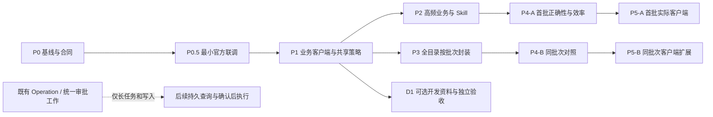

# 千川官方 MCP 与 Skill 接入实施计划

文档属性：AI 实施计划。日期：2026-11-01，续验：2026-11-02。版本：实施修订版 1.2。状态：正式 Core/Adapter、任务与 Skill、本地合同矩阵及 D1 已实现；当前 Codex 的余额/配额与三类资料样本验收通过，三项分页限制及其余真实组合仍单独记录。

关联：[设计方案](../designs/qianchuan-official-mcp-skill-integration-2026-11-01.md)；[156 项公开目录及证据](../research/qianchuan-official-mcp-catalog-2026-11-01.md)。

权威边界：本文规定任务、依赖和验收门禁，不证明某个工具、宿主或授权已可用。本地实现已获授权；真实业务联调、Host 安装、提交/推送和发布分别按任务中的明确授权执行。环境、版本、完成度和测试结果在每次引用前重新核对。

## 当前实施快照（2026-11-02）

这是当前代码和当次验证的过程快照，不是线上发布或全部角色可用性声明。持续维护的合同见[正式查询合同](../../reference/qianchuan-official-mcp.md)，最新执行证据见[实施验收记录](../reviews/qianchuan-official-mcp-implementation-2026-11-01.md)。下文保留阶段任务和原始门禁；状态以本表及验收记录为准。

| 阶段 | 已实现或验证 | 权威边界与剩余项 |
| --- | --- | --- |
| P0 / P0.5 | 原始 156 项目录、155 个实际输入 Schema、156 项公开 GET/响应字段；既有授权单账户余额、配额与两页商品全域计划完成 SDK 对照 | 真实样本只覆盖当次精确范围；历史首批草案不是当前执行合同 |
| P1 | 固定端点客户端、会话池、Schema 兼容分类、Token 修订回收、SDK/MCP 共享预算/冷却；固定模式、工具集、主体/授权策略与安全 DTO | 不包含完整 V3 Operation、Broker 或核心 SDK 迁移 |
| P2 | 九个正式查询/任务入口、Skill 高频与窄目录路由；三个报表入口复用 SDK；默认 35 个 MCP 工具 | 新增工具须在实际客户端重新发现；缺工具不回退等价 CLI |
| P3 | 156/156 项受控首批查询映射，11 分组；Core 与 JSON/SSE 传输矩阵、参数/作用域/投影/失败合同通过 | 153 项 `contract_verified`，3 项 `contract_limited`；按 A_Q1，原完整分页门禁不关闭 |
| P4-A / P4-B | 全量本地合同矩阵与关键 SDK 预检/报表回归通过；少量真实读取核对类型、单位、分页与 SDK 身份 | 日预算 50000 原因未核实；其余角色/场景未真实验收，不宣称普遍提速或 p50/p95 |
| P5-A / P5-B | 当前 Codex 新聊天发现全部九项业务及三项资料工具；修复 Runtime 拒绝跨合同污染后，余额/配额两项真实 GET 和三项资料读取通过；安装包 39 个文件及 D1/历史拒绝进程回归通过 | 当前证据只关闭约定单账户样本；其余 S_R1 场景、角色、客户端组合和 P5-B 全目录真实验收仍未覆盖 |
| D1 | 三项固定资料查询、独立系统存储、既有授权 App 引用/变更失效、Go/Java 映射、隔离 SSE/取消/脱敏；当前 Codex 实际搜索、精确 Schema、Go 示例各一次通过 | 临时启用后已恢复原工具集配置；默认关闭，Java 仍仅有隔离协议证据 |

当前正式入口：[批准合同](../../../runtime/ocean-watch-go/internal/contracts/official_approved.go)、[Core 查询](../../../runtime/ocean-watch-go/internal/application/official/service.go)、[任务编排](../../../runtime/ocean-watch-go/internal/application/official/tasks.go)、[共享策略](../../../runtime/ocean-watch-go/internal/application/policy/policy.go)、[Host 注册](../../../runtime/ocean-watch-go/internal/mcpserver/official.go)。[P0.5 PoC](../research/qianchuan-official-mcp-poc-2026-11-01.md)和 `S_R1-draft` 仅保留历史设计/最小证据，不决定正式运行路由。

### 范围决定 A_Q1：有界查询与完整分页分开

公开文档、锁定 SDK 与再次取得的开发资料 Schema，仍未提供以下可核实结束规则：boost 版本列表、订阅账户列表，以及全域商品 `NEW_PRODUCT/BREAKTHROUGH_PRODUCT` tab。实现决定是保留原 query_id 和安全首批查询，返回明确 `contract_limited`、不完整原因且不伪造续页。该决定保证 156 项均可在合同范围内读取，不缩减目录；但不能替代原 156/156 完整分页门禁，三项外部证据仍未齐全。

后续取得可靠结束规则时，必须补充来源、场景 fixture 和游标合同，再移除限制。当前可用商品 `NEW_PRODUCT_BOOST` 已有明确 `has_more`，按 cursor 模型实现，不纳入上述未核实项。

### 实施决定 A_D1：使用既有受控 CLI 配置入口

D1 的非秘密元数据采用 `developer-docs configure/status`，Skill 在明确维护请求中可调用同一 CLI；不新增常驻服务或普通业务设置页。它支持精确授权 App 引用及独立 App，先验证三个 Schema，再保存系统凭据库并回读。该入口满足独立存储和 App 变化失效要求；启用工具集仍是用户启动配置，不能由文档工具参数打开。

## 1. 范围与实施顺序

目标为一套千川 Skill 统一调度现有用例与完整官方业务查询目录，另提供可选开发资料。先完成最小官方验证和共享策略，再让高频任务独立完成正确性、效率与实际客户端验收；完整目录按组继续扩展，不将 156 项完成或开发资料作为首版前提。

依赖：

首批链：P0 → P0.5 → P1 → P2 → P4-A → P5-A。分组扩展链：P1 → P3（批次）→ P4-B（同批次）→ P5-B（同批次），允许逐批循环；关闭原完整 P3 仍须完成 156/156 完整分页合同；当前有界读取范围决定见 A_Q1。D1 复用共享策略但不返回业务主线成为其退出条件。

P0.5 是版本接入的工程验证，不要求业务用户另配官方 MCP，也不证明所有授权可用。无真实授权时可做离线合同/客户端开发，但不能关闭 P0.5、启用未获准后端或完成 P5-A。首批有界查询不依赖整套 Operation/写入审批；长任务和在线变更继续使用既有 PRD 门禁。

## 2. P0：冻结基线与定义合同

任务：

1. 重新核对源码能力目录、现有 MCP/CLI 和 Skill 快路由，保留工作树已有改动。
2. 将公开 156 项登记为 machine-readable 候选目录，保留工具名、原路径、原关联文档和来源日期。此时状态为 published_only，不启用执行。
3. 优先补齐 P0.5 和首批高频所需的正确 Schema/业务 GET/主体/场景/分页/单位资料；其余条目保持 published_only，在 P3 逐组补齐。缺证据明确阻断，不要求先取得全部 156 项 Schema 才开始连接验证。
4. 确认 uni_promotion_list 的真实列表 Schema，保留目录描述/链接不一致证据；记录 overall 的 all_promotion 工具未出现在本份清单，继续使用 SDK。
5. 校正 Skill 中“warm hint 可跳过 F2”旧描述，同步正式流程；本批 F2 与官方复核仍保留。
6. 定义业务固定任务和目录/查询 DTO，并将 query_id 绑定 capability_id、required_toolsets、minimum_mode、channel/Effect、scope_resolver、全部主体字段与角色/场景条件；复用现有能力 ID，新增任务不得复制同一用例。开发资料仅记录 D1 草案，不进入业务首版门禁。
7. 明确 Core 从固定启动配置读取模式、工具集和账户限制。当前 Registry 只有路由/副作用等元数据，需在 P1 补齐共享策略实现；不能将工具可见性或 OAuth 授权范围当作本地许可。
8. 定义 source_digest、contract_fingerprint、批准映射版本及 Schema 兼容分类；业务关键语义变化与不确定变化阻断，兼容变化不自动增加可用参数/列。

修改区域：contracts、目录 DTO/验证器、现有 Skill 的事实差异、设计与公开资料记录。主 Skill 不先加入尚未注册的新工具路由。

门禁：

- 目录无重复、无漏项；11 分组数和总数 156 一致。
- 已有 SDK 能力、候选官方 MCP、已注册 Host 工具和真实可用状态分开统计。
- 业务 GET 方法不能用名字末尾 get 或 MCP readOnlyHint 代替证明。
- scope 对账户、代理、店铺、组织、User/授权和公共目录有明确区别。
- 首批候选的能力/工具集/最低模式与主体检查可追溯；关闭 reports 时总查询入口不能放行业务报表。
- 首批清单 S_R1 记录目标任务与必要 query_id、验证状态、场景和合同版本；缺失项不能借目录登记宣称已实现。
- 当前预检和报表行为没有被未实现设计覆盖。

## 3. P0.5：最小官方联调

任务：

1. 以最小业务原型连接固定官方 Streamable HTTP 端点，复用现有 TokenManager/TokenLease 和受控读取预算。使用已核对 GET/输入的 2～3 个查询，不等待完整目录或 D1。
2. 在已授权的精确账户/对象内覆盖简单读取、真实分页和长 ID/金额返回；有既有 SDK 读取时对照同对象/日期/口径。不扫描全部授权账户，不做业务写入。
3. 检查当前 Token 是否适用、initialize、tools/list 及 Tool-Range 的实际筛选行为、工具 Schema 与正确 API 资料；无法核实的 profile/长度/分页限制不得标为已支持。
4. 验证实际文本/结构化结果与数字解码。若客户端已浮点化 structuredContent，必须验证可保留原始数字的路径；不可恢复时阻断，不靠转字符串修补身份。
5. 记录冷/热连接、协议控制/业务调用数、分页完整性、阶段耗时和自然出现的业务错误。越权、过期、限流等负例用隔离 fixture，避免人为扰动真实账户。

门禁：

- 最小范围真实连接与查询通过，并能区分协议成功、业务成功和未完成分页；业务写请求为零。
- 关键参数、作用域、单位/精度与对应字段有证据；不能据工具名称猜参数。
- 仅保存脱敏字段/类型、计量、比较结果和范围，不保存 Token、headers 或生产原始响应。
- 失败时保留原因，官方后端不进入已验收范围；既有 SDK 预检/报表继续工作。
- 更新 S_R1 的准备状态；小样本不代表全部工具、角色或性能分位数。

## 4. P1：业务客户端、目录与共享策略

任务：

1. 依据 P0.5 在 Adapter 实现正式业务 Streamable HTTP 客户端，复用当前锁定 Go MCP SDK，固定验证后的消息/数字解码路径。开发 SSE 移至独立 D1。
2. 增加固定 origin/path 的受控连接 profile；测试环境可注入 transport，业务工具不能传入 server URL、代理、任意 headers、凭据或 HTTP 方法。
3. 业务 Token 通过既有 TokenManager/TokenLease 取得，按请求头注入；会话与 Token revision/授权/工具 profile 关联，刷新后正确退役旧会话。
4. 按用例选择 Tool-Range，处理 initialize、tools/list 分页、tool 不存在、会话重连、Schema 差异和远端 isError。
5. 在业务 tools/call 边界复用语义只读槽位与共享冷却，避免 MCP POST 被当前 SDK 的 MethodGet 判断当成写锁。
6. 实现共享 Core 策略：每次调用按 query_id 检查能力/工具集、实际模式、渠道/授权、配置允许账户、角色/场景及全部嵌套主体；拒绝项先于 Token 刷新和业务派发。组合任务逐子项复核，不能只检查总工具的 official_read。
7. 实现 get_qianchuan_official_capabilities 和 query_qianchuan_official：本地目录/策略受限原因，单项参数发现，验证主体、参数、分页、输出与兼容性。仅启用合同和对应主体控制已实现的条目。
8. 实现设计 8.4 的兼容分类与冻结映射，未知/不兼容变化阻断；兼容新增字段不扩大 Host 契约。
9. 新工具加入统一 Registry、MCP Schema、Runtime 代理契约和注册测试，复用同一 Application 策略；实现完成后才进入 Skill 路由。

测试方式：

- 用隔离本地 MCP 服务走真实协议往返，覆盖 initialize、tools/list、tools/call、结构化/文本结果和 Streamable SSE 分段；生产异常/越权用合成 fixture。
- 业务 fixture 使用合成 ID、金额、角色与响应，不把真实账户或原始生产响应保存到仓库。
- 统计实际客户端的控制请求与业务调用；不把这些计数冒称上游 API 次数。
- 正式客户端完成后复验 P0.5 最小范围，验证从原型到正式装配的差异；原型通过不代替正式客户端证据。

门禁：

- 凭据及 raw headers/带凭据 URL 不进入模型参数、结果、日志、SQLite 或业务 fixture。
- scope 不匹配、未知 query_id、未知参数、非 GET 业务能力或未验证 Schema 在派发前阻断。
- 未启用工具集、未知/不足模式、本地账户越界和组合子项越界均在 Core 拒绝；可用 CLI/进程内/MCP 对同 fixture 结果一致，隐藏工具不能绕过。
- MCP 传输 POST 保持业务只读；与 SDK 同账户读控制、父截止时间、取消和冷却一致。
- 连接生命周期、Token 刷新与 Schema 变化不会跨授权复用数据，也不会改变 Host tools/list。
- 首批目录/查询合同的隔离矩阵及至少一个正式客户端真实读复验通过；三个资料用例不在本门禁内。
- 兼容元数据/新增非关键输出保留旧输入白名单与输出 DTO；类型、单位、主体或分页改变及语义不确定时只阻断受影响项。
- 上游连接按需建立；本地目录/doctor 不触发业务网络或 Token 刷新，官方 MCP 失败不影响既有 SDK/F2 用例。

## 5. P2：高频任务与对话路由

依赖 P1，按 S_R1 冻结进入首批验收的任务、必要 query_id、参数/输出映射、场景、主体类型与版本。首批目标包括下列高频任务和报表入口；无法实施的任务/子项明确列入未完成范围，不能用部分指标成功宣称全部功能完成。

任务：

1. 账户健康：按所需检查组合余额/预算/配额；单账户与明确负责账户集合均不扩张到全部授权账户。
2. 计划诊断：先取得当前计划场景，再使用适用的审核、学习期和成本保障查询。不可用信息明确呈现，不默认“正常”。
3. 素材质量：支持精确素材 ID；作品链接复用 F2/官方作品定位，明确作品 ID、素材 ID 和视频 ID 区别。缺身份时不扫描无关达人。
4. 投放建议：预算/ROI/效果建议保留官方场景、获取时间和对象范围；调用建议不触发修改。
5. 将既有 Schema、自定义报表和负责账户报表 Service 暴露为固定 MCP，用同一指标/分页/金额口径，替换 Skill 对这些已经工具化任务的 CLI 主路由。
6. 增加业务查询窄参考，继续复用自定义报表参考，更新 FastRoute 生成片段、路由 fixture 和高频意图；保持同渠道恢复/错误展示。开发资料参考只在 D1 实施后加入。
7. 保留现有作品预检及快照五列 Presentation，不把账户健康或素材标签当作创建计划充分条件。

对话验收样例均使用合成对象：

| 请求 | 验收重点 |
| --- | --- |
| 这个户还能开几条、余额够不够 | 只查指定/负责范围，缺指标不编造余额或额度 |
| 这条计划为什么不跑 | 场景识别和审核建议正确，不支持学习期查询时如实说明 |
| 这些视频是否首发/低效 | 身份映射和标签来源正确，不把标签当授权证明 |
| 给我看看官方建议 ROI | 原值、场景和时间清晰，没有自动修改 |
| 我负责的户近 7 天消耗/ROI | 本地成员范围、日期和整体/全域口径正确，逐户失败可见 |
| 按素材/商品/达人维度分析效果 | 使用正确 Schema 和自定义报表，截断不伪装完整汇总 |
| 同一内部商务标签的实况视频预检 | 商务标签不成为达人昵称/UID，分组身份规则不变 |
| 工具不存在或字段不明确 | 不改走等价 CLI，不猜参数或要求用户查缓存路径 |

门禁：

- 所需上下文已知的高频请求直接调用相应任务 MCP，不先扫描目录/仓库或检索完整手册。
- 实施后的固定工具、输入/输出 Schema、能力目录、Skill 主路由和参考一致。
- 用户只补本次真正缺失的信息；既有链接、模板和授权选择可复用。
- 业务状态、来源、单位、完整性、部分失败和真实写入状态在各客户端可见。
- 通过 P2 的首批范围直接进入 P4-A/P5-A，不等待 P3 或 D1；负责账户等长请求先使用有界同步/可继续分页，完整性不足不形成全量汇总。

## 6. P3：全目录按组逐项完成

依赖 P1，按公开快照的 11 分组推进；每个完成批次进入对应 P4-B/P5-B，无需等其他分组。每条工具都有同一 checklist：

1. 远端工具名、正确 API 文档、输入/输出依据、source_digest、contract_fingerprint 与批准映射版本。
2. 业务 HTTP GET 方法及只读 Effect，明确服务器注入的认证字段。
3. capability_id/工具集/最低模式、scope_resolver/全部主体字段、角色/场景及权限失败语义；不把相同路径前缀当作权限证明。
4. 参数类型、ID 精度、未知字段拒绝、过滤范围和边界值。
5. 分页模型、完整性/总数、游标范围绑定和请求预算。
6. 业务 DTO/字段列/金额单位/日期语义，空值和无数据表达。
7. 正常、无数据、部分失败、未知/取消、兼容/不兼容 Schema、本地策略越界等合成协议 fixture。
8. 已封装状态、当前授权可用性和真实验收范围分别记录。
9. 非广告主查询的控制键/预算、主体层级关系与缓存范围已实现，不将其硬套到 advertiser_id。

| 顺序 | 分组 | 公开条目 | 主要检查 |
| --- | --- | --- | --- |
| 1 | accounts / products | 22 | 角色关系与可投关联，非 advertiser 工具不能硬套账户作用域 |
| 2 | assets / plans | 37 | 身份、全域/乘方兼容、审核与首发/低效标签 |
| 3 | reports / live | 25 | 日期、指标、统计口径、分页和直播实时范围 |
| 4 | finance | 17 | 元/分单位、主体与账户关系；查询不能变成资金动作 |
| 5 | aweme_orders | 17 | 随心推与 PC 全域严格区分，不把订单数据当广告计划数据 |
| 6 | targeting / compliance / operations | 38 | 定向 ID 不证明授权，评论/积分/日志所需字段及权限明确 |
| 合计 | 11 分组 | 156 | 全目录逐项登记和封装验证 |

门禁：

- 156/156 条完成本地参数、作用域、分页、输出与失败合同及隔离 fixture，才称“全目录已封装”。
- 缺少 Schema/方法/场景证据的条目仍为未封装，不得仅用“有阻断原因”关闭 P3。
- 已封装条目没有对应真实角色或授权时可标“未真实验收/当前不可用”，不宣称所有账户可调用。
- 官方移除、禁用或变更导致无法完成的条目提供新官方证据和范围结论；需要调整“完整公开目录”目标时明确提交范围决定，不静默忽略。
- 批次验收仅覆盖其固定清单；分组数量和目录登记不是某个真实授权的可用性证明，也不是 P4-A/P5-A 的依赖。

## 7. P4-A / P4-B：正确性、口径与性能对照

P4-A 依赖 P2，只验收固定 S_R1；P4-B 依赖对应 P3 批次，验收该批次扩展清单。两者使用相同事实/策略标准，不要求全部 P3 完成才能进入 P4-A。

首批验收：

1. 对 S_R1 中每个声明支持的任务和必要子项核对主体、字段、日期、单位、完整性与部分失败；新增查询以正确官方资料和受限真实读取为依据，已有报表比较原 SDK Service 的同口径事实。
2. 验证任务 MCP 与已有 CLI/进程内同 fixture 的策略和事实一致；无真实样本的场景明确未验收，不能扩大声明。
3. 记录同输入/范围的路由数、上下文、initialize/list/call、SDK 请求/重试和耗时；比较冷/热状态，不以少量案例声称 p50/p95 或保证提速。
4. 回归已有 SDK 预检与报表的关键身份/口径边界。首版不替换核心预检后端，不要求先完成全部核心 SDK/MCP 迁移。

后续批次及明确核心迁移的额外验证：

1. 对拟切换的 SDK/MCP 核心读取逐项比较商品、授权达人、作品、计划、计划素材和报表，验证 UID、完整商品集合、素材身份和字段类型；未明确切换的用例继续 SDK。
2. 核心切换前使用同一 Application 流程比较 would_create、would_append、already_present 与阻断结果；远端缺字段不能生成“没有更新目标”。
3. 核心切换前检验跨日期/商务/类型/商品分组、多个候选、删除/下线素材及当日绑定，保留完整清单和详情窗口规则。
4. 固定整体/全域/乘方/随心推主题、日期、缓存和 Token 状态后比较报表值；MCP 缺失 all_promotion 时继续 SDK。
5. 记录高频路由数、目录/Schema 上下文体积、initialize/list/call、SDK 请求/重试、并发峰值和阶段耗时。
6. 将真实联调限定在当时已授权的精确账户/对象范围内。少量样本只报告单次/小样本结果；不以一个案例宣称 p50/p95。

门禁：

- 正确性和来源对照先通过，再考虑核心 Backend 切换。读取不等价或效率收益未确认时保留 SDK，不因“官方 MCP”名称强行迁移。
- 完整清单的旧 100 页/10000 计划上限、200 详情窗口及缺字段/失败段阻断得到验证。
- MCP 与 SDK 同账户实际在途不超过初始保护值 2；控制流不占广告主槽位，取消后释放不会泄漏。
- 提效结论区分减少模型调用/上下文、减少连接开销和下游 HTTP 时间，不混为同一个“速度提升”。
- 本批合同、策略与真实支持范围通过后即可进入相应 P5-A/P5-B；未实施的核心后端切换、其他分组和 D1 不阻断有界查询首批。

## 8. P5-A / P5-B：实际 Host 与分批交付

P5-A 依赖 P4-A，至少在一个已有目标 AI 客户端完成 S_R1 范围的真实任务闭环；该客户端版本/平台与业务范围有证据后才声明首批支持。其余客户端和全部 156 项仍各自记录状态。

P5-B 依赖对应 P4-B 批次，按实际通过的工具/场景/客户端组合扩展支持；不得用一次批次验证宣称所有角色或宿主兼容。

任务：

1. 在实际目标客户端核对 Skill/固定 MCP 工具发现、路径独立、未知工具、取消、长耗时、部分失败和中文长 ID 展示。
2. 新增 Host 工具需要真实重新发现；验证运行中旧契约、重载、新会话和 Runtime 回退，不宣称热代理自动新增工具。
3. 按实际客户端支持的 OS/架构分别列出版本、Runtime/Capability 版本和证据。共享核心测试不代替桌面安装/调用。
4. Harness 只使用桌面应用及内置 Runtime/desktop profile；按授权操作真实安装，不下载 npm/CLI Harness、不改兼容豁免。
5. WorkBuddy 维持既有 PRD 的 WB1 后续依赖；缺少当前版本/真实发现证据时不宣称兼容。
6. 长任务和确认后写入接到既有 Operation/宿主审批工作；该基础未就绪时只声明已验证的有界查询/预检支持，不另造后台宿主。
7. 将已实现内容同步到 Skill、配置/恢复/查询正式文档和 CHANGELOG 未发布段，重建/核对五平台 Runtime 与版本元数据。
8. 对 D1 工具集关闭/未配置/连接失败验证业务首批照常查询；对 Operation/写入审批未就绪验证有界查询仍可交付，长任务/在线执行准确受限。

门禁：

- 只对实际验收的客户端版本/平台/业务范围声明支持，明确未覆盖组合。
- Host 更新/关闭/卸载只清理其自有连接和进程，保留业务授权、账户、模板和 F2 数据。
- 本地实现、安装验收、提交、推送、Tag/Release/Marketplace 各按既有授权边界执行；本计划不自动授予后续发布权限。
- 推送和发布继续执行 AGENTS.md 的全量差异、CHANGELOG、线上 Release 和版本关系核对。
- 首批验收不等待 P3/D1 或全部宿主组合；阶段预览不等于正式发布，五平台构建也不等于五平台实际客户端验收。

## 9. D1：可选开发资料与独立验收

D1 复用 P1 共享策略，但不作为 P0.5、P2、P4-A 或 P5-A 的依赖。只用于本项目的千川/平台公共接口维护，三个资料工具仍由同一 Skill 的窄参考按明确开发意图调用。

任务：

1. 为拟新增 developer_docs 工具集同步正式 PRD、能力/启动策略与用户文档，默认关闭；不开启额外宿主服务、不将资料工具放入 core 万能入口。
2. 增加受控本地元信息设置：引用受保护 App ID 元信息或独立提供 app_id/developer_id，不以业务 OAuth/Secret 为前提。资料记录独立受保护保存，不读取业务 Secret/Token；校验格式及资料连接，引用的 App 变化后失效重核。当前配置入口已支持 developer_id 和精确授权 App 引用，不能用业务 OAuth 替代资料配置。
3. 普通项目配置只存无秘密的启用选择/引用；准备状态不输出 App/developer 值。设置不改写业务 Token、账户授权或 Host profile，不要求普通业务用户完成这一步。
4. 实现固定 S3 SSE 连接模板和受保护元信息注入；筛除日志/错误中的带元信息 URL。资料客户端不取得业务 Token，缺资料元信息不进入业务 OAuth 恢复。
5. 实现 search_oceanengine_api_docs、get_oceanengine_api_schema、get_oceanengine_sdk_example，验证实际远端 Schema 和用户明确的 SDK 风格；检索创建/更新接口不派发业务 POST。
6. 独立加入资料窄参考和 Host 注册过滤；启用配置固定于启动，模型不能通过参数打开。未启用时明确可选准备项，不影响业务路由。

门禁：

- 三类资料用例通过隔离 SSE/参数/结果/取消/脱敏测试及受控资料连接验证，支持范围与当前元信息分别记录。
- 配置、元信息存储和 App 替换流程已实现；不能只在文档提示用户填写一个不存在的配置项。
- D1 关闭、缺元信息或上游不可达时业务查询不初始化资料连接、不触发资料设置或 OAuth。
- 资料只构成接口证据，不授予账户权限、不执行示例代码或业务写入；本期不扩展为通用 SDK/Agent 开发平台。

## 10. 必须覆盖的故障矩阵

| 场景 | 预期 |
| --- | --- |
| 无业务配置 | 明确必要准备项；不自动创建业务状态或 Host 配置 |
| D1 关闭/缺元信息/资料连接失败 | 仅资料请求受限；业务首批不提示必配、不重做业务 OAuth |
| Token 刷新或过期 | 正确租约/会话 revision、原参数恢复、秘密不泄漏 |
| 另一个渠道或主体 ID 注入 | 派发前拒绝，缓存/会话不跨授权共享业务结论 |
| 关闭 reports 后用通用入口查报表 | Core 逐 query_id 拒绝，不能靠总入口或 Token 范围放行 |
| 未知/不足模式、隐藏工具直接调用 | 同一 Core 策略拒绝；模型不能改变启动模式/工具集 |
| 同 Token 下本地账户越界、嵌套/组合子项越界 | 全部主体与子查询分别检查，越界项派发前拒绝 |
| schema 声明只读但业务 POST/未知动作 | 不启用该查询；传输 POST 不影响只读定义 |
| 远端缺工具、Tool-Range 超限、tools/list 分页 | 准确目录/可用性，不截断后声称全覆盖 |
| 远端返回 isError、文本错误或 HTTP 200 错误 | 正确映射；不把外层成功当业务成功 |
| 数字 ID 大于 2^53、19 位 ID、金额小数 | 保留原始整数/十进制精度；不能把已经浮点化的值“转字符串”伪恢复 |
| SDK 解码路径先浮点化 structuredContent | 修正解码/使用可验证原始数字路径；不可恢复时 INVALID_RESPONSE |
| 输出为空、字段缺失、单位不同 | 未返回与 0 分开；金额/ROI 不凭空换算 |
| 兼容文案/排序或新增非关键输出 | 保留批准输入白名单/输出 DTO，记录变化，不自动开放新参数 |
| 输入改型/新增必需项、分页/单位/权限变化或无法判断 | SCHEMA_REVIEW_REQUIRED 仅阻断受影响项，修订证据与映射后恢复 |
| 分页重复、总数不一致、中间页失败 | 完整性明确，不能形成无目标证明或完整汇总 |
| 计划 UID 或完整商品集合缺失 | 阻断核心匹配，不能退化为名字/昵称唯一就新建 |
| F2 冷/热缓存、身份提示不一致 | 本批官方复核不跳过；商务和昵称不识别 UID |
| 同账户 SDK/MCP、多 Host 并发及 429 | 共享槽位与冷却有效，等待不消耗派发后的网络预算 |
| 无 advertiser_id 的组织/店铺/公共查询 | 使用登记的主体控制键/预算，未实现对应控制则不启用 |
| 父任务取消、MCP 重连、Runtime 退出 | 停止未派发工作，释放许可，明确中断/未完成项 |
| Host MCP 缺失或旧契约 | 报告发现问题，不静默改走等价 CLI |
| 任意异常含凭据/URL 查询参数 | 结果和日志只保留白名单错误、阶段与计量 |
| 用户询问建议或预检 | 官方业务写请求为零；建议不形成自动修改授权 |
| 旧预检过期/跨业务日/目标变化后提交 | 使用现有重验证和确认门禁，不借新查询入口绕过 |

这些测试验证行为和边界，不用只比对文案/函数调用名字的测试代替协议和业务对照。

## 11. 完成标准与记录

交付记录至少包括：

- 目录版本、156 条的封装验证计数、未封装原因、当前授权可用性及真实验收覆盖。
- P0.5 最小官方证据、首批 S_R1、P3 批次清单及各自 P4/P5 验收状态；首批完成与全目录完成分别记录。
- 每个固定 MCP 与 Skill 路由的实现/Schema/注册状态；不把设计名称列成现有工具。
- query_id 的能力/工具集/模式/主体绑定，以及 source_digest、contract_fingerprint、批准映射和兼容分类。
- 共用授权/分页/来源/金额/统计口径、错误和取消的验证结果。
- 同输入/范围下的效率测量条件和样本量。
- 实际 Host × 版本 × OS/架构支持矩阵，安装/重载和业务调用证据。
- 未完成的 Operation/宿主执行/真实角色与平台依赖。
- D1 独立工具集/元信息/资料服务验收状态；业务首版不以其完成为前提。

阶段未通过时保留精确原因。P1/P2 可做实现预览；声明真实首批可用须完成 P4-A/P5-A。P3 每批完成相应 P4-B/P5-B 后独立扩展；不能用目录已有 156 行宣布全封装，也不能用首批成功宣布多客户端/全部角色可用。

过程记录仅保留脱敏事实和结论；稳定行为同步到代码、测试、契约和正式文档。业务返回默认不产生文件，真实 Token/Cookie/授权码/账户原始数据不进入仓库。
