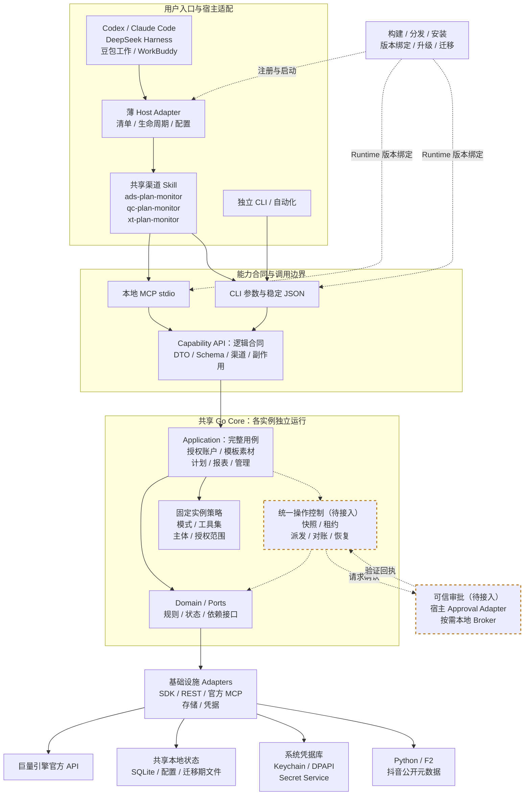

# V3 项目运行架构

本文是持续维护的项目级架构说明，覆盖宿主接入、能力合同、业务核心、操作控制、存储、进程生命周期与交付升级。当前行为以代码和运行证据为准；标为“目标”或“待接入”的部分遵循 [V3 PRD](../product/prd.md)，不能作为已完成验收的依据。

逐步调用、方法、分支和千川预检等待点见[当前项目详细流程图](workflows.md)。该文档展开当前流程，并将尚未接入的统一操作目标单独标明。

## 总览

Ocean Watch 采用本地优先的模块化单体。图中实线表示当前主要调用关系，虚线框表示尚未完成生产接入的目标模块，交付节点的虚线表示安装与版本绑定关系。业务核心只有一套 Go Application/Domain 实现，各进程复用相同代码；“共享核心”不表示所有宿主连接到同一个常驻服务。

Capability API 是逻辑业务合同，由 CLI 和 MCP 分别映射，不新增第三种网络服务。Go CLI 在自身进程内调用 Application；MCP Server 也直接调用 Application，不启动 CLI 或解析 CLI stdout。支持 CLI 的宿主可通过受控启动器调用稳定 JSON；WorkBuddy 仅使用 MCP。Python/F2 是公开作品元数据 Adapter 的外部进程依赖。

## 分层职责与依赖

| 层次 | 项目级职责 | 边界 |
| --- | --- | --- |
| 宿主适配 | 声明式清单、安装注册、Skill/Tool 挂载、配置、取消、结果映射和卸载；目标还包括可信审批桥接。 | 专属代码留在适配包，不选择业务授权、不保存 Token、不编排投放规则。 |
| 共享 Skill | 将用户目标映射到准确渠道和任务，约定调用顺序及展示要求。 | `ads-plan-monitor`、`qc-plan-monitor`、`xt-plan-monitor` 共用框架；宿主仅覆盖受控调用映射，Skill 不授予权限。 |
| 能力合同与 Transport | 静态能力声明、稳定 DTO、JSON Schema、严格解码、渠道/副作用元数据及协议结果。 | CLI 与 MCP 复用同一用例；工具按任务设计，不机械复制全部 CLI 命令。 |
| Application / Domain / Ports | 初始化诊断、授权账户、模板素材、计划、报表、记录与恢复；领域模型、业务身份和依赖接口。 | Application 编排用例，Domain 保留规则与状态；两者不依赖宿主 SDK 或生成的官方 SDK 类型。 |
| 操作控制 | 目标统一操作版本、快照、审批验证、执行租约、派发、对账和恢复。 | 工具可见性与执行权限分开检查；当前生产入口尚未全面接入。 |
| 基础设施与请求治理 | 官方 SDK/REST、SQLite/文件、凭据、浏览器回调、F2，以及跨进程锁、分页、限流与有界重试。 | Adapter 实现端口；Core 决定业务范围和是否执行，公开元数据不能证明官方授权。 |
| 交付与可观测性 | 固定来源构建、平台产物、宿主包、清单校验、版本诊断、脱敏日志、阶段计时、升级与迁移。 | 安装层管理发布文件；业务请求不承担安装升级。数据 Schema、操作格式与能力合同需分别校验。 |

营销、千川、星图是这套框架中的渠道切片，不是各自复制一套运行平台。当前星图切片覆盖授权、账户同步和本地账户/授权查询，尚未接入星图计划、素材与报表 API。

## 从安装到退出的生命周期

1. **构建与安装**：同一源码生成平台 Runtime 和宿主资源，安装层核对清单与完整性，注册对应宿主支持的入口；安装路径和用户业务数据目录分离。目标为每个进程固定不可变 Runtime，当前兼容代理行为见下文。
2. **启动与组合**：宿主创建自己拥有的 MCP 连接/子进程，或 CLI 创建本次调用；Transport 和组合根解析受保护配置、状态根及 Adapter。当前启动时固定工具集、执行模式和主体范围；完整 V3 目标还包括审批方式、操作格式及数据库兼容性。
3. **处理调用**：入口严格解码后交给共享 Application，按渠道、账户和授权定位业务；通过端口访问持久状态与外部系统，输出稳定结构化结果。需要网络的用例按需使用授权服务，不运行共享刷新守护进程。
4. **取消与退出**：目标先停止接收新工作，再有界结束本实例资源；未派发工作可以取消，已派发但结果不明的工作保留事实并在恢复时对账。终止本地调用不等于撤销官方写入。
5. **升级与恢复**：安装层显式更新，必要时先备份、迁移并核对未结操作；新实例重新校验合同、状态和执行条件。完整 V3 不因重启自动重放写入，也不因卸载单个宿主删除共享数据。

上述步骤定义完整 V3 的生命周期合同；当前已实现范围与剩余接入见“当前落地与目标差异”。

## 完整调用链路

### 查询与预检

用户目标经 Host/Skill 选择任务，MCP 或 CLI 将输入规范化为稳定请求。Application 解析准确的渠道、账户和授权，调用 Domain/Ports；Adapter 完成本地读取、官方查询或公开元数据读取，再由 Presenter 返回白名单字段、业务状态和必要展示。

查询与预检的副作用不同：必要缓存和审计可落地，预检还会写入本地快照，但不派发投放变更。`read / plan / execute` 与工具集、主体白名单由 `business_policy` 在实例启动时固定；MCP/CLI 及 Token 准备共用 Core 检查，普通请求和 Skill 不能提高模式。默认 `plan` 保留查询与预检，既有写入继续受提交门禁约束；统一 Operation 与可信审批仍为独立目标。

### 千川官方查询与开发资料

`internal/application/official` 编排受控目录、单项 GET、账户健康、计划诊断、素材标签和建议，`internal/adapters/officialmcp` 负责固定端点、Schema 兼容检查、会话池及原始数字解码。目录来源与正式执行合同分开，156 项在同一 Core 边界执行；153 项为已核实合同，3 项保留首批分页限制。业务 HTTP POST 不属于这批能力，协议 POST 与业务读取槽位分开。

既有报表字段、自定义及负责账户报表复用 SDK Application 服务；核心作品预检继续 SDK。素材检查中的作品定位仍经过本批 F2 和官方达人、归属、商品核验，只生成素材身份，不生成预检或计划变更。

`internal/application/policy` 在 Transport 可见性之外复核工具集、模式、账户及授权；父子主体关系由当前授权记录证明。官方 MCP 与 SDK 共用广告主级请求控制、预算和频控冷却，取消与 Token 修订变化回收各实例的会话资源。

`developer_docs` 默认关闭，三项工具由独立开发资料 Application/Adapter 和系统保护元数据驱动，不读取业务 Token/Secret。既有授权 App 的非秘密引用可用于配置，App 变化后资料绑定失效；资料失败不影响业务查询。具体参数、分页、单位与真实支持边界见[正式查询合同](../reference/qianchuan-official-mcp.md)。

### 初始化、授权与管理

环境检查、首次配置、授权、账户同步、模板本地管理、数据迁移与业务投放是不同用例。诊断目标是只检查必要元数据，默认不触发官方请求或修改用户状态；迁移必须走显式管理入口及备份/锁规则，不向模型提供任意数据库或 Shell 通道。

当前 CLI/MCP 通过同一授权服务处理官方 OAuth、用户/App 核验、凭据保存、账户发现和快照激活；本机浏览器交互由当前 Runtime 拥有的短期会话承载。账户同步确认和账户改绑确认只批准对应管理动作，宿主对 MCP 的连接信任也不构成投放审批。秘密由系统凭据 Adapter 持有，不进入 Skill、模型参数或普通配置。

### 投放写入、审批与恢复（完整 V3 目标）

1. 准备操作及版本，保存输入、账户范围、逐项动作和快照摘要；修改输入产生新版本，并使旧审批失效。
2. 经已验证的宿主 Approval Adapter 请求真实用户确认；无可验证宿主通道时，由按需本地 Broker 交互。回执绑定操作、版本、摘要、范围、有效期和一次性 nonce，Core 通过受保护信任根验证。
3. 在事务内消费有效审批并取得执行租约；执行前再次检查启用能力、模式、渠道/账户与全部子项。审批引用和租约都不能替代官方授权。
4. 在账户级 OS 写锁保护下记录派发意图，执行有界官方请求，再记录结果；数据库事务不跨网络调用或审批等待。租约约束本地执行权，不假设官方 API 支持相同的幂等协议。
5. 明确成功项不重复派发，部分成功按项保存；超时或断开产生的未知项先官方读回对账，再决定后续动作，不能当作明确失败重放。
6. 后续调用按精确操作身份查询或恢复，并重新检查版本、授权、审批和派发事实。持久操作 ID 不意味着存在后台执行器，进程重启也不自动恢复派发。

操作模型、验证端口和 SQLite 已有基础实现。M1 现提供从不可变快照生成确认内容、独立本地 Broker、受保护证据交付和 Verifier 的源码链路；平台范围和未验收项见[Operation 确认基础合同](../reference/operation-approval.md)。上述端到端链路尚未接入全部生产写入，现有 CLI/MCP 投放入口也尚未切换到 Broker。当前 `--submit` 是既有提交门禁，不能描述成已实现的 V3 可信审批证据。

## 进程、资源与数据归属

下表定义 V3 的所有权合同；完整退出、异常回收与多宿主行为仍需逐入口验收。

| 资源 | 所有者与结束方式 | 多宿主共享边界 |
| --- | --- | --- |
| MCP 连接、Runtime 子进程、宿主注册和监听 | 对应宿主适配器实例；仅释放本实例创建的资源。 | 各宿主独立连接和运行进程；卸载 A 不得停止 B。 |
| CLI、F2 子进程及临时文件 | 对应调用实例；完成、取消或有界超时后回收。 | 不按全局进程名查杀，不清理其他调用的目录。 |
| OAuth 本机监听与目标审批 Broker | 分别由授权会话、单次审批请求拥有；结束或超时回收。 | 两种交互具有独立身份与权限，不创建共享常驻 Broker。 |
| Runtime、Skill、Adapter 发布文件 | 安装层管理，活动使用者保留所需版本资源。 | 可以复用不可变字节产物，不共享一个可被任意宿主停止的服务。 |
| SQLite 连接、Token 刷新与账户写锁 | 各 Runtime 持有自己的连接和按需刷新逻辑；跨进程协议协调访问。 | 共享数据和锁，不另建共享数据库服务或刷新 worker。 |
| 账户、配置、系统凭据和业务历史 | 用户所有，通过显式迁移或清理处理。 | 最后一个宿主卸载也不自动删除；恢复按持久事实进行。 |

## 当前落地与目标差异

| 部分 | 当前落点 | 尚未完成的完整 V3 目标 |
| --- | --- | --- |
| 共享核心与入口 | 广告业务已统一到 Go；三个渠道 Skill，81 条 CLI 能力与默认 35 个 MCP 工具；可选开发资料启用后 38 个。 | 新工具与 Skill 合同需重新加载；按宿主版本逐项验收完整生命周期、业务调用和能力等价合同。 |
| 能力与模式 | 用户配置固定 `read / plan / execute`、业务工具集、主体及授权范围，MCP/CLI/Token 准备共用 Core 检查。 | 统一 Operation、跨操作审批和全部生产写入的端到端门禁继续按完整 V3 落地。 |
| 操作与审批 | 已有操作领域、Application Service、SQL 存储及 M1 本地 Broker 的源码确认链路；既有投放入口尚未切换。 | Broker 的 Windows 实现、实际界面和可信来源验收；生产写入统一接入操作状态机、审批、租约与逐项恢复。 |
| 状态存储 | 千川预检 Journal 默认接入 SQLite，旧 JSON 可回读；授权索引、模板、绑定等仍有文件实现。 | 事务性业务状态迁入 SQLite，完成备份、逐项迁移及未结操作处理。 |
| 凭据轮换 | 使用系统凭据库，授权服务已有渠道/授权级跨进程锁和 revision 校验。 | SQL 凭据引用与跨存储轮换恢复基础接入现有 Token Manager，完成故障恢复验证。 |
| Runtime 更新 | Codex 兼容代理可切换兼容版本；Claude 更新后需新任务；WorkBuddy 使用安装器固定目录。 | 每个进程固定不可变 Runtime、显式更新，分别校验能力合同、操作格式和 Schema；完成迁移前保留现有兼容路径。 |
| 诊断与验收 | 已有环境、版本、状态诊断和隔离协议探测；WorkBuddy 已验证安装、三项 Skill 与 26/26 工具连接。 | 完成 PRD M1–M5、各平台数据恢复和逐宿主完整业务验收；工具发现与交叉构建不替代这些证据。 |

## 当前入口与 Runtime 兼容路径

显式从 Git checkout 或 worktree 启动时，CLI、MCP 代理与运行时诊断通过同一来源解析器固定到该目录的已校验构建。运行时快照、选择状态、回退记录和使用租约保存在共享状态根下按 checkout 路径摘要划分的独立目录，托管子进程从私有槽位恢复对应来源范围；授权、账户和业务配置仍按原共享状态根解析。仓库代码或资源变化后须先重建分发清单，完整性校验继续生效。已安装插件仍使用下述宿主兼容升级路径。

Go 切换已经完成。本地 stdio MCP 默认注册 35 个工具：原有 26 个模板、授权、预检、查询与 F2 工具，加上 9 个千川官方查询/任务入口；可选开发资料另有 3 个。`get_capabilities` 在稳定代理内返回能力与实际模式/工具集，其余工具直接转发到固定 Runtime 的同名 MCP 服务，不启动 CLI 或解析 CLI stdout。能力登记包含 81 条 CLI 能力，CLI/MCP 复用能力身份。Skill 对高频目标直接选择唯一工具，千川长尾通过窄目录与精确查询合同路由。

F2 配置页复用本机授权的回环地址与来源校验；Cookie 使用独立的系统凭据项，通过标准输入交给解析子进程。该路径禁止 OAuth 开发用文件回退，也不使用 Windows DPAPI 文件；详见[配置说明](../guides/configuration.md#f2)。新增工具改变 Host 合同，旧会话不会热切换，需重新加载声明。WorkBuddy 已核实 26 项工具的原生发现与连接，其他宿主原有的 23 工具验收记录不覆盖这三项新工具。

`.mcp.json` 在 macOS/Linux 启动固定本地代理。代理监控 `$CODEX_HOME/plugins/cache/ocean-watch/ocean-watch/` 的本地安装版本目录，不调用可能阻塞的 `codex plugin list`；目录名只用于发现候选，不能证明候选可信。代理校验 Plugin 名称/版本、Runtime 清单、MCP 配置、三套 Skill 及其资源、清单列出的全部平台二进制 SHA-256，并运行最多 2 秒的当前平台自报版本探针。

通过校验的完整五平台产物复制到 `$CODEX_HOME/ocean-watch/runtime/versions/<manifest-sha256>` 私有只读槽位。槽位身份由版本、清单哈希和槽位根确定，arm64/x64 进程从同一槽位选择各自二进制。若桌面客户端仍缓存被安装器删除的旧版本目录，代理只在该路径确属 Ocean Watch 缓存且不存在时建立兼容别名，使随后新任务加载新版 Skill/MCP。

同一外层 MCP 会话只在工具合同兼容时建立新内层会话并原子切换；工具名、Schema 或注解变化时，当前任务保留上一 Runtime，新任务加载新版 Host，无需退出客户端。无法初始化或校验身份的候选不会发布；候选握手失败时恢复上一 Runtime，成功切换后清除瞬时回退状态，再通过跨进程使用租约回收不再使用的历史槽位。该使用租约与业务操作的执行租约职责不同。私有 Runtime 状态只提供启动解析与只读诊断，不提供长期固定或人工回退入口。

稳定代理先响应 MCP 协议探测和工具发现，首次业务调用再准备、校验并连接私有 Runtime。这样不会让 Harness 的握手探测等待运行时复制和启动；未通过校验的 Runtime 仍不能处理业务调用。

Codex 与 Claude Code 的 Plugin/MCP 清单仍使用 macOS/Linux 共用的 POSIX 稳定启动器。DeepSeek Harness 通过根目录 npm 组合包加载 `harness/index.mjs`，按平台选择五个内置二进制之一，并注册独立的包内 Skill 提供方；其中包括 Windows amd64 的原生 MCP 启动入口。历史桌面验收的版本与平台范围见接入指南；它不证明当前 V3 工作树已经完成宿主验收。CI 配置覆盖 macOS、Linux 与 Windows，交叉构建成功不等于对应平台的 MCP 已实测。详见 [DeepSeek Harness 接入](../guides/deepseek-harness.md)。旧 Python 业务实现、Prototype、Shadow、兼容迁移入口和旧运行目录已从当前分发中删除，历史设计不作为运行或回退路径。

因此，任何广告业务修复都只进入 `runtime/ocean-watch-go`，不得再增加并行实现。`internal/adapters/python` 的唯一职责是发现 Python 并运行固定 F2；它不能承载授权、账户、模板、计划、报表或官方 API 调用。

WorkBuddy 本机安装器直接注册固定清单目录中的 `mcp serve --stdio`，共用相同工具实现、状态与凭据，不经过 Codex 的稳定代理升级链路。生成的三个 Skill 只保留 MCP 路由，不通过 Shell 补执行 CLI。已在 WorkBuddy `5.9.3`、macOS arm64 验证三项 Skill 原生展示、重启后连接成功与 26/26 工具启用，安装产物的隔离协议探测也通过；完整业务验收仍待完成。更新后需重跑安装器并重新加载 MCP，新固定目录可能需要重新完成原生信任。详见 [WorkBuddy 本机接入](../../hosts/workbuddy/README.md)。

## 目录职责

| 路径 | 职责 |
| --- | --- |
| `skills/*/SKILL.md` | 自然语言意图、业务安全边界、强制输出合同 |
| `package.json` / `harness/cordis.patch.yml` | Harness 组合包清单、兼容版本与按包名注册的配置层 |
| `harness/index.mjs` / `harness/config.mjs` | Cordis 子插件组合与无状态的平台路径解析，不承载业务或修改宿主 profile |
| `harness/desktop-probe.mjs` / `harness/probe.mjs` | 桌面运行时测试启动器与插件合同验收，使用同一份临时状态，测试资源统一由启动器清理 |
| `bin/ocean-watch-launcher` | macOS/Linux 稳定 MCP/CLI 外壳与 Runtime 解析入口 |
| `skills/*/run*` | Unix 委派稳定外壳；Windows 解析版本化 CLI Runtime |
| `.codex-plugin/bin/` | Marketplace 快照内的五平台 Go CLI |
| `runtime/ocean-watch-go/cmd/` | CLI 与确定性运行时构建器 |
| `runtime/ocean-watch-go/internal/mcpserver/` | 稳定代理、stdio MCP、工具 Schema、专用 Presenter、稳定错误和脱敏阶段日志 |
| `runtime/ocean-watch-go/internal/runtimeupdate/` | 安装快照发现、完整性校验、版本槽位、切换与回滚状态机 |
| `runtime/ocean-watch-go/internal/bootstrap/` | CLI 与 MCP 共享的 Adapter/Application 组合根，不承载业务规则 |
| `runtime/ocean-watch-go/internal/contracts/` | 静态能力标识、渠道、副作用、主入口及 CLI/MCP 映射合同 |
| `runtime/ocean-watch-go/internal/cli/` | 参数解析、路由、JSON envelope、Presentation |
| `runtime/ocean-watch-go/internal/application/` | OAuth、账户、模板、素材、计划和报表用例 |
| `runtime/ocean-watch-go/internal/application/operations/` | 操作确认、审批接收、租约和派发服务基础，尚未全面接入生产写入 |
| `runtime/ocean-watch-go/internal/domain/` | 领域模型、规则和稳定错误 |
| `runtime/ocean-watch-go/internal/ports/` | 官方 API、状态、凭据和元数据端口 |
| `runtime/ocean-watch-go/internal/ports/approval/` | 可信审批 Provider/Verifier 与受保护信任根合同，实际宿主/Broker 接入待完成 |
| `runtime/ocean-watch-go/internal/adapters/` | 官方 SDK、SQLite、文件、凭据、浏览器回调、F2 Adapter |
| `runtime/ocean-watch-go/internal/adapters/sqlite/` | 编号 SQL 迁移、操作/快照/派发/凭据引用存储与迁移恢复基础；当前生产默认接入千川 Journal |
| `runtime/ocean-watch-go/internal/platform/` | 分页、重试、限流、请求计数和写入对账 |
| `f2/resolve.py` | F2 原始响应到稳定作品元数据合同的只读映射 |

生成的官方 SDK 类型只能出现在 `internal/adapters/oceanengine`。Application 与 Domain 依赖端口和稳定 DTO，不直接依赖生成 SDK 或 CLI。

## Harness 适配边界

按照 Harness 的组合包规范，`dsh.bundle` 只贡献配置层，真实 profile 的安装、启停和兼容性豁免由宿主管理。入口通过 `inject` 声明 `tools`、`skills`，再以 `ctx.plugin` 挂载宿主提供的 MCP 与 Skill 子插件。连接、watcher、工具和技能注册由 Cordis 的 effect 生命周期管理，父插件卸载会递归释放子插件，不另建一套清理协议。

`package.json` 是兼容版本的唯一机器可读来源。分发校验只检查 peer 身份与精确版本约束，隔离集成测试再调用宿主自己的版本准入检查。项目使用 JavaScript 入口，不需要单独安装 dsh 开发依赖来做类型检查；运行测试直接复用已安装桌面版的实现。

桌面测试启动器只负责打包、临时目录与进程边界，合同测试通过包的公开导出加载入口，验证工具、技能、卸载和重新挂载。测试不打开桌面 UI，不读写真实 profile，不依赖真实模型或业务凭据。广告业务始终留在 Go Runtime。

规范参考：[组合包与安装](https://deepseek-harness.github.io/deepseek-harness/develop/basic/publish)、[生命周期与 effect](https://deepseek-harness.github.io/deepseek-harness/develop/cordis-tutorial/02-lifecycle-and-effects)。

## 请求治理

- 只读请求只对明确临时错误做有界重试；分页失败只重试当前页。
- 分页器拒绝页码倒退、cursor 不前进、总量矛盾和跨页重复 ID。
- Token 刷新按渠道和授权单飞；业务请求严格按广告主解析对应授权。
- 千川批量作品预检不持有广告主写锁；使用一次命令级有界读取池，调用级 `concurrency` 默认为 8、最大 10，不表示 QPS 目标。提交、删除和计划设置仍共享广告主写锁；批量读取与普通千川读取共用跨进程请求控制与官方限流冷却。
- 巨量营销达人素材 MCP 使用显式页码和最多 100 条的官方单页读取，`limit` 直接约束 `page_size`，不会为了返回少量结果预先扫描全部授权素材页。
- 在线写入默认 dry-run；`--submit` 后如结果不确定，先读回对账，禁止盲目重放。
- 营销项目/单元和千川计划/素材均在成功后检查官方对象 ID 或状态。

## 状态与凭据

状态根由 `OCEAN_WATCH_HOME`、`CODEX_HOME`、`~/.codex` 依次解析，所有宿主应共用同一个根。官方刷新响应会替换已存储的 refresh token，分散保存凭据会造成跨宿主刷新冲突；同一渠道的有效授权应复用，营销与千川仍需分别授权。下文的 `$CODEX_HOME` 均指这个解析结果。

CLI 配置优先级为显式 `--config`、`ADS_PLAN_MONITOR_CONFIG`、当前 Plugin 仓库的忽略配置、`$CODEX_HOME/ads-plan-monitor/config.json`。MCP 不接受路径或 `ADS_PLAN_MONITOR_CONFIG` 覆盖，只读取启动时解析出的当前操作系统用户 `$CODEX_HOME/ads-plan-monitor/config.json`；Unix 目录权限不得宽于 `0700`、配置文件不得宽于 `0600`，且拒绝符号链接和路径逃逸。授权快照、缓存和执行记录位于 `$CODEX_HOME/ads-plan-monitor/state/`；千川预检 Journal 默认写入同一目录的 `ocean-watch.db` SQLite 状态库，测试和迁移期可显式注入其他 JournalStore。

MCP 启动后只保留执行官方查询与预检所需的最小运行环境，包括 locale、`PATH`、Python/F2 覆盖、可选 F2 Cookie、代理和开发文件凭据开关；不会把 Cookie、Token 或路径写入工具输出和日志。`list_templates`、`get_template`、`list_managed_accounts`、`get_marketing_authorization`、`get_qianchuan_authorization`、`get_star_map_authorization` 和 `get_qianchuan_preflight` 只读本地状态，不刷新 Token、不调用官方接口；营销素材/报表、千川商品/计划/报表和预检工具可能按现有 Token Manager 规则刷新对应渠道授权并访问官方读取接口。

营销、千川和星图拥有独立 App、OAuth state、Token 和账户索引。`auth.Service` 统一编排 CLI/MCP 的换码、官方用户 UID/App 核验、授权保存与按角色发现；`RecoveryCoordinator` 只处理会话生命周期。新凭据先保存并将授权标为待同步，再由快照服务完整分页、去重、批量校验并核对凭据 revision 后激活。发现失败保留新凭据和旧快照，待同步范围不能用于业务；已识别的角色权限缺失单独记录发现问题。星图当前仅开放授权、账户同步和本地授权状态，计划与报表不复用营销或千川实现。详见[授权合同](../reference/authorization-recovery.md)。

负责账户的持久化仍兼容历史 `advertiser_id` 字段；运行时同时暴露 channel-neutral 的 `subject_id` 与 `subject_kind`。营销和千川的 subject kind 为 `advertiser`，星图为 `star_account`，展示层使用“账号 ID”及对应账号类型，避免把星图账号误称为广告主。

凭据使用 macOS Keychain、Windows DPAPI 或 Linux Secret Service。明文文件只在开发者显式设置 `ADS_PLAN_MONITOR_ALLOW_INSECURE_FILE_FALLBACK=1` 时启用。

### 完整 V3 的数据合同

下表是持久化目标，不能替代上文对当前文件存储和 SQLite 接入范围的说明。

| 数据类别 | 存储目标 | 一致性与权限 |
| --- | --- | --- |
| 非秘密设置 | 小型配置文件 | 用户可管理，受目录和文件权限保护。 |
| 授权索引、账户快照 | SQLite | 保存来源、revision、完整性和激活状态，秘密只存引用。 |
| 模板、绑定、操作、预检、审批记录、派发与对账 | SQLite | 以事务、版本和状态约束连接完整生命周期。 |
| 凭据引用及轮换意图 | SQLite | 记录跨存储恢复事实；系统凭据库与数据库不假设原子提交。 |
| 公开元数据缓存 | SQLite 或可重建缓存 | 记录有效期与来源，不赋予官方权限。 |
| App Secret、Access Token、Refresh Token | OS Credential Store | 不进入 SQLite、普通配置、日志或模型上下文。 |

SQLite 层采用 `database/sql`、无 CGO 驱动和编号 SQL 迁移。完整运行合同要求启用 WAL，并对每个物理连接设置和验证外键、有界 busy timeout 等连接级选项；事务不跨网络请求，审批等待不占用业务写锁。迁移前制作包含 WAL 一致性的受保护备份，旧 Runtime 只能读取已验证兼容的 Schema。现有存储基础并不证明五个平台的并发、崩溃恢复和备份恢复都已验收，具体要求见 [PRD 数据方案](../product/prd.md#5-本地数据与持久化方案)。

## F2 边界

Go 通过 `internal/adapters/workmetadata` 调用 `f2/resolve.py`。该包装层：

- 要求 Python `3.10+` 和 F2 `0.0.1.7`；
- 只查询公开作品信息，不下载媒体、不创建数据库、不自动读取浏览器 Cookie；
- 对一批作品共享只读连接池，设置单作品和整批截止时间，并只重试失败项一次；
- 映射作品 ID、达人 UID、可见抖音号、昵称、视频和所有有效商品提示，并保留首个商品的兼容字段；
- 把原始元数据作为诊断数据传回 Go，但不赋予其官方授权证明力。

F2 不可用、超时或数据不完整时，单条作品可使用有效的 30 天身份缓存，或用户补充的准确可见抖音号，继续定向官方复核；缺少数字 UID 时必须通过完整查询取得唯一精确匹配，命名昵称可由用户显式补充。否则快速跳过该条。错误按空响应、数据不完整、HTTP、网络、超时及解析错误分类；未知失败不被解释为已证实的反爬。任何情况下都不会恢复无条件扫描全部授权达人。

单条和混合作品入口都先获取本批 F2 元数据，再根据启用模板的商品、广告主绑定逐行唯一匹配。缓存只补充身份字段；没有显式商品/模板的行使用公开商品提示，多个商品或候选模板均待确认；匹配完成前不读取对应账户凭据。按广告主和模板拆出的子批次并行预检，共享命令级容量；同账户同授权范围复用不可变租约、完整全域计划扫描及相同查询，不同授权隔离官方事实。各达人独立推进官方核验、详情和素材判断，最终汇总各子快照。唯一兼容的未绑定计划进入追加预览，确认提交后重新核对并保存绑定；多候选、漂移、跨组占用或查询未完成时阻断。新快照 v3 显式记录策略，旧 v2 保留原绑定规则。详见[混合商品作品流程](../reference/qianchuan-work-routing.md)。

## 输出合同

CLI stdout 只输出一个 UTF-8 JSON 文档。MCP stdout 只输出换行分隔的 JSON-RPC 协议帧，结构化运行日志只写 stderr。MCP 使用独立白名单 Presenter，不输出配置路径、凭据、原始配置或内部对象；所有业务 ID 均序列化为字符串。`presentation.required=true` 时，Skill 必须原样使用 `presentation.rendered_markdown` 并保留所有必需列、日期和口径。日志、错误、Presentation 和执行记录不得包含 Secret 或 Token。

## 构建与分发

`cmd/build-runtime` 使用固定 Go 工具链、`CGO_ENABLED=0`、`-trimpath` 与清空 build ID 构建五个平台二进制，并从 Plugin 基础版本注入 CLI 版本。`--all --verify` 在临时位置重建并逐字节对比仓库内产物。

清单中的 SHA-256 用于核对产物一致性，不等于独立的来源签名；来源证明与受信安装属于交付边界。

Marketplace 安装直接消费 Git 快照中的 `.codex-plugin/bin/`。Release 工作流不修改文件或回推 `main`，只验证固定提交、测试、重建产物并创建不可变 Tag/Release。

同一个仓库提供 Codex 插件、Claude Code 插件、DeepSeek Harness 组合包、豆包工作 Skills、WorkBuddy Connector/Skill 及独立 CLI。各入口共用 Go 业务核心、共享状态协议和渠道 Skill；宿主各自管理运行实例：

- Codex 读 `.codex-plugin/plugin.json`，其中 `mcpServers` 显式指向 `./.mcp.json`。
- Claude Code 读 `.claude-plugin/plugin.json`。该清单**必须内联** `mcpServers`，并用 `${CLAUDE_PLUGIN_ROOT}` 展开命令与 `--plugin-root`：Claude 虽然会在缺省时继承插件根的 `./.mcp.json`，但不把其中的相对路径重写到插件根，而是相对用户工作目录解析，因此普通用户在仓库外一律 `ENOENT` 而连不上。内联同名 server 是**替换**而非叠加该缺省发现，只注册一次。`.claude-plugin/marketplace.json` 的 `source` 为 `"./"`，使插件指向 marketplace 自身那一份克隆，而不是再克隆一次仓库。
- DeepSeek Harness 读根目录组合包和 `harness/` 适配入口，通过宿主提供方挂载 MCP 与三个 Skill，业务仍由同一 Go Runtime 处理。
- 豆包工作先导入三个渠道 Skill，再通过 `scripts/install-doubao.sh` 更新已有 Skill 的 MCP 路径；脚本使用所在仓库的 arm64 Runtime，并共用本地状态。
- WorkBuddy 通过 `scripts/install-workbuddy.py` 安装清单固定目录、MCP Connector 和三个 MCP-only Skill，更新与原生信任流程见[接入说明](../../hosts/workbuddy/README.md)。
- 独立 CLI 直接运行对应平台二进制并输出稳定 JSON，不要求启动任何桌面宿主。
- 在本仓库内开发时，项目级 `./.mcp.json` 会与插件级注册并存，形成项目和插件两个作用域的同名 server。这只影响仓库内的开发会话，不影响任何仓库外的普通用户安装；验收插件级路径必须在仓库目录之外进行。
- `.claude-plugin/plugin.json` 与 `.mcp.json`、启动器和三套 Skill 一样纳入 `runtime-manifest.json` 的 SHA-256 绑定。
- 工具 `outputSchema` 必须在顶层声明 `"type":"object"`，且 `"#/$defs/..."` 引用必须能从该顶层解析。MCP 规范和 Go SDK 都接受裸 `oneOf`，但 Claude Code 客户端会拒绝，因此各 MCP 宿主共用的载荷取更严的那一侧。
- Claude Code 的安装布局是 `~/.claude/plugins/cache/<marketplace>/<plugin>/<version>/`（版本目录里的 `+` 被改写为 `-`）。版本化槽位、完整性校验、拒绝与原子切换在 Codex 和 Claude Code 上都照常生效，但候选发现只扫描 `$CODEX_HOME/plugins/cache/`，不扫描 Claude 的缓存；Claude 侧安装因此走已验证的 `PluginRoot` 回退路径，升级插件后需要新任务而不是同一会话热切换。豆包工作使用已安装的插件 Runtime，不参与版本化槽位管理。

完整 V3 的迁移目标为先冻结旧状态写入、备份并创建 Schema，再导入旧记录、逐项分类未结操作，最后按宿主和用例切换。未知派发需先对账，不能导入成可自动执行任务；备份、格式兼容和回退条件核验前，不删除旧业务状态。现有兼容代理不等于这一完整升级迁移方案已完成，具体步骤见 [PRD 第 10–11 节](../product/prd.md#10-升级分发与运行时方案)。

## 升级与耗时证据

- 兼容升级不改变当前已注册工具的名称、Schema 或注解；新增或修改工具属于 Host 合同变更，稳定代理不会在同一旧会话中热切换，需加载新会话。Runtime 以安装快照的 manifest 指纹识别同版本内容变化，不会因版本号未变而复用旧实现。
- 非兼容工具合同或 Skill 触发合同由 Host 在任务开始时加载，当前方案不声称能热替换；此类升级需要新任务。
- 稳定代理按启动时固定的工具目录 SHA-256 隔离 Runtime 选择与拒绝状态；旧合同的拒绝不影响新合同，同一合同仍保留拒绝记录。各合同共用版本槽位、安装锁和活跃租约，清理还保留其他合同当前引用的版本。插件 MCP 启动配置携带公开合同修订标识，使宿主重新加载修订后的代理；该标识不启用工具集或授权。
- 代理 stderr 分别记录 `runtime_initialized`、`runtime_switched`、`runtime_rejected` 和 `business_tool` 阶段及 `duration_ms`；工具结果 `_meta.ocean_watch` 返回实际 Runtime 版本和代理内业务调用耗时。版本目录和 manifest 指纹变化时触发完整候选验证，普通业务调用不查询插件清单或扫描仓库。
- 千川作品预检结构化 `performance` 记录独立组件 stages（输入规范化、短链、F2、凭据、官方核验、计划库存、组对账、素材差集、快照持久化和总墙钟）以及 requests（短链、F2、官方请求、重试、缓存和绑定计数）。并行组件耗时允许重叠且不得相加，`total_runtime_seconds` 是唯一端到端 Runtime 墙钟。模型意图理解发生在 Host 侧，Plugin 无法伪造内部计时；通过 Skill 第一屏唯一矩阵、禁止仓库/缓存探索和一次性能力目录约束其可控路径。
