# Ocean Watch 当前项目详细流程图

本文是持续维护的架构与业务流程说明，用 19 张流程图和 247 个节点展开当前主要用例的步骤、调用方法、访问范围和失败分支，并列出全部 91 项能力。核对日期：2026-11-01；版本基线：产品 1.0.9，当前仓库构建。流程事实以对应源码、能力合同和测试为准，图中的逻辑关系不能代替真实账户的运行验收或耗时测量。

图中的编号与步骤表一一对应。`官方读`访问官方查询接口；`授权`可能刷新或保存授权；`官方写`修改线上计划或素材；`公开`查询抖音公开元数据；`本地`读取、计算或保存本机状态；`待接入`表示已有基础或目标设计尚未接入生产业务链路。每条条件边表示进入下一步骤的条件，多个出边不自动表示网络并发。

## 阅读导航

| 范围 | 图 |
| --- | --- |
| 项目全貌和宿主入口 | 01、02 |
| 初始化、授权、Token、账户和模板 | 03–06 |
| 抖音解析、千川路由与完整预检 | 07–11 |
| 千川提交、直播/商品直接创建、更新和删除 | 12、13 |
| 巨量营销素材、创建、批量和恢复 | 14、15 |
| 素材发现、报表和负责账户汇总 | 16 |
| 请求控制、持久状态、构建安装和升级 | 17、18 |
| 星图当前范围及统一操作目标 | 19 |
| 请求次数、等待点和当前复杂度 | 耗时与复杂度 |
| 全部 MCP 与 CLI 业务能力 | 能力清单 |

## 01 项目全貌

共享 Go Core 是同一套代码；各宿主创建自己的进程和连接，并不是共用一个常驻业务服务器。

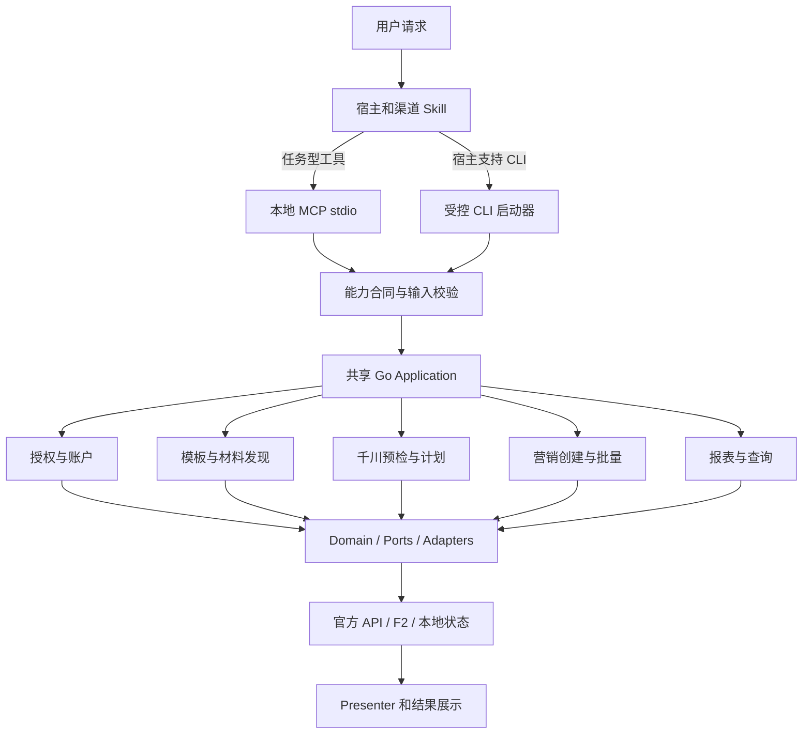

| 节点 | 做什么 | 方法与源码 | 产出与分支 | 访问 |
| --- | --- | --- | --- | --- |
| A01 | 接受查询、预检或明确提交请求 | 宿主对话入口；CLI 参数入口（[入口](../../runtime/ocean-watch-go/cmd/ocean-watch/main.go)） | 用户目标和范围 | 本地 |
| A02 | 选择营销、千川或星图以及精确任务 | 三个 Skill 的 Fast Routing Contract（[渠道 Skill](../../skills/qc-plan-monitor/SKILL.md)） | 已匹配任务直接调用对应 MCP；其他已确认目标查询能力目录 | 本地 |
| A03 | 接收 JSON-RPC 工具请求 | `RunManaged`、`Runtime`（[MCP](../../runtime/ocean-watch-go/internal/mcpserver/server.go)） | 工具 DTO；直接调用 Application | 本地 |
| A04 | 接收稳定的两段 CLI 命令 | `ProductionRouteManifest`（[路由](../../runtime/ocean-watch-go/internal/application/routes.go)） | CLI 参数转换为用例请求；WorkBuddy 安装 Skill 仅开放 MCP | 本地 |
| A05 | 校验工具、字段、渠道和副作用声明 | `DefaultCapabilityRegistry`、严格 JSON 解码（[能力合同](../../runtime/ocean-watch-go/internal/contracts/capabilities.go)） | 有效请求；未知字段或非法 ID 返回参数错误 | 本地 |
| A06 | 编排完整业务用例 | 共享组合根（[千川](../../runtime/ocean-watch-go/internal/bootstrap/qianchuan.go)、[营销](../../runtime/ocean-watch-go/internal/bootstrap/marketing.go)） | Domain 规则及 Ports 调用 | 本地 |
| A07 | 保存授权、同步账户、按需刷新 Token | `auth.Service`、`TokenManager.Ensure`（[授权](../../runtime/ocean-watch-go/internal/application/auth/service.go)） | 按渠道隔离的授权与账户映射；见图 04、05 | 授权 |
| A08 | 管理本地模板并查询素材/投放资源 | `templates.Query`、素材和 discovery Service（[模板](../../runtime/ocean-watch-go/internal/application/templates/query.go)） | 模板骨架、候选素材及正式 ID；见图 06、14、16 | 本地 |
| A09 | 路由作品、官方复核、判断新建或追加 | `CommandService.BatchWorks`（[千川主线](../../runtime/ocean-watch-go/internal/application/plans/qianchuan/commands.go)） | 待确认、预检快照或明确提交结果；见图 08–13 | 官方读 |
| A10 | 准备营销项目与广告，执行批量事务 | `Preparer.Prepare`、`BatchRunner.Execute`（[营销](../../runtime/ocean-watch-go/internal/application/plans/marketing/prepare.go)） | 项目/广告 payload、预览或执行记录；见图 14、15 | 官方读 |
| A11 | 按日期、账户和指标口径查询 | 报表 Application Service（[报表](../../runtime/ocean-watch-go/internal/application/reports/qianchuan_unified.go)） | 指标、范围、分页信息和完整展示；见图 16 | 官方读 |
| A12 | 通过接口隔离领域规则与 SDK/存储 | `internal/domain`、`internal/ports`、`internal/adapters`（[架构](overview.md)） | 规则使用领域类型，SDK 类型留在 Adapter | 本地 |
| A13 | 访问对应的真实数据源 | 官方 Go SDK、Python/F2、SQLite、文件、系统凭据库（[组合根](../../runtime/ocean-watch-go/internal/bootstrap/qianchuan.go)） | 原始结果经校验和映射进入用例；见图 07、17 | 官方读 |
| A14 | 输出白名单字段和规定表格 | MCP 专用 Presenter、`domain.Presentation`（[展示](../../runtime/ocean-watch-go/internal/mcpserver/qianchuan.go)） | MCP 协议结果或 CLI 单个 JSON；required 表格原样展示 | 本地 |

## 02 宿主启动、Runtime 选择与请求分发

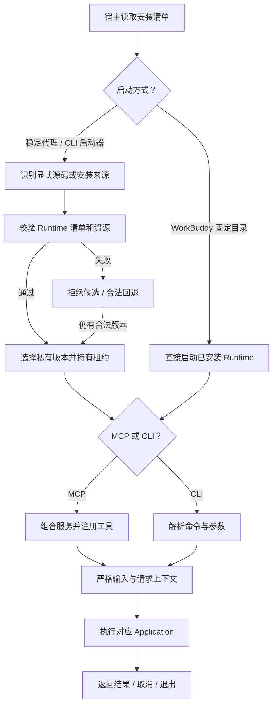

| 节点 | 做什么 | 方法与源码 | 产出与分支 | 访问 |
| --- | --- | --- | --- | --- |
| B01 | 宿主注册连接器和渠道 Skill | Plugin 清单、`.mcp.json`、安装器（[WorkBuddy](../../scripts/install-workbuddy.py)） | 各宿主独立进程与 MCP 连接 | 本地 |
| B02 | 根据安装布局选择启动入口 | `bin/ocean-watch-launcher`、WorkBuddy 的固定 command（[启动器](../../bin/ocean-watch-launcher)） | 版本代理或直接启动；不选择业务账户 | 本地 |
| B03 | 固定当前 Git checkout/worktree 的来源范围 | `runtimeupdate.NewManager`（[来源解析](../../runtime/ocean-watch-go/internal/runtimeupdate/source.go)） | 源码 checkout 拥有独立 Runtime 状态；业务状态仍共享 | 本地 |
| B04 | 核对平台、版本、manifest 和资源摘要 | `Manager.Resolve` 与候选验证（[版本管理](../../runtime/ocean-watch-go/internal/runtimeupdate/manager.go)） | 通过后使用不可变槽位；不以版本字符串代替字节一致性 | 本地 |
| B05 | 保护正在使用的 Runtime 文件 | `ResolveLeased`、`AcquireRuntimeLease`（[租约](../../runtime/ocean-watch-go/internal/runtimeupdate/manager.go)） | 本实例用到的版本不会被提前清理 | 本地 |
| B06 | 保存拒绝状态或回到合法旧版本 | `Manager.Reject`（[回退](../../runtime/ocean-watch-go/internal/runtimeupdate/manager.go)） | 无合法版本时启动失败；源码来源不会静默换成宿主旧构建 | 本地 |
| B07 | 使用安装器固定的二进制和 cwd | `install`（[安装器](../../scripts/install-workbuddy.py)） | WorkBuddy 不使用业务 CLI 回退；安装更新见图 18 | 本地 |
| B08 | 选择 stdio Server 或一次 CLI 调用 | Go `main`（[入口](../../runtime/ocean-watch-go/cmd/ocean-watch/main.go)） | MCP Server 直接调用 Application，不派生业务 CLI | 本地 |
| B09 | 解析受保护状态根并构造依赖 | `RunManaged`、共享 bootstrap（[MCP](../../runtime/ocean-watch-go/internal/mcpserver/server.go)） | 当前 26 个任务型工具；固定 Schema | 本地 |
| B10 | 按能力目录验证两段命令 | `contracts.Lookup`、CLI Runner（[CLI](../../runtime/ocean-watch-go/internal/cli/runner.go)） | 规范化请求；参数或命令错误不进入业务 | 本地 |
| B11 | 验证参数并配置预算、计数和取消上下文 | `decodeStrict`、`PrepareCommandContext`（[治理](../../runtime/ocean-watch-go/internal/platform/requestcontrol/control.go)） | 普通官方查询有界；作品预检单独计数且受分页/请求边界约束 | 本地 |
| B12 | 执行共享用例并按需访问 Adapter | `NewMarketingRuntime`、`NewQianchuanRuntime`（[组合](../../runtime/ocean-watch-go/internal/bootstrap/qianchuan.go)） | 不同 Transport 使用相同规则 | 本地 |
| B13 | 规范输出并释放本实例资源 | MCP Presenter、进程 context（[服务](../../runtime/ocean-watch-go/internal/mcpserver/server.go)） | MCP stdout 为协议帧，日志在 stderr；取消不撤销已发生的官方写入 | 本地 |

## 03 初始化与 F2 本机配置

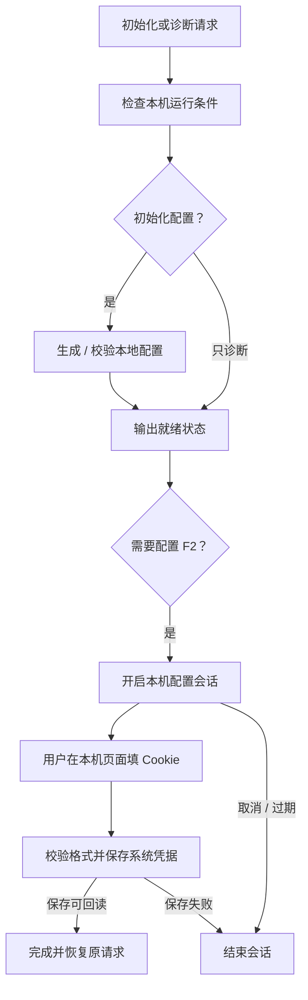

| 节点 | 做什么 | 方法与源码 | 产出与分支 | 访问 |
| --- | --- | --- | --- | --- |
| C01 | 区分只读诊断与本地初始化 | `setup doctor/init/validate`（[onboarding](../../runtime/ocean-watch-go/internal/application/onboarding/doctor.go)） | 选择环境诊断、配置创建或就绪校验 | 本地 |
| C02 | 检查 Runtime、Python/F2 和必要本地元数据 | Doctor 与 Runtime Diagnose（[诊断](../../runtime/ocean-watch-go/internal/runtimeupdate/diagnostic.go)） | 真实环境就绪项；诊断结果不证明官方业务可用 | 本地 |
| C03 | 决定是否改变本地配置 | onboarding 用例（[初始化](../../runtime/ocean-watch-go/internal/application/onboarding/initialize.go)） | 只诊断继续 C05；明确初始化进入 C04 | 本地 |
| C04 | 按渠道创建基础配置并验证结构 | 初始化、`Validator.Validate`（[校验](../../runtime/ocean-watch-go/internal/application/onboarding/validate.go)） | 本地骨架；后续账户和模板需要真实绑定 | 本地 |
| C05 | 展示配置、授权和依赖就绪情况 | `LocalState.Snapshot`（[状态](../../runtime/ocean-watch-go/internal/application/onboarding/status.go)） | 脱敏结果；OAuth 授权见图 04 | 本地 |
| C06 | 检查是否需要保存/更新 F2 Cookie | `f2config.Settings.Status`（[F2 设置](../../runtime/ocean-watch-go/internal/application/f2config/config.go)） | 有凭据可读不等于抖音已接受 Cookie | 本地 |
| C07 | 创建当前 Runtime 拥有的短期回环会话 | `start_f2_configuration`（[MCP 配置入口](../../runtime/ocean-watch-go/internal/mcpserver/f2_configuration.go)） | configuration_url、session_id 和有效期 | 本地 |
| C08 | 在本机页面接收 Cookie | F2 配置 Adapter（[会话接口](../../runtime/ocean-watch-go/internal/application/f2config/config.go)） | Cookie 不经过模型参数或聊天消息 | 授权 |
| C09 | 校验格式、大小和后端，写入并回读 | `Settings.Save`、`ValidateCookie`（[保存](../../runtime/ocean-watch-go/internal/application/f2config/config.go)） | 独立系统凭据项；仅接受规定系统凭据后端 | 授权 |
| C10 | 返回保存状态，允许恢复原解析/预检 | `get_f2_configuration_session`（[MCP](../../runtime/ocean-watch-go/internal/mcpserver/f2_configuration.go)） | completed 且 credential_saved、can_resume 后恢复；在线可用性仍由解析验证 | 本地 |
| C11 | 取消、过期或失败时结束临时交互 | `cancel_f2_configuration_session`（[MCP](../../runtime/ocean-watch-go/internal/mcpserver/f2_configuration.go)） | 会话只属于原进程；会话丢失不能推出系统 Cookie 丢失 | 本地 |

## 04 三渠道 OAuth 授权与账户同步

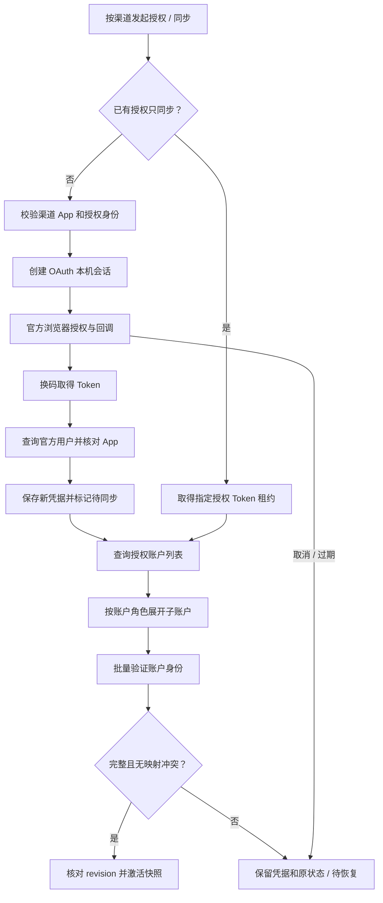

| 节点 | 做什么 | 方法与源码 | 产出与分支 | 访问 |
| --- | --- | --- | --- | --- |
| D01 | 固定 marketing、qianchuan 或 star_map 范围 | `Service.Prepare`（[授权用例](../../runtime/ocean-watch-go/internal/application/auth/service.go)） | 精确渠道、可选原授权 ID 和原账户 | 本地 |
| D02 | 区分 OAuth 和已有授权账户同步 | `RecoveryRequest.Operation`（[准备](../../runtime/ocean-watch-go/internal/application/auth/service.go)） | sync_accounts 不重复换码 | 本地 |
| D03 | 读取对应渠道 App 并核对授权归属 | `Service.Prepare`、`validateGrant`（[服务](../../runtime/ocean-watch-go/internal/application/auth/service.go)） | App 信息留在凭据 Adapter；不跨渠道复用 Token | 授权 |
| D04 | 建立短期会话、state 和回环页面 | `RecoveryCoordinator`（[会话](../../runtime/ocean-watch-go/internal/application/auth/recovery_coordinator.go)） | 当前进程拥有的 session_id、OAuth URL、有效期 | 本地 |
| D05 | 用户完成官方授权，校验回调身份和状态 | 回调校验规则（[回调](../../runtime/ocean-watch-go/internal/application/auth/callback.go)） | 有效授权码进入 D06；错误/取消不继续 | 授权 |
| D06 | 单次换码取得授权 Token | `OAuthAdapter.ExchangeCode`（[OAuth](../../runtime/ocean-watch-go/internal/adapters/oceanengine/oauth.go)） | 新 Token；不输出凭据值 | 授权 |
| D07 | 获取官方用户 UID，核对当前 App | `GetAuthorizedUser`（[官方用户](../../runtime/ocean-watch-go/internal/adapters/oceanengine/oauth_user.go)） | 用户/App 唯一授权身份；身份不符停止保存激活 | 官方读 |
| D08 | 保存新 revision 凭据再记录待同步授权 | `Authorizer.save`（[保存](../../runtime/ocean-watch-go/internal/application/auth/authorize.go)） | 新凭据可恢复；待同步账户范围不能直接用于业务 | 授权 |
| D09 | 使用指定授权取得可用于同步的租约 | `TokenManager.Ensure`，AllowPending=true（[Token](../../runtime/ocean-watch-go/internal/application/auth/token_manager.go)） | 同步所用 revision；见图 05 | 授权 |
| D10 | 获取 OAuth 用户当前授权的账户集合 | `AdvertiserDiscoveryAdapter.listAuthorizedAccounts`（[发现](../../runtime/ocean-watch-go/internal/adapters/oceanengine/advertisers.go)） | 账户类型和有效状态 | 官方读 |
| D11 | 按角色完整展开业务账户 | `expandAccount`、客户中心/EBP/代理/店铺查询（[角色发现](../../runtime/ocean-watch-go/internal/adapters/oceanengine/advertiser_roles.go)） | 去重后的候选 ID；明确角色权限不足单独记录 issue | 官方读 |
| D12 | 验证候选广告主或星图账户 | `verifyAdvertisers`、`verifyStarAccounts`（[验证](../../runtime/ocean-watch-go/internal/adapters/oceanengine/advertisers.go)） | 广告主每组最多 50 个；拒绝错误或重复身份 | 官方读 |
| D13 | 检查完整快照和已有账户归属冲突 | `validateAdvertiserSnapshot`、`activateAdvertiserSnapshot`（[快照](../../runtime/ocean-watch-go/internal/application/auth/snapshot.go)） | 冲突需明确改绑范围；不自动抢占已有映射 | 本地 |
| D14 | revision 一致后原子更新索引和激活状态 | `AdvertiserSnapshotSync.syncLease`（[激活](../../runtime/ocean-watch-go/internal/application/auth/snapshot.go)） | pending_account_sync=false；账户索引成为后续业务授权依据 | 本地 |
| D15 | 保存稳定失败阶段和可恢复身份 | 授权失败分类、Coordinator（[恢复](../../runtime/ocean-watch-go/internal/application/auth/recovery_failure.go)） | 同步失败保留新凭据及旧快照；恢复后重跑原请求，不批准投放写入 | 本地 |

## 05 按需 Token 使用与刷新

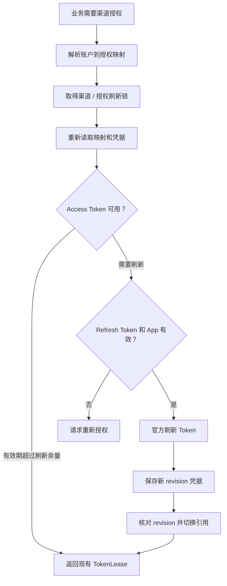

| 节点 | 做什么 | 方法与源码 | 产出与分支 | 访问 |
| --- | --- | --- | --- | --- |
| E01 | 官方读或明确提交按需获取凭据 | `TokenManager.Ensure`（[入口](../../runtime/ocean-watch-go/internal/application/auth/token_manager.go)） | 不依赖常驻刷新服务 | 授权 |
| E02 | 固定渠道、广告主及授权选择器 | `domain.ResolveAuthorization`（[解析](../../runtime/ocean-watch-go/internal/domain/authorization.go)） | 唯一授权；缺失、歧义或待同步范围返回恢复错误 | 本地 |
| E03 | 协调同授权跨进程刷新 | `RefreshLocker.Acquire`（[Manager](../../runtime/ocean-watch-go/internal/application/auth/token_manager.go)） | 避免多个宿主同时轮换同一个授权 | 本地 |
| E04 | 锁后重读，防止使用过期 revision | 授权存储与系统凭据端口（[Manager](../../runtime/ocean-watch-go/internal/application/auth/token_manager.go)） | 当前有效 credential 引用 | 授权 |
| E05 | 检查 Access Token 与过期时间 | `accessTokenReady`；默认刷新余量 30 分钟（[判断](../../runtime/ocean-watch-go/internal/application/auth/token_manager.go)） | 缺少到期元数据的非空 Token 当前视为可用；有元数据按时间校验 | 本地 |
| E06 | 把凭据和 revision 放入本次请求上下文 | `tokenLease`、`WithAdvertiserTokenLease`（[上下文](../../runtime/ocean-watch-go/internal/application/auth/request_context.go)） | 只供 Adapter 使用；不返回 Token 值 | 本地 |
| E07 | 检查 refresh_token、有效期和对应 App | `tokenExpired`、AppID 核验（[Manager](../../runtime/ocean-watch-go/internal/application/auth/token_manager.go)） | 不满足返回 REAUTHORIZATION_REQUIRED | 授权 |
| E08 | 用户完成对应渠道授权恢复 | `start_authorization`（[恢复合同](../reference/authorization-recovery.md)） | 保留原请求，完成且 can_resume 后继续 | 授权 |
| E09 | 调用官方刷新接口 | `OAuthAdapter.RefreshToken`（[OAuth](../../runtime/ocean-watch-go/internal/adapters/oceanengine/oauth.go)） | 可恢复网络错误和无效刷新凭据分别分类 | 授权 |
| E10 | 先保存下一 revision 的秘密 | `applyToken`、CredentialStore.Write（[轮换](../../runtime/ocean-watch-go/internal/application/auth/token_manager.go)） | 新 Token 保存在系统凭据库 | 授权 |
| E11 | 核对原 revision 后更新授权索引 | `Authorizations.UpdateChannel`（[切换](../../runtime/ocean-watch-go/internal/application/auth/token_manager.go)） | revision+1 成为当前引用；失败不会声称已激活 | 本地 |

## 06 负责账户与模板管理

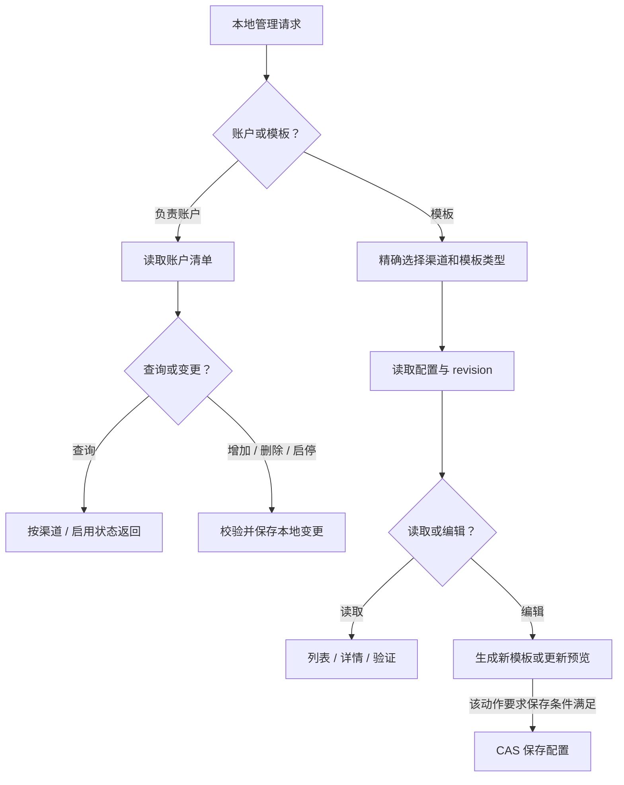

| 节点 | 做什么 | 方法与源码 | 产出与分支 | 访问 |
| --- | --- | --- | --- | --- |
| F01 | 区分负责范围、本地模板和实际投放 | 管理能力合同（[能力](../../runtime/ocean-watch-go/internal/contracts/capabilities.go)） | 本地管理不自动修改官方计划 | 本地 |
| F02 | 进入对应本地数据管理用例 | accounts/templates CLI 与 MCP（[Runner](../../runtime/ocean-watch-go/internal/cli/runner.go)） | 查询或本地变更路径 | 本地 |
| F03 | 读取用户维护的负责账户表 | AccountBook / 本地配置（[账户模型](../../runtime/ocean-watch-go/internal/domain/accounts.go)） | 负责账户不等同于全部 OAuth 授权账户 | 本地 |
| F04 | 区分成员查询和成员管理 | `accounts list/add/remove/enable/disable`（[能力](../../runtime/ocean-watch-go/internal/contracts/capabilities.go)） | 查询进入 F05；管理进入 F06 | 本地 |
| F05 | 返回匹配渠道与状态的负责账户 | `list_managed_accounts`（[MCP](../../runtime/ocean-watch-go/internal/mcpserver/server.go)） | star_map 使用 subject_kind=star_account；带日期绩效进入图 16 | 本地 |
| F06 | 修改负责账户成员或启用状态 | CLI 管理入口及 AccountBook（[CLI](../../runtime/ocean-watch-go/internal/cli/runner.go)） | 不新增官方 OAuth 权限 | 本地 |
| F07 | 区分营销上传/达人和千川商品/直播模板 | 模板 Domain 规则（[模板](../../runtime/ocean-watch-go/internal/domain/templates)） | 绑定渠道、账户、商品及投放骨架；星图模板尚未接入 | 本地 |
| F08 | 在编辑前取得配置 revision | `Creator.Begin`、ReadWithRevision（[创建](../../runtime/ocean-watch-go/internal/application/templates/create.go)） | 用于后续冲突检测 | 本地 |
| F09 | 选择只读或编辑用例 | `Query`、`Lifecycle`（[生命周期](../../runtime/ocean-watch-go/internal/application/templates/lifecycle.go)） | 查询不刷新 Token 或访问官方 API | 本地 |
| F10 | 展示稳定 ID、详情及配置合法性 | `Query.List/Show`、`Lifecycle.Validate`（[查询](../../runtime/ocean-watch-go/internal/application/templates/query.go)） | 精确选择模板，不按内容模糊猜测 | 本地 |
| F11 | 应用创建、文案、更新或删除规则 | `Creator.Finish`、`Lifecycle.SetCopy/Delete/UpdateQianchuanProductTemplate`（[规则](../../runtime/ocean-watch-go/internal/application/templates/lifecycle.go)） | 各动作的保存门禁不同；删除/千川更新支持 dry-run | 本地 |
| F12 | 防止覆盖其他进程已修改配置 | `ConfigStore.CompareAndSwap`（[接口](../../runtime/ocean-watch-go/internal/application/templates/create.go)） | revision 不一致报冲突；本地管理条件不能概括为所有动作都需 --submit | 本地 |

## 07 抖音链接与 F2 公开元数据

本图展开千川作品投放预检的公开解析阶段；单条作品也按一行批量输入处理。

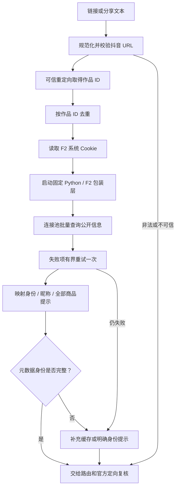

| 节点 | 做什么 | 方法与源码 | 产出与分支 | 访问 |
| --- | --- | --- | --- | --- |
| G01 | 接受完整 URL 或带短链的分享文本 | `ResolveRequest`（[用例](../../runtime/ocean-watch-go/internal/application/workmetadata/resolve.go)） | 保留输入行号 | 本地 |
| G02 | 提取有效链接并拒绝非法 host/port/形状 | `NormalizeDouyinURL`、`ValidateDouyinURL`（[URL Adapter](../../runtime/ocean-watch-go/internal/adapters/workmetadata/douyin.go)） | 可信抖音 URL；不接受任意网络地址 | 本地 |
| G03 | 在可信域内最多跟随五次重定向 | `DouyinRedirectResolver.Resolve`、`WorkIDFromURL`（[短链](../../runtime/ocean-watch-go/internal/adapters/workmetadata/douyin.go)） | aweme_item_id 和 canonical URL | 公开 |
| G04 | 去重且检查重复输入设置冲突 | `Resolver.ResolveLinks`、`routedLinkResolver.ResolveLinks`（[去重](../../runtime/ocean-watch-go/internal/application/plans/qianchuan/routing_links.go)） | 一致重复行跳过；同作品设置冲突阻断对应子批次 | 本地 |
| G05 | 在本批公开元数据查询后检查身份是否完整 | `resolveBatchLinks`（[解析](../../runtime/ocean-watch-go/internal/application/plans/qianchuan/commands.go)） | 单条和批量都先解析 F2；缓存命中或明确身份不跳过本批 F2 | 本地 |
| G06 | 在已确定账户范围内补充缺失的身份提示 | `OwnerHintCache.Load`、`routedLinkResolver.applyHint`（[提示](../../runtime/ocean-watch-go/internal/application/plans/qianchuan/routing_links.go)） | 默认 30 天缓存；只补缺失字段，不覆盖 F2 身份；准确可见号缺 UID 时官方恢复 | 本地 |
| G07 | 读取系统凭据中的独立 F2 Cookie | `Settings.Cookie`（[凭据](../../runtime/ocean-watch-go/internal/application/f2config/config.go)） | 通过 stdin 交给子进程；缺失走图 03 | 授权 |
| G08 | 验证 Python 3.10+、F2 0.0.1.7 与包装脚本 | `F2Resolver.ResolveMany`（[进程 Adapter](../../runtime/ocean-watch-go/internal/adapters/workmetadata/f2.go)） | 固定入口、超时和输出上限 | 本地 |
| G09 | 共享只读连接池抓公开作品详情 | 包装层 `f2/resolve.py`（[F2](../../f2/resolve.py)） | 公开元数据；不下载视频，也不读取浏览器 Cookie | 公开 |
| G10 | 仅重试失败项一次并保留细分原因 | Python 包装层的批量执行（[重试](../../f2/resolve.py)） | HTTP、网络、超时、空响应和解析失败分别记录 | 公开 |
| G11 | 校验作品 ID 并保留所有有效商品提示 | `Resolver.ResolveMetadata`（[映射](../../runtime/ocean-watch-go/internal/application/workmetadata/resolve.go)） | UID、可见号、昵称、作品、商品提示；多商品不取第一个自动路由 | 本地 |
| G12 | 输出解析成功项和失败行给下游 | `qianchuanWorkInputs`、路由模块（[下游](../../runtime/ocean-watch-go/internal/application/plans/qianchuan/commands.go)） | 未明确商品且缺少公开商品提示时待确认；有明确范围和准确身份可继续官方核验；否则跳过 | 本地 |

## 08 千川作品按商品、账户、模板路由

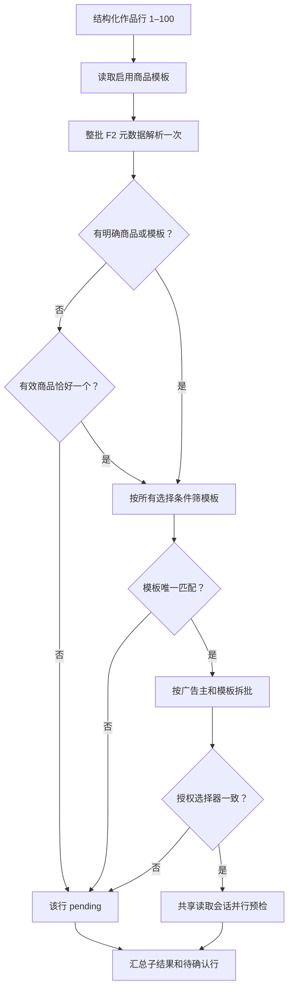

| 节点 | 做什么 | 方法与源码 | 产出与分支 | 访问 |
| --- | --- | --- | --- | --- |
| H01 | 严格解码逐行链接和可选选择器 | `decodePreflightInput`（[MCP](../../runtime/ocean-watch-go/internal/mcpserver/qianchuan.go)） | 行级 product_id/name、advertiser_id、plan_template、身份和命名字段 | 本地 |
| H02 | 只从当前启用商品全域模板找候选 | `QianchuanProductPlanPayloads`（[路由](../../runtime/ocean-watch-go/internal/application/plans/qianchuan/routing.go)） | 复用现有商品/账户绑定；不另建猜测映射 | 本地 |
| H03 | 用明确选择或 F2 商品提示确定路由条件 | `needsBatchRouting`、`routeBatchWorks`（[选择](../../runtime/ocean-watch-go/internal/application/plans/qianchuan/routing.go)） | 行模板优先于全局模板；明确商品/模板不依赖公开商品猜测 | 本地 |
| H04 | 在账户查询前解析整批作品的公开元数据 | `Links.Resolve`、`routedLinkResolver`（[复用](../../runtime/ocean-watch-go/internal/application/plans/qianchuan/routing.go)） | 已取得的作品、身份和商品数据供所有子批次复用，不按模板重跑 F2 | 公开 |
| H05 | 去重并要求恰好一个有效商品 ID | `validPositiveID` 和商品集合判断（[商品定位](../../runtime/ocean-watch-go/internal/application/plans/qianchuan/routing.go)） | 0 个/多个/解析失败不能自动选商品 | 本地 |
| H06 | 返回行号、稳定原因和候选 | `RoutingPending`（[待确认](../../runtime/ocean-watch-go/internal/application/plans/qianchuan/routing.go)） | 不为寻找可用账户逐户查询凭据或试投 | 本地 |
| H07 | 所有显式条件必须同时满足 | 精确商品 ID、商品全称/简称、模板 ID/名称、广告主筛选（[筛选](../../runtime/ocean-watch-go/internal/application/plans/qianchuan/routing.go)） | 商品名称精确匹配；标题不是路由依据 | 本地 |
| H08 | 要求唯一一个模板 | 候选数量检查（[唯一性](../../runtime/ocean-watch-go/internal/application/plans/qianchuan/routing.go)） | 无候选 routing_not_found；多个 routing_ambiguous | 本地 |
| H09 | 按广告主＋模板形成独立子批次 | `routedWorkBatch`（[分组](../../runtime/ocean-watch-go/internal/application/plans/qianchuan/routing.go)） | 保留各批模板、逐行设置和独立预检 ID | 本地 |
| H10 | 检查同子批次的 auth_account_id 冲突 | 授权选择器比较（[冲突](../../runtime/ocean-watch-go/internal/application/plans/qianchuan/routing.go)） | 冲突时该批全部 pending | 本地 |
| H11 | 并行启动子批次，共享命令级容量和范围内事实 | `batchWorks`、`batchReadSession`（[会话](../../runtime/ocean-watch-go/internal/application/plans/qianchuan/read_session.go)） | 同账户同授权共享不可变租约及查询，不同授权隔离事实；每账户最多占两个读取任务位置；见图 09 | 官方读 |
| H12 | 保留各子结果、原始行号和 failure | `presentRoutedPreflightOutput`（[汇总](../../runtime/ocean-watch-go/internal/mcpserver/qianchuan_routing.go)） | 每批单独展示五列及 ID；不存在跨账户统一提交 ID | 本地 |

## 09 千川预检主线：任务并行与汇合

F2 元数据完成后才启动账户读取。计划列表与官方作品核验并行；每个达人取得自己的核验结果和账户清单后独立推进详情与素材判断。工具最终返回整批汇总，不提供后台任务 ID 或逐组流式返回。实际 HTTP 读取可重叠，仍受图 17 的容量、节流与冷却约束。

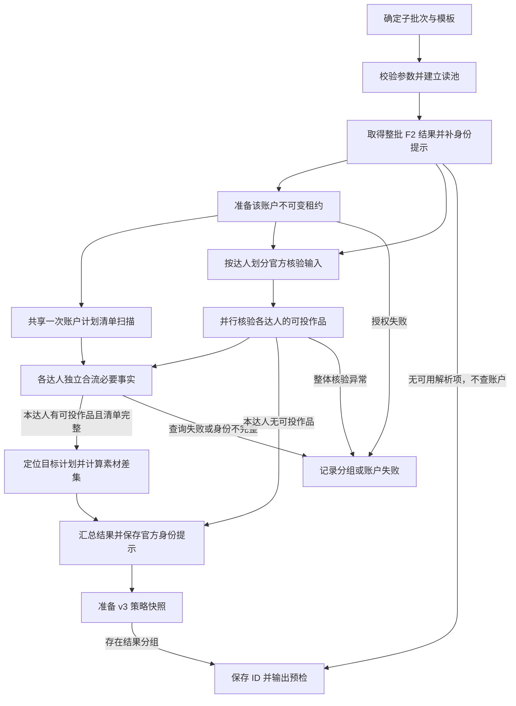

| 节点 | 做什么 | 方法与源码 | 产出与分支 | 访问 |
| --- | --- | --- | --- | --- |
| I01 | 读取明确的商品全域模板与广告主 | `ExportQianchuanPlanPayload`（[主线](../../runtime/ocean-watch-go/internal/application/plans/qianchuan/commands.go)） | 模板必须启用且绑定完整 | 本地 |
| I02 | 校验行设置、并发范围及输入冲突 | `NewReadPool`；默认 8，范围 1–10（[读池](../../runtime/ocean-watch-go/internal/application/plans/qianchuan/read_pool.go)） | 整次路由共享容量，同授权范围合并正在进行和已完成的相同查询 | 本地 |
| I03 | 先取得链接/F2 结果，复用路由阶段已取得的事实 | `resolveBatchLinks`、`routedLinkResolver`（[解析](../../runtime/ocean-watch-go/internal/application/plans/qianchuan/commands.go)） | 缓存只补身份字段；无可用作品时不准备凭据或扫描计划 | 公开 |
| I04 | 元数据完成且路由明确后准备账户租约 | `readLease`、`batchReadSession.Ensure`（[凭据准备](../../runtime/ocean-watch-go/internal/application/plans/qianchuan/read_session.go)） | 本批同账户同授权取一次租约，scopedContext 固定渠道、授权和广告主 | 授权 |
| I05 | 租约就绪后共享账户列表扫描，与作品核验重叠 | `CurrentPlanScanner.ScanCurrentPlans`（[扫描](../../runtime/ocean-watch-go/internal/application/plans/qianchuan/reconcile.go)） | 同账户同授权同查询窗口不按模板或达人重复扫描；后续页有界并行 | 官方读 |
| I06 | 按 UID、准确可见号或单作品划分核验任务 | `partitionCreatorWorks`、`qianchuanWorkInputs`（[输入](../../runtime/ocean-watch-go/internal/application/plans/qianchuan/preflight_pipeline.go)） | 逐行目标商品和命名设置保留；未知 UID 仍需官方恢复 | 本地 |
| I07 | 各达人并行执行三步官方作品核验 | `preflightCreators`、`WorkVerifier.Verify`（[流水线](../../runtime/ocean-watch-go/internal/application/plans/qianchuan/preflight_pipeline.go)） | matched、skipped、query_failures；慢达人不阻止其他就绪达人做计划和素材判断；见图 10 | 官方读 |
| I08 | 本达人核验就绪后取得共享的完整账户清单 | `awaitInventory`、完成通道（[合流](../../runtime/ocean-watch-go/internal/application/plans/qianchuan/preflight_pipeline.go)） | 新建仍需完整查询；清单失败影响依赖该范围的组，其他账户继续；账户收尾等待扫描退出 | 本地 |
| I09 | 保存官方确认的身份定位提示 | `OwnerHints.Store`（[缓存写入](../../runtime/ocean-watch-go/internal/application/plans/qianchuan/commands.go)） | 缓存写失败降为 warning；缓存不储存投放授权结论 | 本地 |
| I10 | 建组并判断绑定、详情和素材差集 | `BatchService.Execute`（[计划判断](../../runtime/ocean-watch-go/internal/application/plans/qianchuan/batch.go)） | 每组动作或错误；见图 11 | 官方读 |
| I11 | 固定输入、模板、选择策略、绑定和动作摘要 | `prepareBatchSnapshot`（[快照](../../runtime/ocean-watch-go/internal/application/plans/qianchuan/preflight_v2.go)） | 新格式 v3；旧 v2 保留 bound_only 语义；冲突和失败组 SubmitEligible=false | 本地 |
| I12 | 保存版本化 Journal 和规定输出 | `Journals.Save`、`presentPreflightOutput`（[存储](../../runtime/ocean-watch-go/internal/adapters/sqlite/journal.go)） | 最长 30 分钟且不跨上海业务日；无结果组时没有可提交快照 | 本地 |
| I13 | 脱敏返回明确失败阶段 | `mapQianchuanPreflightError`（[错误](../../runtime/ocean-watch-go/internal/mcpserver/qianchuan.go)） | 区分授权、F2、官方核验、计划清单、对账和快照失败 | 本地 |

## 10 千川官方作品核验的三个关卡

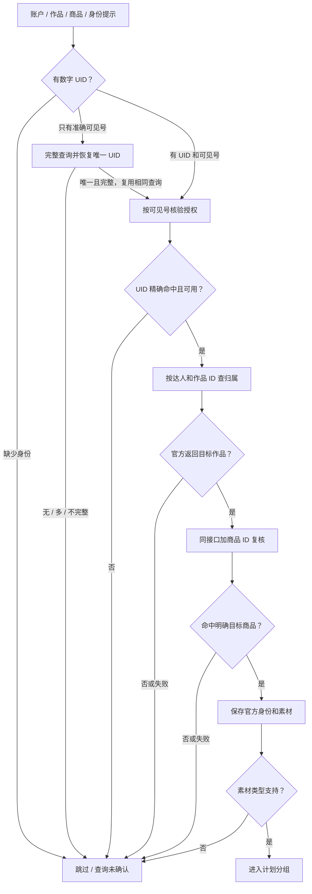

| 节点 | 做什么 | 方法与源码 | 产出与分支 | 访问 |
| --- | --- | --- | --- | --- |
| J01 | 规范化作品、模板商品和身份提示 | `WorkVerifier.Verify`、`normalizeWorkInputs`（[核验](../../runtime/ocean-watch-go/internal/application/plans/qianchuan/verify.go)） | 无效 ID/重复行单独处理；不扫描所有达人寻找归属 | 本地 |
| J02 | 确定能否进行定向查询 | `normalizedOwnerHints`（[提示](../../runtime/ocean-watch-go/internal/application/plans/qianchuan/verify.go)） | 搜索关键词必须是可见抖音号；昵称和数字 UID 不充当关键词 | 本地 |
| J03 | 无 UID 时查询可见号的完整结果集 | `recoverVisibleCreatorHints`（[恢复](../../runtime/ocean-watch-go/internal/application/plans/qianchuan/creator_recovery.go)） | 按 VisibleID 精确匹配并要求唯一 UID；相同授权范围与参数的分页事实供 J04 复用 | 官方读 |
| J04 | 查询目标账户下的授权抖音号列表并复用本批分页事实 | `/open_api/v1.0/qianchuan/uni_aweme/authorized/get/`，search_key_words=可见号、VIDEO_PROM_GOODS、CREATE；`authorizationPage`（[核验](../../runtime/ocean-watch-go/internal/application/plans/qianchuan/verify.go)） | 每页 100、最多 100 页；UID 已知时找到精确 UID 后即可结束；不同授权不复用 | 官方读 |
| J05 | UID 必须精确匹配且未明确被禁用 | `resolveAuthorizedHint`、`creatorUsable`（[通过条件](../../runtime/ocean-watch-go/internal/application/plans/qianchuan/verify.go)） | has_authorized=false 或禁用=true 拒绝；这两个状态字段缺失时当前允许继续复核 | 本地 |
| J06 | 先在达人范围内核验作品归属 | `/open_api/v1.0/qianchuan/file/video/aweme/get/`，aweme_id=UID、aweme_item_ids=作品，每批最多 50，不带 product_id（[请求](../../runtime/ocean-watch-go/internal/application/plans/qianchuan/verify.go)） | 返回作品必须属于请求集合；有 has_more 时认定结果不完整 | 官方读 |
| J07 | 将成功查无和查询异常分开 | `collectVerifiedOwners` 与失败集合（[归属判断](../../runtime/ocean-watch-go/internal/application/plans/qianchuan/verify.go)） | 查无为 creator_work_mismatch；查询失败为 creator_query_incomplete | 本地 |
| J08 | 按达人、目标商品及规范化作品集合构造商品查询 | 同一作品接口，每批最多 50；`queryWorks`（[商品任务](../../runtime/ocean-watch-go/internal/application/plans/qianchuan/verify.go)） | 行内明确商品只查该商品；未明确时遍历模板候选；相同查询在授权范围内共享 | 官方读 |
| J09 | 收敛到行内明确目标商品或完整官方匹配集合 | TargetProductID、matchedProducts 与 failedProductWorks（[判断](../../runtime/ocean-watch-go/internal/application/plans/qianchuan/verify.go)） | 成功查无为 product_mismatch；任何必要商品查询失败均为 product_query_incomplete，不采用部分商品集合 | 本地 |
| J10 | 使用官方返回的达人和素材字段 | `VerifiedWork`、`mapCreatorVideo`（[映射](../../runtime/ocean-watch-go/internal/adapters/oceanengine/qianchuan_read.go)） | 素材 ID、作品 ID、标题、素材类型及已匹配商品；公开提示不能覆盖官方匹配 | 本地 |
| J11 | 过滤当前支持的素材类型 | `normalizeBatchRequest`，VIDEO_LARGE / VIDEO_VERTICAL（[素材类型](../../runtime/ocean-watch-go/internal/application/plans/qianchuan/batch.go)） | 不支持进入 unsupported_image_mode | 本地 |
| J12 | 交给完整分组身份和计划对账 | `BatchService.Execute`（[下游](../../runtime/ocean-watch-go/internal/application/plans/qianchuan/batch.go)） | 见图 11；这一步通过不保证计划清单查询也通过 | 本地 |
| J13 | 保留稳定原因、行号和查询失败记录 | `skippedFromWork`、WorkQueryFailure（[分类](../../runtime/ocean-watch-go/internal/application/plans/qianchuan/verify.go)） | creator_unavailable、身份缺失/歧义、归属/商品不匹配、查询未完成等分开 | 本地 |

## 11 千川计划清单、目标选择与素材差集

时间范围是提交给官方列表接口的查询窗口；代码没有额外检查每个候选计划的创建日期，不能把列表结果概括为“只含今天新建的计划”。当日业务身份由本地绑定日期控制。

当前商品全域接口 `/open_api/v1.0/qianchuan/uni_promotion/list/` 在锁定 SDK 中没有 UID 筛选字段。代码按账户和授权范围扫描一次，再并行读取可能兼容商品的计划详情核对数字 UID；不使用普通千川 `/ad/get/` 的 UID 查询来证明全域计划不存在。

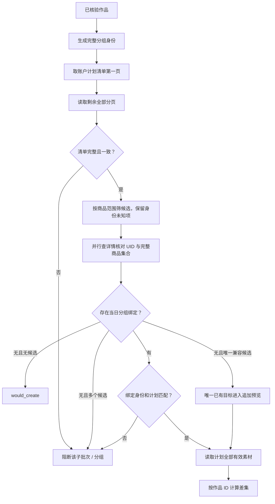

| 节点 | 做什么 | 方法与源码 | 产出与分支 | 访问 |
| --- | --- | --- | --- | --- |
| K01 | 接收官方核验通过的作品和目标商品 | `VerifiedWork`（[核验输出](../../runtime/ocean-watch-go/internal/application/plans/qianchuan/verify.go)） | 已有 UID、作品和匹配商品 | 本地 |
| K02 | 按账户＋模板＋达人 UID＋商品集合＋类型＋商务建组 | `NewPlanGroupIdentity`、`GroupID`（[分组](../../runtime/ocean-watch-go/internal/domain/qianchuan/batch.go)） | 同达人不同类型/商务/商品不合并；昵称不是分组身份 | 本地 |
| K03 | 以上海业务日 00:00:00–23:59:59 查询账户商品全域计划 | `ScanCurrentPlans`，Status=ALL、VIDEO_PROM_GOODS、UNI_PROJECT、每页 100（[清单](../../runtime/ocean-watch-go/internal/application/plans/qianchuan/reconcile.go)） | 同账户同授权本批共享一次；接口未提供 UID 过滤；最多 100 页 | 官方读 |
| K04 | 依据第一页总页数并行取得后续页 | `parallelOrdered`（[分页](../../runtime/ocean-watch-go/internal/application/plans/qianchuan/reconcile.go)） | HTTP 可重叠，受图 17 的容量、间隔和共享冷却约束 | 官方读 |
| K05 | 核对页号、总页数、总数、ID 唯一和总行数 | `validateCurrentPlanPage`、seenPlanIDs（[完整性](../../runtime/ocean-watch-go/internal/application/plans/qianchuan/reconcile.go)） | QUERY_FAILED、CHANGED、INVALID、TOO_LARGE 分别返回；不能把失败当作没有计划 | 本地 |
| K06 | 从完整列表选择可能兼容商品和场景的非删除候选 | `selectIdentityCandidates`（[候选](../../runtime/ocean-watch-go/internal/application/plans/qianchuan/reconcile.go)） | 可见号缺失或变更不能直接排除；已有精确绑定只需其目标候选；候选工作仍受最多 10000 条清单边界约束 | 本地 |
| K07 | 每段最多 200 个并行查询详情，核对 UID、完整商品集合和目标 | `FetchPlanDetail`、`sameStringSet`（[精确核对](../../runtime/ocean-watch-go/internal/application/plans/qianchuan/reconcile.go)） | 同授权范围按计划 ID 去重；失败段阻断后续段，缺 UID/商品或查询异常不能成为无计划证明 | 官方读 |
| K08 | 读取本地当日绑定并检查已有计划被其他组占用 | `scopedPlanBindings`、`planClaimedByAnotherGroup`（[绑定](../../runtime/ocean-watch-go/internal/application/plans/qianchuan/reconcile.go)） | 完整 group_id 保持模板/类型/商务隔离；同计划跨组争用为 plan_group_conflict | 本地 |
| K09 | 无匹配计划且无绑定时准备新建 | `PlanMatchPolicy.Status=would_create`（[决策](../../runtime/ocean-watch-go/internal/application/plans/qianchuan/reconcile.go)） | 当前预检只生成计划名和创建 payload | 本地 |
| K10 | 无绑定且唯一兼容目标时固定该计划进入预览 | `PlanSelectionUniqueExisting`、unbound_existing（[选择](../../runtime/ocean-watch-go/internal/application/plans/qianchuan/reconcile.go)） | 多候选为 plan_selection_required；预检不写绑定；旧 v2 仍为 legacy_binding_required | 本地 |
| K11 | 核对绑定身份、日期以及确切计划 ID | `BindingMatchesIdentity`、`PlanBindingDigest`（[校验](../../runtime/ocean-watch-go/internal/application/plans/qianchuan/bindings.go)） | 一致才 bound；不一致为 binding_drift | 本地 |
| K12 | 完整查询 VIDEO 素材并排除已删除成员 | `planMaterialsWithPool`、`fetchAllPlanMaterialsWithPool`（[素材](../../runtime/ocean-watch-go/internal/application/plans/qianchuan/batch.go)） | 同计划查询本批共享；一作品多个不同有效素材 ID 视为歧义 | 官方读 |
| K13 | 按作品 ID 比较已有与目标集合 | `executeExistingGroup`（[差集](../../runtime/ocean-watch-go/internal/application/plans/qianchuan/batch.go)） | 有新增为 would_append；全部存在为 already_present；每次追加最多 100 条 | 本地 |
| K14 | 保存清单、身份覆盖、绑定或目标冲突 | `PlanInventoryError`、`blockRoutedPlanConflicts`（[错误](../../runtime/ocean-watch-go/internal/application/plans/qianchuan/plan_selection.go)） | 清单异常影响对应范围；分组异常不可提交，其他已核验组保留结果 | 本地 |

## 12 千川预检快照提交与读回确认

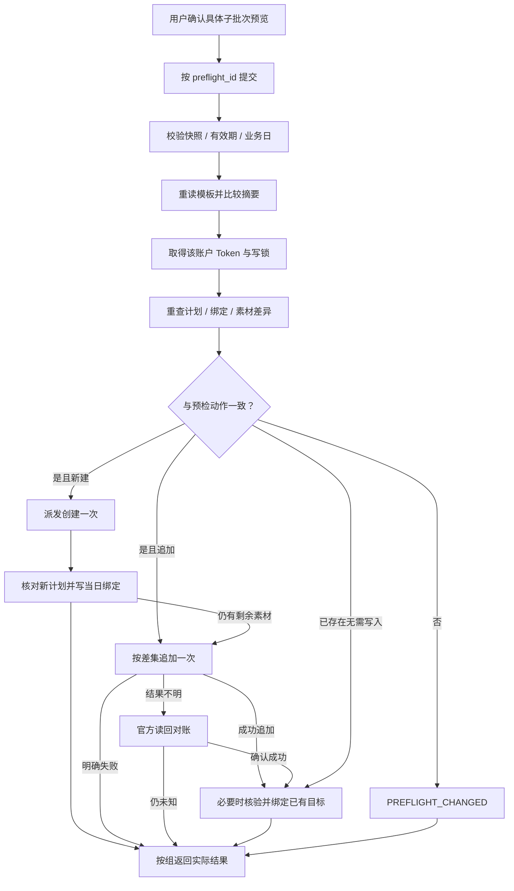

| 节点 | 做什么 | 方法与源码 | 产出与分支 | 访问 |
| --- | --- | --- | --- | --- |
| L01 | 确认具体账户、模板、作品及动作预览 | Skill 提交边界（[流程合同](../reference/qianchuan-work-routing.md)） | 当前既有 --submit 门禁；不是已完成的 V3 可信审批 Provider | 本地 |
| L02 | 精确提交一个子快照，不混入新输入 | `submitBatchPreflight`（[提交](../../runtime/ocean-watch-go/internal/application/plans/qianchuan/commands.go)） | preflight_id 不能与新模板/作品行混用 | 本地 |
| L03 | 读取版本化快照并核对策略、摘要与有效期 | `decodeBatchPreflight`、业务日检查（[快照](../../runtime/ocean-watch-go/internal/application/plans/qianchuan/preflight_v2.go)） | v3 显式选择策略；v2 按原绑定规则提交；v1 只读；旧执行器拒绝 v3；最长 30 分钟且不跨上海日 | 本地 |
| L04 | 防止提交时模板账户和 payload 已改变 | `batchTemplateDigest`（[重验](../../runtime/ocean-watch-go/internal/application/plans/qianchuan/commands.go)） | 模板禁用或摘要变化要求重新预检 | 本地 |
| L05 | 固定渠道授权，并取得广告主写锁 | `readLease`、`WithAdvertiserLock`、GuardedExecutor（[写入控制](../../runtime/ocean-watch-go/internal/application/plans/write_safety.go)） | 同账户相关写操作串行执行 | 授权 |
| L06 | 复用已核验作品，重新读取当前计划及素材 | `snapshot.batchRequest`、`ScanCurrentPlans`（[重查](../../runtime/ocean-watch-go/internal/application/plans/qianchuan/commands.go)） | 跳过 SubmitEligible=false 的组；不重新抓链接/F2，也不重新执行三关作品核验 | 官方读 |
| L07 | 比较动作、计划 ID、绑定摘要及素材划分 | `preflightDecisionChanged`、ExpectedPresent/WriteItemIDs（[比较](../../runtime/ocean-watch-go/internal/application/plans/qianchuan/batch.go)） | 目标或差集变化停止该组；其他可用组仍按自己的状态处理 | 本地 |
| L08 | 要求重新生成当前预检 | PREFLIGHT_CHANGED（[状态](../../runtime/ocean-watch-go/internal/application/plans/qianchuan/batch.go)） | 不把已经变化的预览直接改成新写入 | 本地 |
| L09 | 创建时只带本分组已核验商品和素材 | `executeNewGroup`、CreateExecutor；`/v1.0/qianchuan/uni_aweme/ad/create/`（[创建](../../runtime/ocean-watch-go/internal/application/plans/qianchuan/create.go)） | 首批最多 100 条；不扩展模板里无关商品 | 官方写 |
| L10 | 官方读回新计划，再保存完整当日绑定 | `verifyCreatedPlan`、`NewPlanBinding`、Bindings.Put（[确认](../../runtime/ocean-watch-go/internal/application/plans/qianchuan/batch.go)） | 成功后可供后续追加；读回/绑定失败可能已经创建计划，状态单独显示 | 官方读 |
| L11 | 仅追加预检确认的新增作品 | `appendWorks`、OnceDispatcher；`/v1.0/qianchuan/uni_promotion/ad/material/add/`（[追加](../../runtime/ocean-watch-go/internal/application/plans/qianchuan/batch.go)） | 每批最多 100，操作 key 保证本次调度不重复 | 官方写 |
| L12 | 超时/断开结果不明时查询实际素材成员 | `refreshPlanMaterialsWithPool`（[对账](../../runtime/ocean-watch-go/internal/application/plans/qianchuan/batch.go)） | 明确存在则完成；无法确认保持 unknown，不直接重放 | 官方读 |
| L13 | 返回真实创建/追加/已存在/失败/未知 | BatchResult、Presentation（[结果](../../runtime/ocean-watch-go/internal/application/plans/qianchuan/batch.go)） | 多账户已完成写入不因其他批次失败而回滚；后续重试需核对已有结果 | 本地 |
| L14 | 唯一未绑定目标确认追加或已存在后，重新核对并记录绑定 | `adoptExistingPlan`、Bindings.Put（[已有目标绑定](../../runtime/ocean-watch-go/internal/application/plans/qianchuan/plan_selection.go)） | 在账户写锁下独立回读 UID、商品及状态；绑定失败单独返回，不能把已追加素材当作未派发 | 官方读 |

## 13 千川其他计划操作

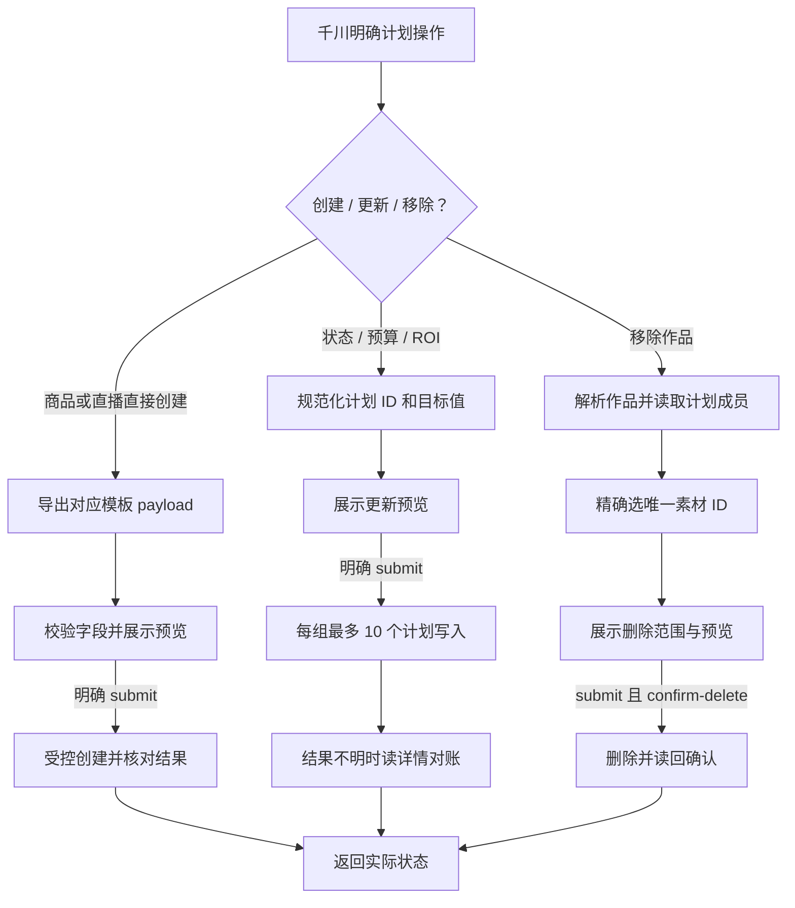

| 节点 | 做什么 | 方法与源码 | 产出与分支 | 访问 |
| --- | --- | --- | --- | --- |
| M01 | 根据精确操作类型选择用例 | 千川计划能力目录（[能力](../../runtime/ocean-watch-go/internal/contracts/capabilities.go)） | 这些当前为 CLI 能力；与作品预检 MCP 入口不同 | 本地 |
| M02 | 区分直接创建、设置变更与成员移除 | `CommandService`、`MutationExecutor`、`RemoveExecutor`（[命令](../../runtime/ocean-watch-go/internal/application/plans/qianchuan/commands.go)） | 不将所有操作套用作品三关核验 | 本地 |
| M03 | 选择商品全域或直播全域模板 | `createPayload`、ExportQianchuanPlanPayload（[模板导出](../../runtime/ocean-watch-go/internal/application/plans/qianchuan/commands.go)） | 目标类型和绑定明确；通用创建不能自行默认商品/直播 | 本地 |
| M04 | 校验创建 payload、预算和缺失字段 | `CreatePlan`、`normalizeCreateRequest`（[校验](../../runtime/ocean-watch-go/internal/application/plans/qianchuan/create.go)） | blocking_fields 非空时不派发；直接模板创建不等同于作品链接预检 | 本地 |
| M05 | 写入并在结果不明时使用相应官方对账 | `CreateExecutor.Execute`（[创建](../../runtime/ocean-watch-go/internal/application/plans/qianchuan/create.go)） | 创建结果及派发状态 | 官方写 |
| M06 | 校验十进制 ID、状态和精确目标值 | `normalizeQianchuanMutation`（[参数](../../runtime/ocean-watch-go/internal/application/plans/qianchuan/mutations.go)） | 状态/预算/ROI 的合法目标 | 本地 |
| M07 | 在未提交时返回目标更新预览 | `MutationExecutor.Execute` 与 GuardedExecutor（[预览](../../runtime/ocean-watch-go/internal/application/plans/qianchuan/mutations.go)） | dry_run；不修改计划 | 本地 |
| M08 | 按账户锁分批更新官方设置 | MutationStatus/Budget/ROI，当前每批最多 10 个计划（[更新](../../runtime/ocean-watch-go/internal/application/plans/qianchuan/mutations.go)） | 行级成功、失败和派发状态 | 官方写 |
| M09 | 在未知派发情况下比较计划当前设置 | FetchPlanDetail 和对账判断（[读回](../../runtime/ocean-watch-go/internal/application/plans/qianchuan/mutations.go)） | 不把结果不明当作明确失败重试 | 官方读 |
| M10 | 用原作品 ID 查指定计划中的素材成员 | `RemoveWorks`、RemoveExecutor（[移除](../../runtime/ocean-watch-go/internal/application/plans/qianchuan/remove.go)） | 当前入口使用 Links.Resolve，也可能调用 F2；之后读取指定计划素材 | 官方读 |
| M11 | 将作品映射到唯一有效素材 ID | 移除用例的匹配规则（[选择](../../runtime/ocean-watch-go/internal/application/plans/qianchuan/remove.go)） | 无匹配、多个匹配、已删除分别报告 | 本地 |
| M12 | 展示具体计划、素材和官方关联删除提示 | RemoveResult.RiskNotice、ConfirmDelete（[预览](../../runtime/ocean-watch-go/internal/application/plans/qianchuan/remove.go)） | 用户必须确认准确范围；多号/多商品删除可能影响关联投放 | 本地 |
| M13 | 每批最多 100 素材执行删除并查询确认 | `/v1.0/qianchuan/uni_promotion/ad/material/delete/`（[派发](../../runtime/ocean-watch-go/internal/application/plans/qianchuan/remove.go)） | submit 与 confirm-delete 缺一不可 | 官方写 |
| M14 | 展示成功、失败、未知和核对结果 | 对应 Result Presenter（[用例](../../runtime/ocean-watch-go/internal/application/plans/qianchuan/mutations.go)） | 不用一个 ok 字段概括所有行 | 本地 |

## 14 巨量营销：素材核验到创建 payload

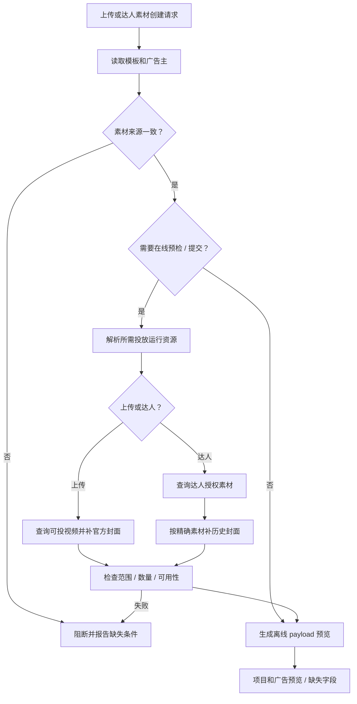

| 节点 | 做什么 | 方法与源码 | 产出与分支 | 访问 |
| --- | --- | --- | --- | --- |
| N01 | 区分账户上传和达人授权创建 | PrepareUpload / PrepareCreator（[类型](../../runtime/ocean-watch-go/internal/application/plans/marketing/prepare.go)） | 精确广告主、素材 ID、模板、商品和命名参数 | 本地 |
| N02 | 合并营销模板与运行参数 | `ApplyMarketingPlanTemplate`、`Preparer.Prepare`（[模板](../../runtime/ocean-watch-go/internal/application/plans/marketing/prepare.go)） | 模板绑定账户；不使用千川模板或 Token | 本地 |
| N03 | 校验 source_type 和每单元素材数 | source_type 与 materialLimit（[来源](../../runtime/ocean-watch-go/internal/application/plans/marketing/prepare.go)） | 不允许上传素材走达人模板；当前营销单元素材上限默认 5 | 本地 |
| N04 | 区分离线结构预览与官方在线核验 | `Submit` 或 `OnlinePreflight` 为真（[模式](../../runtime/ocean-watch-go/internal/application/plans/marketing/prepare.go)） | 离线预览不证明素材可投 | 本地 |
| N05 | 按缺失条件解析事件、DPA、商品图和投放资源 | `AssetResolver.Resolve`（[运行资源](../../runtime/ocean-watch-go/internal/application/plans/marketing/runtime_assets.go)） | 已有明确资源直接复用；按需查官方项目/广告/事件，不无条件查询所有资源 | 官方读 |
| N06 | 根据素材来源走不同官方核验 | prepareUploadedVideos / prepareCreatorVideos（[分支](../../runtime/ocean-watch-go/internal/application/plans/marketing/prepare.go)） | 视频库或达人素材查询 | 本地 |
| N07 | 确认上传视频可投，并为每个视频取得官方封面 | QueryVideos 的 ad-get 与 cover-suggest 模式（[上传素材](../../runtime/ocean-watch-go/internal/application/plans/marketing/prepare.go)） | 精确 video_id、cover_id；缺失或不可用阻断 | 官方读 |
| N08 | 按明确 item_id 查询当前授权及可用性 | `Materials.QueryCreator`，MinimumRemainingDays=1（[达人素材](../../runtime/ocean-watch-go/internal/application/plans/marketing/prepare.go)） | 候选达人、作品、素材及不可用原因 | 官方读 |
| N09 | 缺封面时按作品＋素材匹配历史官方广告 | `HistoricalCreatorCoverResolver.Resolve`（[封面恢复](../../runtime/ocean-watch-go/internal/application/plans/marketing/creator_cover.go)） | 唯一封面才复用；多个或没有候选不猜测 | 官方读 |
| N10 | 检查素材、达人与广告主范围及选材限制 | prepareCreatorVideos、applyCreatorPayload（[核验](../../runtime/ocean-watch-go/internal/application/plans/marketing/prepare.go)） | 同单元素材与模板策略一致 | 本地 |
| N11 | 渲染名称、预算、ROI、商品和创意字段 | `BuildPayloads`（[payload](../../runtime/ocean-watch-go/internal/application/plans/marketing/payload.go)） | Project 与 Promotion payload；广告需要项目 ID | 本地 |
| N12 | 返回来源证据、选材和缺失字段 | `PreparedPlan`、PreflightSummary（[预览](../../runtime/ocean-watch-go/internal/application/plans/marketing/prepare.go)） | 明确提交后进入图 15 | 本地 |
| N13 | 保留精确输入或运行资源失败原因 | Prepare 返回错误和 MissingFields（[错误](../../runtime/ocean-watch-go/internal/application/plans/marketing/prepare.go)） | 不把离线结构通过表述为官方审核通过 | 本地 |

## 15 巨量营销：批量、项目 / 广告事务与恢复

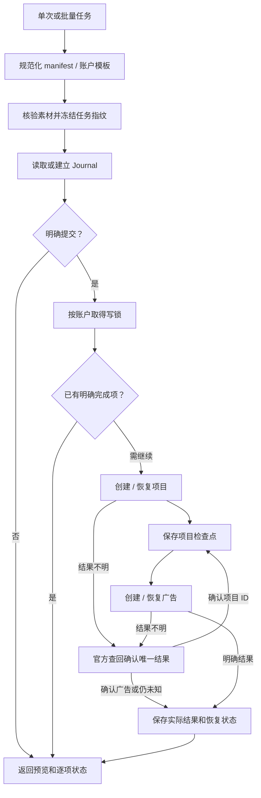

| 节点 | 做什么 | 方法与源码 | 产出与分支 | 访问 |
| --- | --- | --- | --- | --- |
| O01 | 选择单次上传/达人或批量创建 | CreateService、UploadBatchService、CreatorBatchService（[创建](../../runtime/ocean-watch-go/internal/application/plans/marketing/create.go)） | 全部使用营销专属用例 | 本地 |
| O02 | 校验 manifest、精确素材、账户与模板映射 | `ParseCreatorBatchManifest`、resolveUploadAccountTemplates（[达人批量](../../runtime/ocean-watch-go/internal/application/plans/marketing/creator_batch.go)、[上传批量](../../runtime/ocean-watch-go/internal/application/plans/marketing/upload_batch.go)） | 不一致任务在执行前阻断 | 本地 |
| O03 | 按该批量模式核验素材并生成稳定任务身份 | `CreatorBatchFingerprint`、uploadScopeFingerprint（[指纹](../../runtime/ocean-watch-go/internal/application/plans/marketing/creator_batch.go)） | 在线模式查官方素材，离线模式只做结构预览；上传批量冻结候选素材，恢复时不随素材库新增而换任务 | 官方读 / 本地 |
| O04 | 读取任务范围记录并核对指纹 | `BatchRunner.Execute`、findUploadJournal（[记录](../../runtime/ocean-watch-go/internal/application/plans/marketing/batch.go)） | 当前营销主要使用文件 Journal；不同批量模式的预检记录策略各自定义 | 本地 |
| O05 | 执行当前 Submit 门禁 | `GuardedExecutor.Execute`（[门禁](../../runtime/ocean-watch-go/internal/application/plans/write_safety.go)） | dry_run 输出；明确提交才能派发官方写入 | 本地 |
| O06 | 汇总逐项预览、成功、失败和待恢复 | BatchResult、CreatorBatchResult、UploadBatchResult（[批量](../../runtime/ocean-watch-go/internal/application/plans/marketing/batch.go)） | 成功项和失败项分别保存，不宣称整体原子事务 | 本地 |
| O07 | 同广告主写任务串行，不同账户可受限并发 | WithAdvertiserLock 和 BatchRunner（[写锁](../../runtime/ocean-watch-go/internal/application/plans/write_safety.go)） | 避免本地并发重复创建 | 本地 |
| O08 | 检查完成、项目已建、广告未知等任务状态 | Journal.Jobs / 恢复判断（[状态](../../runtime/ocean-watch-go/internal/application/plans/marketing/batch.go)） | 已明确完成项不重新派发；未决项进入相应恢复步骤 | 本地 |
| O09 | 按单次操作 key 创建或恢复项目 | `Executor.executeTransaction`、`/v3.0/project/create/`（[项目](../../runtime/ocean-watch-go/internal/application/plans/marketing/executor.go)） | 明确 project_id；未知结果先对账 | 官方写 |
| O10 | 持久保存项目已创建的事实 | `emitCheckpoint`（[检查点](../../runtime/ocean-watch-go/internal/application/plans/marketing/executor.go)） | 后续广告失败时保留项目；重试复用准确项目 ID | 本地 |
| O11 | 把准确项目 ID 注入广告 payload 后派发一次 | `/v3.0/promotion/create/`、promotionPayload（[广告](../../runtime/ocean-watch-go/internal/application/plans/marketing/executor.go)） | promotion_id 与完成状态 | 官方写 |
| O12 | 根据精确创建身份查回项目或广告 | `reconcileProject`、`reconcilePromotion`（[对账](../../runtime/ocean-watch-go/internal/application/plans/marketing/executor.go)） | 只有唯一可核实结果才确认；无结果/歧义保持恢复状态 | 官方读 |
| O13 | 保存逐项结果、检查点和派发事实 | Journal.Save、Checkpoint（[持久记录](../../runtime/ocean-watch-go/internal/application/plans/marketing/batch.go)） | 跨调用恢复依赖 Journal；OnceDispatcher 自身只保证本次实例不重复派发 | 本地 |

营销项目/广告的状态、预算、出价、ROI 更新使用独立 `MutationExecutor` 和每批最多 10 个对象的参数约束，复用账户写锁、一次派发和未知结果读回规则；具体端点见能力清单所对应的[更新用例](../../runtime/ocean-watch-go/internal/application/plans/marketing/mutations.go)。

## 16 素材 / 资源发现、报表与负责账户汇总

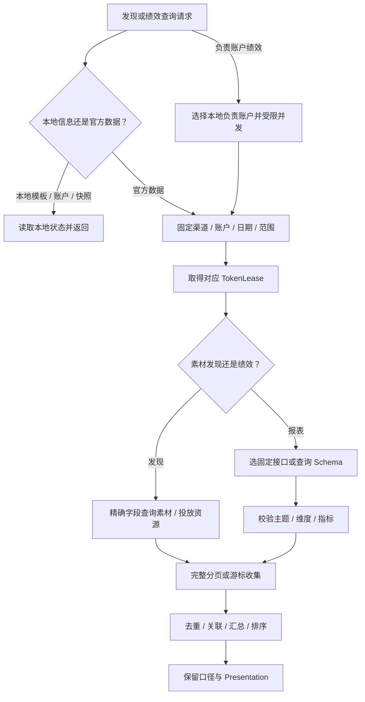

| 节点 | 做什么 | 方法与源码 | 产出与分支 | 访问 |
| --- | --- | --- | --- | --- |
| P01 | 识别找 ID、看配置还是查日期绩效 | FastRoute / 能力合同（[合同](../../runtime/ocean-watch-go/internal/contracts/capabilities.go)） | 同一商品/计划的列表与报表不能混用统计口径 | 本地 |
| P02 | 对只读本地工具避免无关官方调用 | MCP 专用 query handlers（[注册](../../runtime/ocean-watch-go/internal/mcpserver/server.go)） | 模板、负责账户、授权状态和预检快照查询不刷新 Token | 本地 |
| P03 | 返回本地模板、成员、授权元数据或快照 | templates.Query、auth.QueryService、GetBatchPreflight（[本地查询](../../runtime/ocean-watch-go/internal/application/templates/query.go)） | 不用历史快照替代当前绩效 | 本地 |
| P04 | 固定渠道、目标账户及日期和 report scope | 规范化 Query（[千川报表](../../runtime/ocean-watch-go/internal/application/reports/qianchuan.go)） | overall 包含乘方，uni 为全域；营销/千川不会复用对方指标 | 本地 |
| P05 | 按需准备当前授权和请求上下文 | Service.token / marketingToken（[报表](../../runtime/ocean-watch-go/internal/application/reports/marketing.go)） | Token 刷新见图 05 | 授权 |
| P06 | 分配到发现或报表用例 | 素材、discovery、reports Service（[发现](../../runtime/ocean-watch-go/internal/application/discovery/marketing.go)） | 选择准确源，而不是用列表财务字段代替报表 | 本地 |
| P07 | 查上传素材、达人、商品、项目/广告、DPA/事件等 | `QueryVideos/QueryCreator`、`QueryProjects/QueryPromotions/QueryDPA/QueryEvents/QueryGoals/ResolveCities`（[素材](../../runtime/ocean-watch-go/internal/application/materials/marketing.go)、[发现](../../runtime/ocean-watch-go/internal/application/discovery/marketing.go)） | 精确 ID、名称或明确过滤条件，保留真实来源 | 官方读 |
| P08 | 区分固定账户/计划报表与自定义报表 | 千川 all_promotion、uni_promotion、config/data；营销 config/get 与 custom/get（[千川统一报表](../../runtime/ocean-watch-go/internal/application/reports/qianchuan_unified.go)） | 自定义报表先确认主题和可用字段 | 官方读 |
| P09 | 按官方 Schema 校验 dimensions、metrics 和 filters | reports Service 的 Schema/Custom（[Schema](../../runtime/ocean-watch-go/internal/application/reports/qianchuan_unified.go)） | 未支持字段、主题或不合法组合不发送查询 | 本地 |
| P10 | 使用稳定主键收集全部分页 / 游标 | `pagination.CollectPages/CollectCursor`（[分页平台](../../runtime/ocean-watch-go/internal/platform/pagination)） | 页数上限、重复主键和完整性错误明确返回；top 主要影响展示而非扫描量 | 官方读 |
| P11 | 用明确 ID 关联素材/广告和报表，精确计算金额 | `parseMarketingPlanRows`、summaries、`domain.Decimal`（[汇总](../../runtime/ocean-watch-go/internal/application/reports/marketing.go)） | 消耗、订单、GMV、ROI 与排序；空值和零值按具体报表合同处理 | 本地 |
| P12 | 保留日期、scope、来源、失败和必需表格 | `domain.Presentation`、各 MCP Presenter（[展示](../../runtime/ocean-watch-go/internal/mcpserver/qianchuan.go)） | required rendered_markdown 原样输出，部分失败不隐藏 | 本地 |
| P13 | 按本地负责范围选择账户，逐户授权与查询 | `accounts.Reporter.Report`；默认并发 4，上限 8（[汇总](../../runtime/ocean-watch-go/internal/application/accounts/report.go)） | marketing/qianchuan 可汇总；当前 star_map 没有绩效 Reporter | 本地 |

## 17 官方请求控制与本地数据边界

本图展开一次 Port 请求的网络治理和按需落地；投放写入的账户锁、派发前检查点和恢复记录由上层用例负责，见图 12、15。只需返回结果的查询不会强制写入业务 Journal。

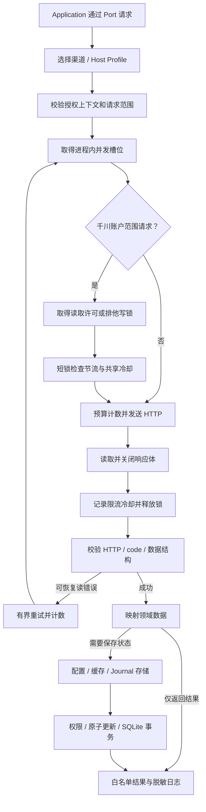

| 节点 | 做什么 | 方法与源码 | 产出与分支 | 访问 |
| --- | --- | --- | --- | --- |
| Q01 | 让业务规则依赖 Port 而非 SDK 类型 | Ports 与 Adapter（[端口](../../runtime/ocean-watch-go/internal/ports)） | 相同用例可注入隔离测试实现 | 本地 |
| Q02 | 选择官方主机、超时和客户端缓存 | `ClientFactory.Client`（[客户端](../../runtime/ocean-watch-go/internal/adapters/oceanengine/client.go)） | 官方业务/账户发现走 api.oceanengine.com；OAuth/代理/千川作品 Profile 走 ad.oceanengine.com | 本地 |
| Q03 | 核对渠道授权与精确 advertiser scope | `governedTransport.RoundTrip`、`securityTransport`（[范围](../../runtime/ocean-watch-go/internal/adapters/oceanengine/client.go)） | host/scheme 固定，禁止 SDK 重定向，响应默认最大 8 MiB | 本地 |
| Q04 | 按授权和 endpoint family 取得并发槽位 | `requestcontrol.Governor.Acquire`（[进程内治理](../../runtime/ocean-watch-go/internal/platform/requestcontrol/control.go)） | 普通千川授权并发默认 1；预检 MCP Factory 配到 10，ReadPool 按请求限制 1–10 | 本地 |
| Q05 | 判断是否已经固定千川广告主 | `qianchuanAdvertiserScopedProfile`（[Profile](../../runtime/ocean-watch-go/internal/adapters/oceanengine/client.go)） | 官方业务/作品 Profile 使用共享控制；OAuth/账户发现阶段不走广告主共享锁 | 本地 |
| Q06 | 读取取得两个固定槽位之一及旧协议共享锁，写入取得排他锁 | `AcquireRead`、`Acquire`（[读取控制](../../runtime/ocean-watch-go/internal/adapters/filesystem/qianchuan_read_control.go)） | 同账户读取可同时在途；写入及旧版排他请求与读取互斥；进程退出由 OS 释放许可 | 本地 |
| Q07 | 记录请求尝试并执行官方网络请求 | `ReserveAttempt`、基础 RoundTrip（[发送](../../runtime/ocean-watch-go/internal/adapters/oceanengine/client.go)） | 普通请求默认预算 4096；作品预检用无硬计数上限的跟踪预算，仍有分页/HTTP/取消约束；写入需先通过用例门禁 | 官方读 / 写 |
| Q08 | 有界读取并关闭响应体 | governedTransport、timeoutBody、sharedControlledBody.Close（[响应](../../runtime/ocean-watch-go/internal/adapters/oceanengine/client.go)） | 千川固定广告主请求默认准入等待 60 秒，派发后的网络/响应体读取 30 秒；其他请求保留 HTTP 总超时，均服从调用方截止时间 | 官方读 |
| Q09 | 观察限流结果，更新冷却并恰好一次释放许可和锁 | sharedControlledBody、Controller 返回的 release（[释放](../../runtime/ocean-watch-go/internal/adapters/filesystem/qianchuan_read_control.go)） | 请求间隔 250ms；限流默认冷却 5 秒，Retry-After 有界到 30 秒；错误和取消同样收尾 | 本地 |
| Q10 | 要求 HTTP 成功、业务 code=0 和必要结构 | `GuardEnvelope`、各 response guard（[响应校验](../../runtime/ocean-watch-go/internal/adapters/oceanengine/envelope.go)） | 超时、业务错误、缺数据不当作空结果或未授权 | 本地 |
| Q11 | 仅对分类可恢复的官方读错误重试 | `ClassifyReadError`、`readPolicy`（[重试](../../runtime/ocean-watch-go/internal/adapters/oceanengine/retry.go)） | 默认延迟 1秒、2秒加抖动；最多两次额外重试；投放写入不按这套策略盲目重放 | 官方读 |
| Q12 | 映射稳定 ID、分页和业务字段 | 各官方 Adapter（[千川](../../runtime/ocean-watch-go/internal/adapters/oceanengine/qianchuan_read.go)） | ID 用字符串输出，SDK 枚举和响应结构留在 Adapter 内 | 本地 |
| Q13 | 按数据职责选择存储 | 受保护配置/授权索引/绑定文件、身份缓存、SQLiteJournalStore、系统凭据（[Journal](../../runtime/ocean-watch-go/internal/adapters/sqlite/journal.go)） | 当前千川预检默认 SQLite；营销 Journal 等仍有文件实现；秘密在系统凭据库 | 本地 |
| Q14 | 校验权限、拒绝符号链接并采用原子更新 / DB 事务 | filesystem、ConfigStore.CAS、SQLite Adapter（[SQLite](../../runtime/ocean-watch-go/internal/adapters/sqlite)） | WAL/迁移/外键等由存储层设置；完整全量迁移仍待接入；事务不跨网络等待 | 本地 |
| Q15 | 输出必要业务状态和阶段计数 | MCP Presenter、performance、stderr 结构日志（[输出](../../runtime/ocean-watch-go/internal/mcpserver/qianchuan.go)） | 秘密和内部配置不进入普通工具输出 | 本地 |
| Q16 | 仅在短锁内检查并更新下一次准入时间及冷却 | `admitRead`、`recordReadCooldown`（[准入](../../runtime/ocean-watch-go/internal/adapters/filesystem/qianchuan_read_control.go)） | 读取等待和网络 I/O 不占用状态短锁；醒来重新检查冷却；状态 JSON 保持旧格式；两个槽位是本地保守上限，不是官方配额 | 本地 |

## 18 构建、安装、更新与 Runtime 回退

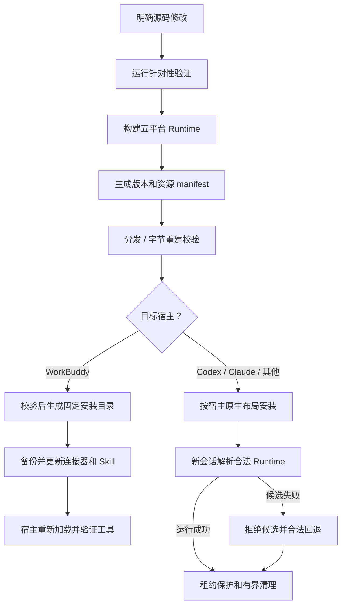

| 节点 | 做什么 | 方法与源码 | 产出与分支 | 访问 |
| --- | --- | --- | --- | --- |
| R01 | 在明确授权范围修改源码并保留已有改动 | 仓库 AGENTS.md（[规则](../../AGENTS.md)） | 本地修改、提交、推送、正式发布是分别授权的阶段 | 本地 |
| R02 | 根据范围执行 Go/Python/协议与分发验证 | CONTRIBUTING 和测试入口（[贡献](../../CONTRIBUTING.md)） | 隔离测试不能代替真实宿主和业务验收 | 本地 |
| R03 | 固定工具链生成五个平台二进制 | `cmd/build-runtime --all`（[构建器](../../runtime/ocean-watch-go/cmd/build-runtime/main.go)） | darwin/linux amd64、arm64，windows amd64；CGO=0、trimpath | 本地 |
| R04 | 将版本、二进制和必要资源绑定到 manifest | `buildRuntimeManifest`（[清单](../../runtime/ocean-watch-go/cmd/build-runtime/main.go)） | SHA-256 指纹识别同版本不同内容；摘要不是独立来源签名 | 本地 |
| R05 | 核对版本关系、分发资源和可重现字节 | validate_distribution、version_tag、build-runtime --verify（[分发校验](../../scripts/validate_distribution.py)） | 普通代码修改仍归未发布，不自动升版本或发 Release | 本地 |
| R06 | 使用目标宿主规定的接入方式 | Host 清单和接入说明（[架构](overview.md)） | 每个宿主拥有自己的连接与进程 | 本地 |
| R07 | 识别本机平台并验证安装文件 | `install`（[WorkBuddy 安装](../../scripts/install-workbuddy.py)） | 版本＋manifest 指纹命名的固定目录 | 本地 |
| R08 | 保留其他服务、共享数据和原生信任，备份旧配置 | 原子写 JSON、render_skill（[安装器](../../scripts/install-workbuddy.py)） | 三个 MCP-only Skill；不把 CLI 不可调用能力伪装成 WorkBuddy 工具 | 本地 |
| R09 | 按宿主状态加载新二进制并验收连接 | mcp-probe 与原生宿主验证（[协议探测](../../runtime/ocean-watch-go/cmd/mcp-probe/main.go)） | 当前工具目录 26 项；工具连接通过不代表完整业务预检通过 | 本地 |
| R10 | 使用各宿主清单注册 Skill 和 MCP | Codex/Claude/Harness/豆包适配资源（[布局](overview.md)） | Harness 桌面兼容与实际 profile 验收另有项目规则 | 本地 |
| R11 | 按来源解析版本，并确认当前 Host 合同 | `Manager.Resolve`、代理 catalog 比较（[版本](../../runtime/ocean-watch-go/internal/runtimeupdate/manager.go)） | 兼容实现可切换；工具 Schema/Skill 合同变化需新会话 | 本地 |
| R12 | 记录候选拒绝并选择合法上一版本 | `Manager.Reject`（[回退](../../runtime/ocean-watch-go/internal/runtimeupdate/manager.go)） | 不清理或覆盖用户业务数据 | 本地 |
| R13 | 活动使用者退出后才清理旧 Runtime | `PruneObsoleteRuntimes`（[资源](../../runtime/ocean-watch-go/internal/runtimeupdate/manager.go)） | 共享数据保留；发布到远端和 Release 不属于安装流程的自动步骤 | 本地 |

## 19 星图当前范围与统一操作目标

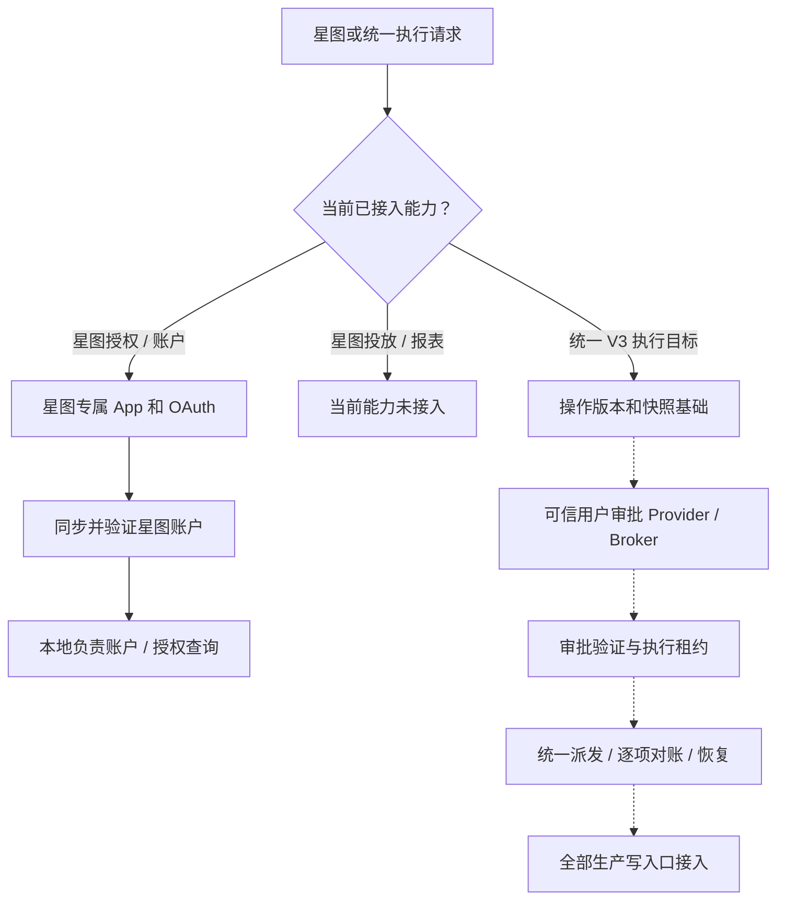

| 节点 | 做什么 | 方法与源码 | 产出与分支 | 访问 |
| --- | --- | --- | --- | --- |
| S01 | 固定 star_map 渠道或辨明目标架构问题 | 星图 Skill 与架构合同（[Skill](../../skills/xt-plan-monitor/SKILL.md)） | 避免把 shared 能力误认为星图投放能力 | 本地 |
| S02 | 依据能力目录和生产组合根确认当前范围 | `DefaultCapabilityRegistry`、MCP Runtime（[能力](../../runtime/ocean-watch-go/internal/contracts/capabilities.go)） | 当前星图仅授权、同步和本地账户/授权查询 | 本地 |
| S03 | 使用星图独立授权身份 | `auth.Service` 的 star_map 分支（[授权](../../runtime/ocean-watch-go/internal/application/auth/service.go)） | 不复用营销/千川 App 或 Token | 授权 |
| S04 | 过滤正确账户角色并核对星图身份 | `filterStarMapAccounts`、`verifyStarAccounts`（[发现](../../runtime/ocean-watch-go/internal/adapters/oceanengine/advertisers.go)） | 星图授权账户快照 | 官方读 |
| S05 | 使用中性 subject_id 与 star_account 类型输出 | `list_managed_accounts`、`get_star_map_authorization`（[注册](../../runtime/ocean-watch-go/internal/mcpserver/server.go)） | 星图账号不称为千川广告主 | 本地 |
| S06 | 标明尚未接入星图模板、计划、素材和报表 | 当前目录与生产入口（[架构边界](overview.md)） | 不给出伪造官方投放或绩效结果 | 待接入 |
| S07 | 已有操作版本、快照和数据库基础实现 | Operation Domain、SQLite Repository（[基础](../../runtime/ocean-watch-go/internal/application/operations/service.go)） | 当前千川 Journal 使用部分基础；不等于统一控制链路全部已接入 | 待接入 |
| S08 | 目标：取得真实用户可验证审批证据 | Approval Ports 与 PRD（[目标说明](overview.md)） | 真实宿主 Provider/Broker 尚未全面生产接入 | 待接入 |
| S09 | 基础：验证回执并原子消费审批和取得租约 | `AcceptApproval`、`Service.Execute`（[基础服务](../../runtime/ocean-watch-go/internal/application/operations/service.go)） | 有实现基础；不能声称现有 --submit 已具有该证据链 | 待接入 |
| S10 | 目标：统一操作版本、派发意图和逐项恢复 | `BeginDispatch`、`CompleteDispatch`（[基础服务](../../runtime/ocean-watch-go/internal/application/operations/service.go)） | 生产写用例当前仍各自使用 Guard/Journal/对账 | 待接入 |
| S11 | 目标：所有生产入口共用模式、审批和恢复门禁 | 生产组合根与 V3 架构说明（[差异](overview.md)） | 当前未全面接入；不作为现在耗时链路中的已运行步骤 | 待接入 |

## 耗时与复杂度：当前代码已经能确认的部分

### 千川请求次数

假设：一个已唯一匹配的子批次，网络请求成功，无重试、无 UID 恢复、无额外授权候选页；将不同达人的作品分别按 50 条分批。令达人数量为 C，第 c 个达人归属查询批次为 Bc，模板绑定商品数为 P；商品复核只针对归属成功的作品，记其批次数为 Bc'。

- 达人授权：通常 C 次；多页查询和多个可见号关键词会增加次数。
- 作品归属：sum(Bc) 次。
- 商品复核：P × sum(Bc') 次。当前代码按模板商品创建任务，随后才按行目标收敛。
- 没有 UID、只有准确可见号：先增加完整身份恢复查询，再执行常规授权查询。
- 计划清单：至少 1 次，正常为列表页数；每页 100，最多 100 页。
- 候选计划详情：每个候选计划最多一次，子批次内共享查询。
- 已绑定计划素材：完整素材分页；同计划在本读池中共享一次完整查询。
- 同账户同授权范围的模板子批次共享一次清单及相同计划详情；不同账户或授权范围单独查询。
- 官方读失败的默认重试最多增加 2 次请求；F2 的失败项额外重试最多 1 次，二者不是同一策略。

一条作品、一个商品、已知 UID、授权列表一页且计划列表一页时，最低常见路径是 3 次作品官方核验＋1 次计划清单，尚不包含候选详情、素材成员、Token 刷新和重试。这是请求结构推导，不是实测秒数。

### 同账户读取的并行边界

`CommandService.BatchWorks` 先完成整批 F2，再取得账户范围凭据，重叠计划清单与各达人的官方核验。`ReadPool` 默认 8；同账户读取最多两个请求在途，并通过共享旧协议锁与写入或旧版排他请求互斥。每个达人自己的核验完成后可独立进入计划匹配和素材差集。

该行为由[共享读取控制](../../runtime/ocean-watch-go/internal/adapters/filesystem/qianchuan_read_control.go)、[HTTP Transport](../../runtime/ocean-watch-go/internal/adapters/oceanengine/client.go)和[并行/超时回归](../../runtime/ocean-watch-go/internal/adapters/oceanengine/qianchuan_parallel_test.go)支持。250ms 派发间隔、共享冷却、旧版进程的排他请求和响应时间仍会增加墙钟。准入等待默认上限 60 秒；取得许可后，网络及响应体读取另有 30 秒上限，均受调用方取消约束。

### 等待和阻断点

| 当前环节 | 为什么增加复杂度或耗时 | 现有证据 / 确认范围 |
| --- | --- | --- |
| 未标商品的自动路由 | 先取公开商品元数据，才能确定模板和广告主 | routeBatchWorks；明确商品/模板的行仍先尝试 F2，失败后才使用可用缓存或用户补充身份 |
| UID 恢复 | 完整精确匹配之后仍有一次常规授权检查 | recoverVisibleCreatorHints → resolveAuthorizedHint |
| 归属与商品分两轮 | 一轮确认归属，第二轮带商品条件确认可用于目标商品 | WorkVerifier.Verify；成功查无与查询失败分别分类 |
| 多商品模板 | 对模板商品逐个构造作品过滤查询 | productTasks；行目标在结果汇总阶段才收敛 |
| 计划清单扫描 | 全域接口未提供 UID 筛选，需覆盖可能的计划 | ScanCurrentPlans；同账户同授权共享，完整分页失败阻断 |
| 首页后并行分页 | 同账户只允许两个读取请求在途，分页期间变化会触发完整性错误 | AcquireRead / validateCurrentPlanPage |
| 零可用作品仍等待清单 | Token 就绪时已开始扫描，核验后必须等待扫描返回 | coordinate 中 inventoryReady 汇合 |
| 历史计划与绑定 | 按段完成必要详情核验，查本地分组绑定并比较摘要 | FindCurrentPlans / PlanBindingDigest；每段最多 200 个，失败不继续下一段 |
| 追加素材差集 | 要完整读取现有素材，才能避免重复追加或错误目标 | planMaterialsWithPool / executeExistingGroup |
| 真正提交再次校验 | 在写锁内重查模板、计划、绑定和素材划分 | submitBatchPreflight；复用作品核验快照 |
| 重试和限流 | 准入等待、网络超时、官方可恢复错误与共享冷却延长墙钟 | 准入 60秒、派发后读取 30秒、readPolicy、共享冷却；占比须以实际计时核实 |

### 怎样读取真实计时

`performance.stages` 包含输入规范化、短链、F2、凭据、官方核验、计划清单、分组对账、素材差集、快照保存和 `total_runtime_seconds`。组件可以重叠，不能把所有 stage 秒数相加；端到端以 total_runtime_seconds 为准。`performance.requests` 包含官方尝试、重试、缓存和绑定计数。模型在宿主中理解意图的耗时不在 Plugin 的 Runtime 计时内。

MCP 全局阶段错误在 `error.details` 保留已取得的性能数据；达人分组错误在 `failed_results[].error_details` 保留安全阶段、超时/取消原因、端点和官方数字错误码，并按需提供 `inventory_reason`。未运行或未测量的后续阶段不作为已完成证据，原始异常和凭据不输出。单个 `PLAN_INVENTORY_QUERY_FAILED` 仍不能证明是计划数量导致超时；必须核对实际原因、耗时与请求计数。`ok=true` 也不能替代分组成功和快照可提交检查。

## 能力清单

以下清单从当前 `DefaultCapabilityRegistry` 提取。CLI 与 MCP 重叠能力只计一次业务身份；Transport 选择按 Skill Fast Route 和宿主支持范围执行。WorkBuddy 当前安装版只挂载 MCP 路由，CLI 条目不等同于 WorkBuddy 可直接调用工具。`需要提交门禁`用于真实执行，干跑预览不派发线上写入；本地配置管理各动作的门禁以具体实现为准。

<!-- capability-inventory:start -->
<!-- 本段由当前能力合同生成；修改能力后重新核对。 -->

当前共 **91 项唯一能力**，含 **77 个 CLI 命令、26 个 MCP 工具**；其中 12 项同时有两种 Transport。按合同渠道计数：shared 31、qianchuan 34、marketing 25、star_map 1。shared 管理能力可用于多个渠道，不表示星图已有投放或报表。

| 能力 ID | CLI 命令 | MCP 工具 | 合同副作用 | 需要提交门禁 | 流程 |
| --- | --- | --- | --- | --- | --- |
| `shared.setup_doctor` | `setup doctor` | — | 本地读 | 否 | [03](#flow-03) |
| `shared.setup_initialize` | `setup init` | — | 本地写 | 否 | [03](#flow-03) |
| `shared.setup_validate` | `setup validate` | — | 本地读 | 否 | [03](#flow-03) |
| `shared.authorization_set_app` | `auth set-app` | — | 授权写 | 否 | [04](#flow-04) |
| `shared.authorization_authorize` | `auth authorize` | — | 授权写 | 否 | [04](#flow-04) |
| `shared.authorization_status` | `auth status` | — | 本地读 | 否 | [05](#flow-05) |
| `shared.authorization_refresh` | `auth refresh` | — | 授权写 | 否 | [05](#flow-05) |
| `shared.authorization_sync_accounts` | `auth sync-accounts` | — | 授权写 | 否 | [04](#flow-04) |
| `shared.authorization_mappings` | `auth mappings` | — | 本地读 | 否 | [05](#flow-05) |
| `shared.managed_account_list` | `accounts list` | `list_managed_accounts` | 本地读 | 否 | [06](#flow-06) |
| `shared.managed_account_add` | `accounts add` | — | 本地写 | 否 | [06](#flow-06) |
| `shared.managed_account_remove` | `accounts remove` | — | 本地写 | 否 | [06](#flow-06) |
| `shared.managed_account_enable` | `accounts enable` | — | 本地写 | 否 | [06](#flow-06) |
| `shared.managed_account_disable` | `accounts disable` | — | 本地写 | 否 | [06](#flow-06) |
| `shared.managed_account_report` | `accounts report` | — | 官方读 | 否 | [16](#flow-16) |
| `shared.template_list` | `templates list` | `list_templates` | 本地读 | 否 | [06](#flow-06) |
| `shared.template_get` | `templates show` | `get_template` | 本地读 | 否 | [06](#flow-06) |
| `shared.template_create` | `templates create` | — | 本地写 | 否 | [06](#flow-06) |
| `shared.template_set_copy` | `templates set-copy` | — | 本地写 | 否 | [06](#flow-06) |
| `shared.template_validate` | `templates validate` | — | 本地读 | 否 | [06](#flow-06) |
| `shared.template_delete` | `templates delete` | — | 本地写 | 否 | [06](#flow-06) |
| `qianchuan.template_list` | `qc-templates list` | — | 本地读 | 否 | [06](#flow-06) |
| `qianchuan.template_create` | `qc-templates create` | — | 本地写 | 否 | [06](#flow-06) |
| `qianchuan.template_update` | `qc-templates update` | — | 本地写 | 否 | [06](#flow-06) |
| `qianchuan.live_template_list` | `qc-templates list-live` | — | 本地读 | 否 | [06](#flow-06) |
| `qianchuan.live_template_create` | `qc-templates create-live` | — | 本地写 | 否 | [06](#flow-06) |
| `marketing.video_search` | `materials videos` | `search_marketing_videos` | 官方读 | 否 | [16](#flow-16) |
| `marketing.creator_material_search` | `materials creator` | `search_marketing_creator_materials` | 官方读 | 否 | [16](#flow-16) |
| `marketing.image_search` | `materials images` | — | 官方读 | 否 | [16](#flow-16) |
| `marketing.product_search` | `materials products` | — | 官方读 | 否 | [16](#flow-16) |
| `qianchuan.creator_video_search` | `qc-materials creator-videos` | — | 官方读 | 否 | [16](#flow-16) |
| `qianchuan.work_inspect` | `qc-materials inspect-work` | — | 公开读 | 否 | [07](#flow-07) |
| `qianchuan.authorized_creator_list` | `qc-materials authorized-creators` | — | 官方读 | 否 | [16](#flow-16) |
| `qianchuan.product_list` | `qc-products list` | — | 官方读 | 否 | [16](#flow-16) |
| `qianchuan.product_search` | `qc-products search` | `search_qianchuan_products` | 官方读 | 否 | [16](#flow-16) |
| `qianchuan.plan_list` | `qc-plans list` | `list_qianchuan_plans` | 官方读 | 否 | [13](#flow-13) |
| `qianchuan.plan_get` | `qc-plans show` | `get_qianchuan_plan` | 官方读 | 否 | [13](#flow-13) |
| `qianchuan.plan_material_list` | `qc-plans materials` | — | 官方读 | 否 | [13](#flow-13) |
| `qianchuan.plan_binding_audit` | `qc-plans binding-audit` | — | 官方读 | 否 | [11](#flow-11)、[13](#flow-13) |
| `qianchuan.plan_bind` | `qc-plans bind` | — | 本地写 | 是 | [11](#flow-11)、[13](#flow-13) |
| `qianchuan.plan_status_update` | `qc-plans update-status` | — | 线上写 | 是 | [13](#flow-13) |
| `qianchuan.plan_budget_update` | `qc-plans update-budget` | — | 线上写 | 是 | [13](#flow-13) |
| `qianchuan.plan_roi_update` | `qc-plans update-roi` | — | 线上写 | 是 | [13](#flow-13) |
| `shared.run_list` | `runs list` | — | 本地读 | 否 | [12](#flow-12)、[15](#flow-15) |
| `shared.run_get` | `runs show` | — | 本地读 | 否 | [12](#flow-12)、[15](#flow-15) |
| `marketing.plan_create_uploaded` | `plans create` | — | 线上写 | 是 | [14](#flow-14)、[15](#flow-15) |
| `marketing.plan_create_creator` | `plans create-creator` | — | 线上写 | 是 | [14](#flow-14)、[15](#flow-15) |
| `qianchuan.plan_create` | `plans create-qianchuan` | — | 线上写 | 是 | [13](#flow-13) |
| `qianchuan.plan_batch_works` | `plans batch-qianchuan-works` | — | 线上写 | 是 | [08](#flow-08)、[09](#flow-09)、[10](#flow-10)、[11](#flow-11)、[12](#flow-12) |
| `qianchuan.plan_remove_work` | `plans remove-qianchuan-work` | — | 线上写 | 是 | [13](#flow-13) |
| `marketing.plan_batch_uploaded` | `plans batch-upload` | — | 线上写 | 是 | [14](#flow-14)、[15](#flow-15) |
| `marketing.plan_batch_creator` | `plans batch-creator` | — | 线上写 | 是 | [14](#flow-14)、[15](#flow-15) |
| `marketing.project_status_update` | `plans update-project-status` | — | 线上写 | 是 | [15](#flow-15) |
| `marketing.promotion_status_update` | `plans update-promotion-status` | — | 线上写 | 是 | [15](#flow-15) |
| `marketing.promotion_budget_update` | `plans update-budget` | — | 线上写 | 是 | [15](#flow-15) |
| `marketing.promotion_bid_update` | `plans update-bid` | — | 线上写 | 是 | [15](#flow-15) |
| `marketing.project_roi_update` | `plans update-roi` | — | 线上写 | 是 | [15](#flow-15) |
| `marketing.material_report` | `reports materials` | `report_marketing_materials` | 官方读 | 否 | [16](#flow-16) |
| `marketing.report_schema` | `reports schema` | — | 官方读 | 否 | [16](#flow-16) |
| `marketing.custom_report` | `reports custom` | — | 官方读 | 否 | [16](#flow-16) |
| `marketing.plan_report` | `reports plans` | `report_marketing_plans` | 官方读 | 否 | [16](#flow-16) |
| `qianchuan.plan_report` | `qc-reports plans` | `report_qianchuan_plans` | 官方读 | 否 | [16](#flow-16) |
| `qianchuan.material_report` | `qc-reports materials` | — | 官方读 | 否 | [16](#flow-16) |
| `qianchuan.account_report` | `qc-reports account` | — | 官方读 | 否 | [16](#flow-16) |
| `qianchuan.uni_account_report` | `qc-reports uni-account` | `report_qianchuan_uni_account` | 官方读 | 否 | [16](#flow-16) |
| `qianchuan.report_schema` | `qc-reports schema` | — | 官方读 | 否 | [16](#flow-16) |
| `qianchuan.custom_report` | `qc-reports custom` | — | 官方读 | 否 | [16](#flow-16) |
| `qianchuan.product_report` | `qc-reports products` | — | 官方读 | 否 | [16](#flow-16) |
| `qianchuan.room_report` | `qc-reports rooms` | — | 官方读 | 否 | [16](#flow-16) |
| `qianchuan.author_report` | `qc-reports authors` | — | 官方读 | 否 | [16](#flow-16) |
| `marketing.project_discovery` | `discover projects` | — | 官方读 | 否 | [16](#flow-16) |
| `marketing.promotion_discovery` | `discover promotions` | — | 官方读 | 否 | [16](#flow-16) |
| `marketing.dpa_discovery` | `discover dpa` | — | 官方读 | 否 | [16](#flow-16) |
| `marketing.event_discovery` | `discover events` | — | 官方读 | 否 | [16](#flow-16) |
| `marketing.deep_bid_discovery` | `discover deep-bids` | — | 官方读 | 否 | [16](#flow-16) |
| `marketing.goal_discovery` | `discover goals` | — | 官方读 | 否 | [16](#flow-16) |
| `marketing.city_discovery` | `discover cities` | — | 官方读 | 否 | [16](#flow-16) |
| `shared.capability_list` | — | `get_capabilities` | 本地读 | 否 | [02](#flow-02) |
| `shared.f2_configuration_start` | — | `start_f2_configuration` | 授权写 | 否 | [03](#flow-03) |
| `shared.f2_configuration_get` | — | `get_f2_configuration_session` | 本地读 | 否 | [03](#flow-03) |
| `shared.f2_configuration_cancel` | — | `cancel_f2_configuration_session` | 授权写 | 否 | [03](#flow-03) |
| `shared.authorization_start` | — | `start_authorization` | 授权写 | 否 | [04](#flow-04) |
| `shared.authorization_session_get` | — | `get_authorization_session` | 本地读 | 否 | [04](#flow-04) |
| `shared.authorization_session_cancel` | — | `cancel_authorization_session` | 授权写 | 否 | [04](#flow-04) |
| `shared.authorization_sync_start` | — | `start_account_sync` | 授权写 | 否 | [04](#flow-04) |
| `qianchuan.work_preflight` | — | `preflight_qianchuan_works` | 官方读 | 否 | [08](#flow-08)、[09](#flow-09)、[10](#flow-10)、[11](#flow-11) |
| `qianchuan.preflight_get` | — | `get_qianchuan_preflight` | 本地读 | 否 | [12](#flow-12) |
| `qianchuan.authorization_inspect` | — | `get_qianchuan_authorization` | 本地读 | 否 | [05](#flow-05) |
| `marketing.authorization_inspect` | — | `get_marketing_authorization` | 本地读 | 否 | [05](#flow-05) |
| `star_map.authorization_inspect` | — | `get_star_map_authorization` | 本地读 | 否 | [19](#flow-19) |
| `qianchuan.account_report_fixed` | — | `report_qianchuan_account` | 官方读 | 否 | [16](#flow-16) |

合同副作用是入口声明：官方读可能按需刷新授权或保存缓存，预检会保存本地快照；它不代表调用完全没有本地副作用。真实线上写入门禁以及配置管理确认条件仍以各用例为准。
<!-- capability-inventory:end -->

## 维护与核验

- 改动流程时同时核对 Application 条件、实际 Adapter 参数、能力合同及测试；方法引用按符号和文件维护，避免用陈旧行号代替事实。
- 本文基于当前源码与隔离测试，不读取真实 Token、Cookie、授权码或生产响应。真实性能必须使用明确账户、输入和时间范围的运行证据。
- `overview.md` 继续维护总架构与目标差异；本文展开当前步骤，不将未接入目标加入已运行流程。
- 文档图示与节点表可用于交互查看；节点表中的“方法与源码、产出与分支、访问”是解释每一步的依据。
