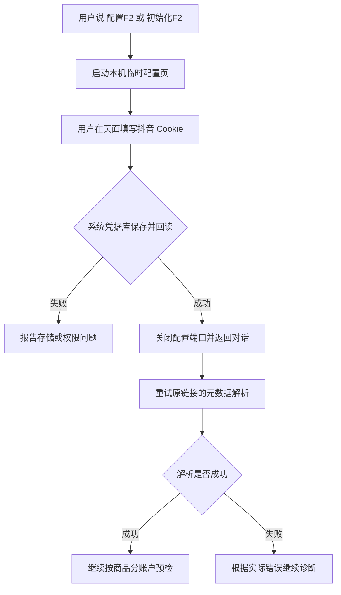

# 配置与授权

## 配置位置

读取顺序：

1. `--config PATH`
2. `ADS_PLAN_MONITOR_CONFIG`
3. 从当前目录向上找到 Plugin 根后读取 `config/ads-plan-monitor/config.json`
4. `$CODEX_HOME/ads-plan-monitor/config.json`

状态根按 `OCEAN_WATCH_HOME`、`CODEX_HOME`、`~/.codex` 依次解析；Codex、Claude Code、DeepSeek Harness 与豆包工作共用同一个根，因此授权只需完成一次。推荐普通用户运行 `setup init --home-config`；仓库内配置仅供本地开发且已被 Git 忽略。

配置存储渠道端点、OAuth 回调、负责账户和业务模板，不存 App Secret、Access Token 或 Refresh Token。修改后运行：

```bash
skills/ads-plan-monitor/run setup validate --mode query
skills/ads-plan-monitor/run setup validate --mode create-preview
skills/ads-plan-monitor/run setup validate --mode create-submit
```

## 凭据

- macOS：Keychain
- Windows：DPAPI 用户本地保护文件
- Linux：Secret Service（`secret-tool`）

没有安全后端时默认拒绝写入。仅限受控开发环境可显式设置 `ADS_PLAN_MONITOR_ALLOW_INSECURE_FILE_FALLBACK=1`；生成的明文文件必须位于工作树外。

营销与千川使用独立的 App、OAuth state、Token 和广告主映射。业务命令按 `channel + advertiser_id` 解析精确授权，不跨渠道或跨用户猜测 Token。多份授权覆盖同一广告主时必须指定可验证的授权身份。

星图由 `xt-plan-monitor` Skill 使用同一框架，内部渠道键保留 `star_map`，App、授权和账号映射继续独立。`get_star_map_authorization` 只读本地状态，账号使用 `subject_id` / `star_account`；CLI 与通用授权管理仍可能保留 `advertiser_id` 这一历史参数名，此时填写的是星图账号 ID。

## OAuth 与广告主快照

统一回调地址：

```text
http://127.0.0.1:8787/oauth/callback
```

营销 state 使用 `AD.<nonce>`，千川使用 `QC.<nonce>`。必须同时校验完整 state 和渠道。兑换 Token 后调用官方 `/2/user/info/` 核验 UID 和 App，再保存新凭据及待同步授权，然后按 `account_role` 获取广告主：直接广告主、客户中心、EBP 和千川店铺分别走对应接口。完整分页、去重和批量详情校验成功后，才原子替换该授权的广告主快照；分页或校验异常保留旧快照，已识别的权限缺失或不支持角色单独记录发现问题。

授权记录保存 `app_id` 与 `authorized_user_id`，同渠道、同 App、同 UID 再次登录只复用唯一已验证记录。重新授权时指定既有 `authorization_id`，身份不匹配不替换凭据。新凭据保存后即进入待同步状态，因此重新授权后同步失败也能补同步，无需再做 OAuth；保留的旧账户映射在待同步期间不能用于业务请求。旧记录缺少官方身份时不自动合并，需显式选定旧 ID 补齐身份。

```bash
skills/ads-plan-monitor/run auth status --channel marketing
skills/ads-plan-monitor/run auth sync-accounts --channel marketing --authorization-id AUTHORIZATION_ID
skills/qc-plan-monitor/run auth mappings --channel qianchuan --advertiser-id ADVERTISER_ID
```

`auth sync-accounts` 刷新 OAuth 授权覆盖，不修改 `managed_accounts`。`accounts list` 读取的是用户维护的负责账户簿，两者不能互相替代。

使用 MCP 的宿主通过 `start_authorization` 获取官方 OAuth 页面，通过 `start_account_sync` 获取本机同步确认页，随后用 `get_authorization_session` 查询状态，或用 `cancel_authorization_session` 取消。必须显式传入 `marketing`、`qianchuan` 或 `star_map`；重新授权时沿用已有 `authorization_id`。缺失的 OAuth App 必须通过受控 CLI 配置，MCP/浏览器不收集 Secret；授权码和凭据只在本机 Core 内处理。官方刷新错误 `40103`/`40107` 需要重新授权，账户快照待同步则重试同步即可。账户重绑默认拒绝，只有明确传入 `rebind_existing=true` 才会改变已有映射。只有凭据、账户快照及目标账户范围均验证成功，才能重跑原查询/预检；各角色接口与恢复规则详见[恢复合同](../reference/authorization-recovery.md)。WorkBuddy 不要求用户在终端执行 `./run`。

## 模板

默认模板是创建骨架，不可直接提交。业务模板必须绑定渠道和广告主；营销模板还绑定商品、素材模式和投放设置，千川商品模板绑定商品全称、商品简称和 1–30 个商品 ID，直播模板绑定直播账号数字 UID。

素材、作品、封面和运行时 ID 不应固化到模板。模板删除默认 dry-run，并要求 `--submit`；被引用的模板只有在展示诊断并明确接受后才能使用受保护的强制删除。

Plugin 的 `list_templates` 与 `get_template` MCP 工具只读取当前用户的 `$CODEX_HOME/ads-plan-monitor/config.json`。它们不接受 `--config`、`ADS_PLAN_MONITOR_CONFIG`、任意路径或环境覆盖，不解析仓库内开发配置，不读取凭据，也不调用官方 API。Unix 上该目录权限必须不宽于 `0700`、文件权限必须不宽于 `0600`；符号链接或路径逃逸会被拒绝。

`list_templates` 返回可继续传给 `get_template` 的字符串 `template_id`。详情查询必须同时传入精确渠道与 ID；千川显示名不能代替模板 ID。分页游标绑定本地状态版本，状态变化后应丢弃旧游标并从第一页重查，不能拼接不同版本的结果。

千川作品批量预检使用 MCP `preflight_qianchuan_works`，输入 1–100 条结构化 `items[]`；全局 `plan_template` 可选。每行可携带自己的 `work_url`、`plan_type`、`business`，也可指定 `product_id`、精确商品全称/简称 `product_name`、`advertiser_id` 和行级 `plan_template`。混合商品/账户根据启用模板的既有绑定唯一匹配后拆成独立子批次，无需新增映射表；缺少商品、多个商品、无匹配或多个候选均进入待确认，不自动选择账户。可选 `concurrency` 为 1–10、默认 8。该工具不接受顶层 `work_urls`、顶层 `plan_type/business`、配置路径、`submit` 或 payload 输出开关；它不会写入官方业务数据，但会访问各匹配账户的官方只读接口、必要时刷新其授权、更新非敏感作品身份提示缓存，并为各子批次保存最长 30 分钟且不跨上海业务日的独立预检快照。完整字段和流程见[混合商品作品路由](../reference/qianchuan-work-routing.md)。

预检先解析短链，再读取广告主与作品 ID 绑定的 owner hint。热缓存可以跳过该作品的 F2，但不能跳过当前官方授权、作品归属、商品匹配、计划和素材复核；冷缓存或缓存损坏只让缺失项回到 F2，缓存错误默认降级并记录指标。只读预检不持有广告主写锁，批量读取与普通千川读取共用跨调用限流和 `Retry-After` 冷却。

命名优先使用逐行 `creator_name` 或 F2 返回的昵称；缓存命中而没有公开昵称时，使用本次官方核验返回的达人昵称。两者都缺失且模板需要昵称时才要求补充，不能用抖音号或 UID 冒充昵称。工具返回 `ok=true` 或生成预检快照不代表所有分组通过，需逐组检查状态及失败、跳过和查询错误。

结构化行可用准确 `creator_douyin_id` 和命名 `creator_name` 补充 F2 未获取的身份/昵称；只有可见抖音号时，必须经该账户官方定向查询取得唯一精确匹配的数字 UID。可选 `creator_uid` 不能脱离可见抖音号单独使用。昵称和公开商品提示都不证明投放授权，官方归属、目标商品核验始终保留。

`get_qianchuan_preflight` 只接受严格的 `preflight_id`，只读本地 Operation Journal，不读取凭据、不刷新 Token、不调用官方 API。工具只返回模板、商品、有效期、可提交作品数量和稳定排序的新建/追加决策，不返回原始作品链接、模板 payload、授权选择器或快照指纹。确认提交仍使用 `plans batch-qianchuan-works --submit --preflight-id ID`，MCP 不会自动提交。

常用千川查询由八个任务型 MCP 工具承载：`list_managed_accounts`、`get_qianchuan_authorization`、`search_qianchuan_products`、`list_qianchuan_plans`、`get_qianchuan_plan`、`report_qianchuan_account`、`report_qianchuan_uni_account` 和 `report_qianchuan_plans`。前两个只读本地账户/授权状态，不刷新 Token、不调用官方 API；后六个使用广告主绑定授权，必要时刷新 Token，并读取官方商品、计划或报表接口。所有输入拒绝配置路径与未知字段，所有 ID 使用字符串，输出只保留完成任务所需字段，不返回图片/素材 URL、原始官方响应、请求 URL、凭据值或内部错误。

常用巨量营销查询由五个任务型 MCP 工具承载：`get_marketing_authorization` 只读本地授权和广告主映射，不刷新 Token、不调用官方 API；`search_marketing_videos`、`search_marketing_creator_materials`、`report_marketing_materials` 和 `report_marketing_plans` 使用广告主绑定授权并读取现有素材或固定报表用例。达人素材查询按 `page` 单页读取，`limit` 直接作为官方 `page_size`，最多 100 条，不会先扫描最多 100 页再截断输出。

这些工具只覆盖高频固定查询。跨渠道负责账户效果、营销报表字段发现和自定义主题、营销图片/商品，以及千川素材/商品/直播间/达人等高级报表仍使用明确的 CLI 路由；缺失某个已工具化 MCP 能力时必须停止该常用查询，不能静默改走等价 CLI。

## 本地状态

`$CODEX_HOME/ads-plan-monitor/state/` 保存授权快照、请求控制、作品身份提示缓存和 Plugin 执行记录；`ocean-watch.db` 是 SQLite 事务状态库，千川预检快照及其操作版本写入该库，营销旧 JSON Journal 路径仍保留在迁移期。它们不属于开源仓库，不应复制到其他用户环境。

30 天作品身份缓存只保存非敏感的作品 ID、可见抖音号与数字达人 UID 关系，用作下一次官方定向查询提示。缓存不证明授权、归属或商品匹配，过期或不匹配时快速跳过。

## F2

Go CLI 自动发现 Python；可用 `OCEAN_WATCH_PYTHON` 指定解释器。只在开发测试中才使用 `OCEAN_WATCH_F2_ENTRYPOINT` 覆盖包装脚本路径。

固定要求：

- Python `3.10+`
- F2 `0.0.1.7`
- `socksio>=1,<2`

在对话中说“配置 F2”“初始化 F2”或“更新抖音 Cookie”。插件启动临时 `127.0.0.1` 端口并给出配置页，用户在页面填写 Cookie；聊天和 MCP 参数不接收 Cookie。保存到系统凭据库并回读成功后，返回原对话重试作品解析或预检。

macOS 使用钥匙串，Windows 使用 Credential Manager，Linux 使用 Secret Service（需 `secret-tool` 和可用的用户 D-Bus 会话）。F2 不使用配置文件、数据库、DPAPI 文件或开发用明文回退；系统凭据库不可用时直接报错。凭据项为服务 `ads-plan-monitor` 下的 `douyin-f2-cookie`，与广告平台 OAuth 独立，同一操作系统用户共用，不按广告主重复配置。

macOS 的长 Cookie 在钥匙串内按修订分段保存，逐段验证后才更新主索引，以避免系统命令行输入长度上限造成截断。所有分段仍只在系统凭据库中；读取时在内存中还原，不生成临时 Cookie 文件。

配置会话默认 10 分钟有效，保存、取消、超时或 Runtime 退出后关闭端口；页面禁用缓存，校验本机 Host、来源及表单随机令牌，不回显 Cookie。保存成功仅证明系统存储及回读成功，不代表 Cookie 未过期或作品可访问。失效时重新配置，再重试原请求；不会自动创建计划。

配置会话仅保存在原 Runtime 进程内，重启或切换宿主后可能查不到旧会话。此时 `get_f2_configuration_session` 的错误详情会独立返回 `configuration_status`：`configured=true` 表示当前系统凭据可读取且格式有效，可先重试原请求，无需仅因会话丢失而重填。`online_verified=false` 明确表示没有检查抖音在线有效性；会话未找到、存储状态和线上解析失败是三种不同事实。

内置浏览器可能在同源提交时发送 `Origin: null`。配置页兼容该行为，继续强制校验回环 Host、会话和独立 CSRF 令牌，并拒绝浏览器标记的跨站请求；不会因此跳过表单校验。

Go 从系统凭据库读取 Cookie，通过子进程标准输入传给固定版本 F2；不放入进程命令参数或子进程 Cookie 环境变量。只有单独运行开发包装脚本时仍保留原 `OCEAN_WATCH_F2_DOUYIN_COOKIE` / 访客模式；正常产品流程缺少系统凭据会明确提示配置。F2 只获取作品信息，不下载媒体、不创建数据库、不自动读取浏览器 Cookie。

固定版本 F2 由项目包装层补齐当前作品详情接口需要的 `x-tt-argus` 请求头。缺少该头时，即使 Cookie 已完整保存并传入，也可能返回 HTTP 403 和 `Blocked by ArgusSecurityPlugin Uifid Not Found`；该错误不能作为 Cookie 保存失败、作品私密或已删除的证据。平台接口继续变化时，仍需依据实际响应诊断。


