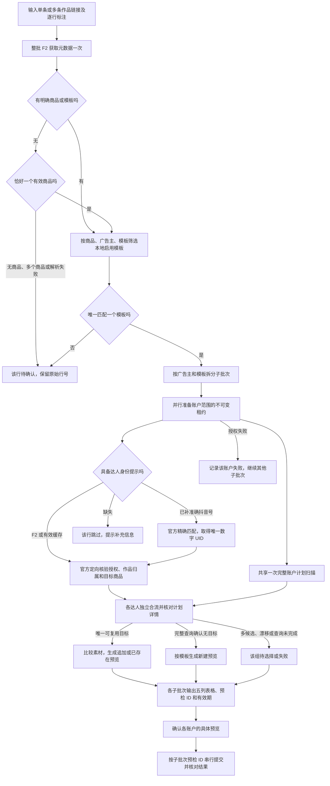

# 千川混合商品作品建计划流程

单条和批量作品共用流程：先批量获取 F2 元数据，再用当前启用的商品模板确定每行的商品、广告主和模板，按账户组织并行预检。每个达人取得自己的必要事实后独立判断追加或新建。识别失败的行进入待确认列表；成功的子批次各自保留预检 ID，确认后按 ID 分别提交。

## 处理流程



这一步路由只做预检，不创建线上计划。公开商品提示和用户补充的达人信息都不能证明可投放；官方核验通过后才生成可提交快照。

同账户同授权范围的子批次共享凭据租约、计划列表、相同授权分页、作品查询和计划详情事实；不同账户或授权不共享官方事实。读取任务使用命令级并发，默认 8、最大 10；同账户本地最多两个读取请求同时在途，单模板、混合路由和快照复核均先在应用层按账户排队，再进入 HTTP 准入等待，仍遵守 250ms 派发间隔和共享冷却。这些值是本地控制参数，不是官方配额。

当前商品全域列表 `/open_api/v1.0/qianchuan/uni_promotion/list/` 的锁定 SDK 没有 UID 筛选字段，因此每账户及授权范围扫描一次，再并行核对相关计划详情中的数值 `aweme_id`。列表里的可见抖音号缺失或变更不能作为“没有计划”的证据。普通千川 `/ad/get/` 支持 UID 过滤，但不能用它的空结果代替商品全域查询。

## 逐行输入

普通对话调用 MCP `preflight_qianchuan_works`。`items` 为 1–100 行，`concurrency` 为 1–10，默认 8。混合商品或账户时省略全局 `plan_template`；同一模板的旧调用仍可使用全局字段。

| 字段 | 作用 |
| --- | --- |
| `work_url` | 必填，原始作品链接或分享文本 |
| `product_id` | 指定目标商品，必须属于所选模板；官方核验也只接受该商品 |
| `product_name` | 与模板的商品全称或简称精确匹配，不按标题模糊猜测 |
| `plan_template` | 指定该行模板，优先于全局模板 |
| `advertiser_id` | 限定该行广告主，必须与模板绑定一致 |
| `auth_account_id` | 可选授权选择器；同一子批次有冲突时全部待确认 |
| `creator_douyin_id` | 用户补充的准确可见抖音号，用于官方定向查询 |
| `creator_uid` | 可选数字 UID，提供时也必须提供可见抖音号 |
| `creator_name` | 用户补充的计划命名昵称，仅用于命名 |
| `plan_type` / `business` | 该行计划类型、商务，缺省时不加对应命名片段 |

商品 ID、广告主 ID、达人 UID 均使用字符串。多个筛选字段同时提供时必须同时满足。没有显式商品或模板时，公开元数据必须给出恰好一个不同的有效商品 ID；多个商品不自动取第一个。同一商品匹配多个账户或多个模板时，也不自动选第一个。

模板含多个商品时，新建计划的 `product_ids` 与素材商品列表只包含该分组已经官方核验的目标商品，避免把模板里的其他商品带入本次计划。

路由复用既有模板的商品与账户绑定，无需另建映射表。只有唯一匹配的行才会准备该广告主的凭据或发起官方查询；不会为了寻找可用账户逐个试投。

CLI 开发与诊断可使用重复 `--work-item` JSON 参数；以下名称和 ID 均为示例，需要替换为实际配置：

```bash
skills/qc-plan-monitor/run plans batch-qianchuan-works \
  --work-item '{"work_url":"https://www.douyin.com/video/10001","product_name":"商品A","advertiser_id":"20001","creator_douyin_id":"creator_a","creator_name":"达人甲"}' \
  --work-item '{"work_url":"https://www.douyin.com/video/10002","product_name":"商品B","advertiser_id":"20002","creator_douyin_id":"creator_b","creator_name":"达人乙"}'
```

`--work-item` 不能与 `--work-url`、`--plan-type`、`--business` 混用。带路由输入的直接 `--submit` 会被拒绝；先获取预览和子批次快照。

## 结果与提交

混合路由结果带 `routed=true`，包含：

- `batches[]`：每项有广告主/模板摘要、原始零起始 `input_indexes`、状态和独立预检结果。MCP 位于 `preflight`，CLI 位于 `result`；可提交的子结果带自己的 `preflight_id`、`expires_at` 和 `presentation`。
- `pending[]`：原始 `input_index`、稳定原因码和候选模板/账户。补充选择后只重跑这些行。
- 子批次失败：MCP 返回脱敏 `failure.error`，保留授权恢复码；不会丢弃其他子批次已完成的快照。恢复后只重跑失败子批次的原始行。

每个子批次先标明广告主和模板，再原样展示 `presentation.rendered_markdown`，固定为 `计划ID｜达人昵称｜商品ID｜素材ID｜素材标题`。跳过、待确认和失败原因放在表外。没有跨账户统一提交 ID。

“可复用目标”要求账户、详情 UID、完整商品集合和投放目标适用，且计划未删除。已有当日绑定必须匹配完整分组身份和精确计划 ID；无绑定且唯一兼容目标时直接进入追加预览，预检不写绑定。多个候选为 `plan_selection_required`，同一计划被不同组占用为 `plan_group_conflict`，绑定漂移为 `binding_drift`。必要详情按每段最多 200 个推进，覆盖全部候选后才判断唯一目标或无目标；任一段失败即阻断后续段。清单仍最多 100 页、10000 条计划，超过清单边界、查询不完整或身份未核实均不新建。

MCP 的全局失败在 `error.details` 中保留安全的 `stage` 和已取得的 `performance`；达人分组失败在 `failed_results[].error_details` 中保留阶段、超时或取消原因、安全端点及官方数字错误码，按需返回 `inventory_reason`。原始异常、请求参数和凭据不进入结果。`ok=true` 只表示工具已返回结果，验收仍须检查分组状态和快照的 `ready_for_submit`。

千川固定广告主请求的准入等待与网络读取独立计时：默认最多等待 60 秒取得许可，实际派发后最多 30 秒完成网络与响应体读取，两段都受调用方的取消和截止时间约束。并发、250ms 间隔和共享冷却仍有效，因此大账户首次完整核验可能需要较长时间。

用户确认具体账户、模板和预览后，逐个提交对应快照：

```bash
skills/qc-plan-monitor/run plans batch-qianchuan-works \
  --submit --preflight-id CONFIRMED_CHILD_PREFLIGHT_ID
```

快照最长有效 30 分钟且不跨上海业务日。提交重用已经核验的作品，不再抓取链接或调用 F2；重新核对模板、当日计划和素材差异，在对应广告主锁下串行写入。单个子批次失败不会回滚其他账户已经完成的线上操作，重试时应保留并核对已有结果。

新快照为 v3，并显式保存 `selection_policy`。旧 v2 按 `bound_only` 的原规则读取和提交；v1 只读，新策略快照被旧执行器拒绝。唯一未绑定目标必须通过精确预检 ID 提交，确认追加成功或素材已存在后重新核对目标，再保存当日绑定。绑定失败可能发生在素材已追加之后，恢复时先核对实际结果。MCP 当前提供预检和本地快照读取，确认提交仍是 CLI 能力；WorkBuddy 尚无执行该快照的 MCP 工具。

## 解析失败时的处理

`f2_metadata_query_failed` 仅说明公开元数据查询失败，不能据此认定为反爬拦截、视频不可播放或作品未授权。包装层另区分空响应、身份不完整、HTTP 错误、网络错误、超时及输出解析错误，不输出 Cookie 或原始异常。

本批先尝试 F2，缓存命中或用户补充身份不跳过该步骤；路由已取得的结果不会在子批次重复请求。F2 失败后，已有明确商品/模板和有效账户身份缓存，或用户补充准确 `creator_douyin_id` 时，可以继续定向官方复核。缺少数字 UID 时，Core 必须在该广告主下完整查询并取得唯一精确匹配，再核验授权、作品归属和商品。仅有昵称不能继续；查询不完整时授权状态仍未知。未明确商品且缺少唯一公开商品提示的行仍需补充路由选择。
